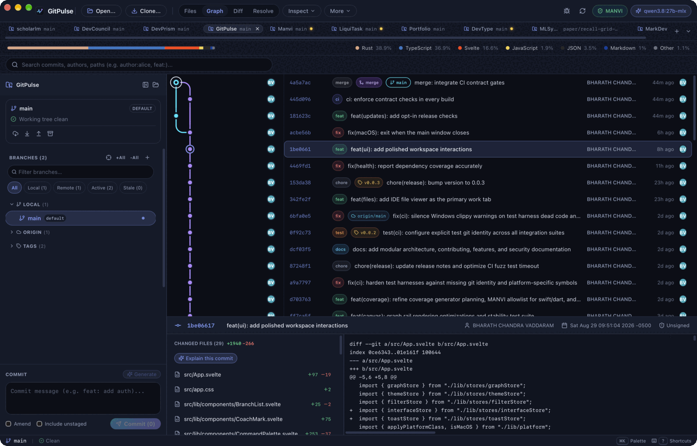
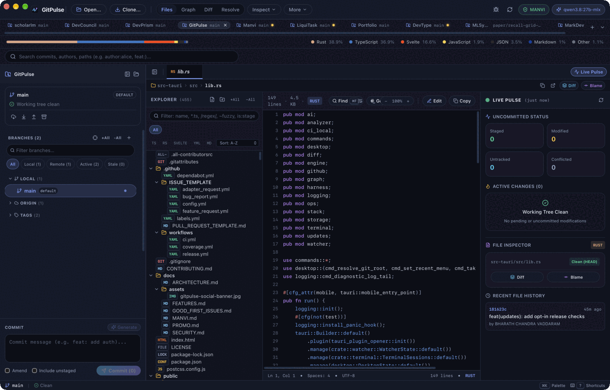
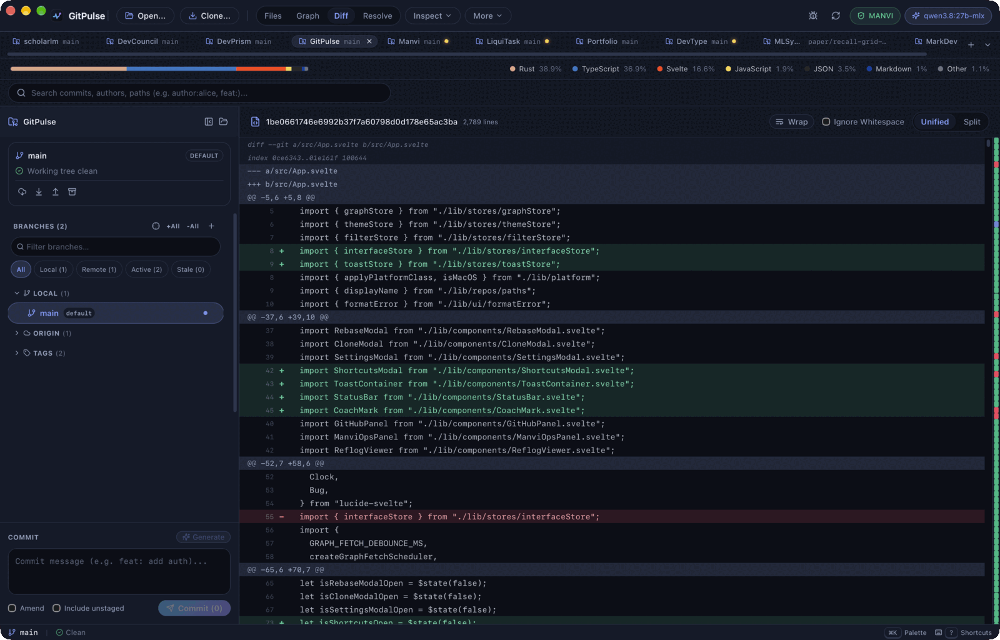
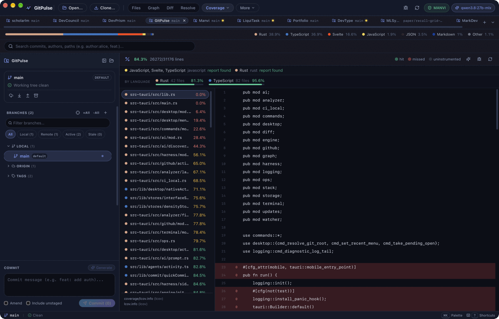
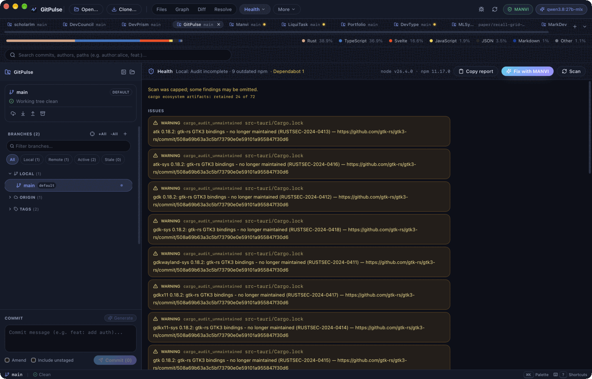
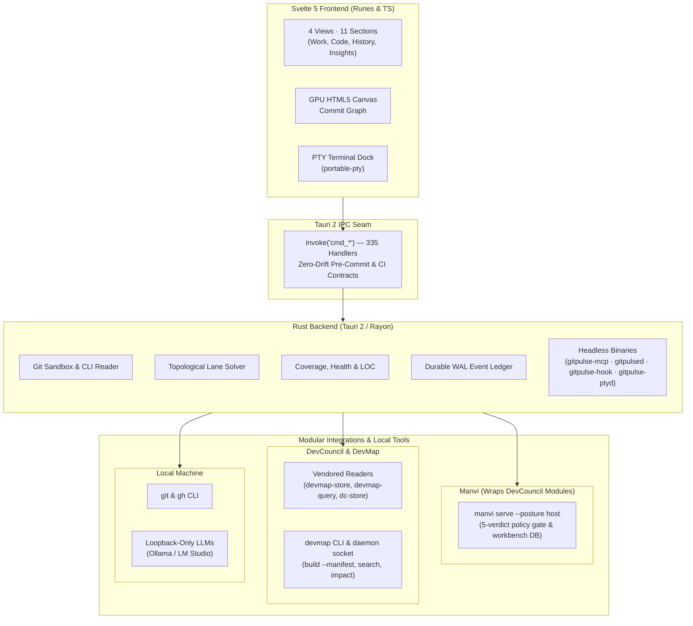

# GitPulse

<p align="center">
  <a href="https://gitpulse.vbcr.dev/"></a>
  <a href="https://github.com/bharathvbcr/GitPulse/actions/workflows/ci.yml"></a>
  <a href="https://github.com/bharathvbcr/GitPulse/actions/workflows/coverage.yml"></a>
  <a href="https://github.com/bharathvbcr/GitPulse/releases"></a>
  <a href="LICENSE"></a>
  
  
</p>

<p align="center"><sub>Tested on macOS; Windows and Linux builds are available but not yet tested.</sub></p>

**Fast, local-first Git desktop client, code intelligence suite, and task workspace.**

Review changes with GPU acceleration, resolve 3-way conflicts, follow branch and commit
history, search across repositories, organize tasks with board swimlanes, and inspect repository
health from a native Rust / Tauri 2 app with a Svelte 5 frontend. 100% on-device, private-by-design,
zero telemetry.

[Download](https://github.com/bharathvbcr/GitPulse/releases/latest) ·
[Getting started](docs/GETTING_STARTED.md) ·
[Documentation](docs/README.md) ·
[Website](https://gitpulse.vbcr.dev/) ·
[Release notes](CHANGELOG.md) ·
[v2.0 Beta notes](docs/RELEASE_NOTES_v2.0.0.md)



## GitPulse 2.0 — Coming Soon

GitPulse 2.0 (currently in beta on `main` as `1.99.0` — the first release since `v1.3.1`, rolling in all unpublished `v1.4.0` and `v1.5.0` changes; see the [v2.0 release notes](docs/RELEASE_NOTES_v2.0.0.md)) brings a redesigned desktop shell, out-of-process terminal and agent hosting, pre-operation Git recovery snapshots, and full multi-agent worktree orchestration:

- **Streamlined 4 views & 11 sections with floating glass cards:**
  - **Work (`Overview · Remote · Tasks`)**: Inline 3-way conflict editor leading Overview whenever a merge or rebase is parked, plus folded stale-branch cleanup with tip backups, policy activity, outgoing-commit checks, and release tag publishing.
  - **Code (`Explorer · Map`)**: Inline Search (`git grep`) and Blame toggles inside Explorer, and a Map overview of repository size, caps, and critical files with `[n/5]` live build progress and hover tooltips across files, symbols, and subsystems.
  - **History (`Graph · Diff`)**: Unified `Commits | HEAD moves | Suspects` switcher on Graph, a **History (`⌥H`)** commit-graph rail tab right inside Diff, rich commit hover cards (full message body, `git notes`, recorded verification), and `Shift+click` `older..newer` commit-to-commit comparisons.
  - **Insights (`Pulse · Coverage · Health · Storage`)**: in-process Secrets scan (Kingfisher as the opt-in deep scan) folded into Health under one health verdict, five-row previewed report lists (`Show all N`), and Storage on-demand `git commit-graph write`.
- **Theme preset gallery, saved themes shelf & macOS window wallpapers:** Seventeen built-in `gitpulse-theme/1` presets across Standard (*Neural HUD*, *Reactor*, *Pure Black*, *Crimson*, *Phosphor*, *Synthwave*, *Paper*), Developer (*Amber CRT*, *Blueprint*, *Midnight IDE*, *Arctic*, *Solar Dark*, *Daylight*), and Sci-Fi (*Nebula*, *Orbital*, *Neon City*, *Hyperspace*); a **My themes** shelf for up to 24 saved or imported themes; and eleven seeded static SVG backdrops or custom raster wallpapers (`<= 2560px` JPEG in IndexedDB, macOS only).
- **Stacked worktree tabs & collapsible repository groups:** Every checkout of a repository shares one tab with a checkout switcher, and inactive repository groups (and inactive tabs within groups) can collapse from the tab bar, Settings, or Command Palette.
- **Always-on Unix terminal host (`gitpulse-ptyd`), WebGL rendering & hosted Manvi runs:** PTY terminal sessions on Unix unconditionally live in `gitpulse-ptyd` ([Terminal host](docs/TERMINAL_HOST.md)) with transcript recovery (`512 KiB`), a durable 64-row session ledger (`terminal-sessions.v1.jsonl`, `TerminalResume --fork`), default-on detached `manvi serve --listen` hosting for managed Codex and Claude runs, GPU WebGL rendering (`@xterm/addon-webgl` with 5-minute context hold and 3-strike DOM fallback), DEC 2026 synchronized output, `@xterm/addon-unicode11`, kernel-event exit waiting, and **Send to agent** live-session wakeups (`gitpulse-hook deliver`).
- **Pre-operation Git snapshots (`refs/gitpulse/ops/<n>`) & agent turn checkpoints (`refs/gitpulse/turns/`):** Allowed agent Git mutations record pre-operation snapshots with CAS-checked undo (`cmd_undo_op_snapshot`) in Reflog, while opt-in turn checkpoints capture working-tree state at agent turn start and end (inspectable over MCP via `gitpulse_turn_checkpoints`).
- **Zero-copy agentic worktrees, Claude Code hooks, Codex ledger & live MCP control plane:** Eleven `gitpulse_worktree_*` MCP tools, `gitpulse-worktree` CLI, `gitpulse-rustc` build cache, `.worktreeinclude`, and `WorktreeCreate`/`WorktreeRemove` plugin hooks provision `claude --worktree` and isolated subagents with CoW-seeded DevMap stores (`~1.2 s` query-ready vs `~7.6 s` cold). `gitpulse_sessions` and `agents.live` report live Claude Code, Codex, Antigravity, DevCouncil, and Manvi sessions (`0` `git` spawns on `gitpulse_sessions`), alongside Codex rollout ledger ingestion, per-run activity timelines, agent thread trees, `gitpulse_merge_conflicts`, `gitpulse_landed`, `gitpulse_provenance`, and inode-bound ledger adoption.
- **Workbench schema 17 & faster Tasks board:** Merges the Inbox column into Backlog (five columns: *Backlog*, *Ready*, *In progress*, *Review*, *Done*), adds cross-repo queues, a two-way GitHub issue sync outbox, and DAG launch readiness, automatically fills board columns up to 2,000 cards (`fillBoard`), refreshes live while the window is on screen even when unfocused (`liveOnScreen`), and adds a two-row header, subtask progress, due-date/status filters, attention inbox dismiss/restore, card merge/delete, `expected_revision` CAS protection on `gitpulse_add_task`, and CI watching on agent branches.
- **Manvi Anthropic account registry, host-load governor, Firebase diagnostics & PR review:** Launches `manvi serve` via `~/.anthropic-accounts` (`anthropic-account exec --no-fallback`) with `Cloud · <model>` pill display, governs agent launches under severe host memory pressure (`sysload::governor`) with class-tiered Git spawn budgets (`spawn-budget.v2`), adds GitHub PR review/approve/merge actions, classifies Firebase App Hosting CLI failures with redacted *Copy diagnostics*, renders GitHub commit author avatars in Graph, and expands `dc-redact` secret detection (`ya29.`, `1//`, `GOCSPX-`, GitLab `gldt-`/`glft-`/`glrt-`/`glwt-`, Slack `xoxe-`, AWS `ABIA`/`ACCA`/`A3T`, HuggingFace `api_org_`).

## Get started

1. [Install GitPulse](docs/INSTALLATION.md) and Git for your platform.
2. Open a repository and review **Trust and Open**. Trust allows its hooks,
   helpers, and project tools to run with your account permissions.
3. Use **Work** for changes in flight, **History** to review a commit, and
   **Code** to explore files. Open the command palette with `⌘K` / `Ctrl+K`.
4. Replay the guided tour any time from **Settings → Appearance → Guided walkthrough**.

GitHub CLI, DevMap, Manvi, and local model servers are optional; install the
ones needed for the features you use. The [first repository guide](docs/GETTING_STARTED.md)
walks through a review, task creation, and optional setup.

## Quick install & agent setup

If you installed the packaged desktop app, **Settings → Agents → Connect** (or its **Copy setup prompt**) symlinks the bundled `gitpulse-mcp` and `gitpulse-hook` into `~/.local/bin` without needing a source checkout or Rust toolchain, and **Help → Set Up Optional Tools** installs DevMap, the analysis suite, or Manvi interactively.

To build and wire up **GitPulse**, **DevCouncil** (`devmap`, `dcstore`, `dcverify`, `dcgrep`, `devcouncil`), **Manvi** (`manvi`), and MCP integrations from source (requires **Git**, **Bun 1.4.2**, **Rust 1.100+**, and **Go 1.27.4+**), paste this prompt into Claude Code, Codex, Antigravity, or Cursor (or run the fenced commands directly):

````text
Install and wire up the complete GitPulse, DevCouncil, Manvi, and MCP toolchain on this machine, then verify every binary, schema, and host integration without skipping failing checks:

1. Preflight tools and checkouts:
   - Confirm `git`, `bun`, `rustc`/`cargo`, and `go` are on `PATH` (and `~/.local/bin` / Cargo / Go bin dirs are reachable).
   - Check whether sibling `GitPulse`, `DevCouncil`, and `Manvi` checkouts already exist; otherwise ask where to clone `https://github.com/bharathvbcr/GitPulse.git` (and optionally `DevCouncil` / `Manvi`), and do not install system packages outside Cargo/Go/Bun user bins without asking.

2. Install GitPulse MCP, hooks, and worktree/cache CLIs (`gitpulse-mcp`, `gitpulse-hook`, `gitpulse-worktree`, `gitpulse-rustc`):
   - From a `GitPulse` checkout (or after `git clone https://github.com/bharathvbcr/GitPulse.git && cd GitPulse`):
     ```sh
     bun install --frozen-lockfile
     bun run mcp:install
     cargo install --path crates/gitpulse-worktree --locked --force
     ```
   - Skip rebuilding `gitpulse-mcp` / `gitpulse-hook` from source if I already linked them from the packaged app via Settings -> Agents -> Connect in `~/.local/bin`.

3. Install all DevCouncil components (`devmap`, `dcstore`, `dcverify`, `dcgrep`, `devcouncil`):
   - If a local `DevCouncil` checkout is present, run `bash scripts/install.sh`; otherwise install from GitHub:
     ```sh
     cargo install --git https://github.com/bharathvbcr/DevCouncil.git --locked --force devmap-cli
     cargo install --git https://github.com/bharathvbcr/DevCouncil.git --locked --force --bin dcstore dc-store
     cargo install --git https://github.com/bharathvbcr/DevCouncil.git --locked --force --bin dcverify dc-verify
     cargo install --git https://github.com/bharathvbcr/DevCouncil.git --locked --force --bin dcgrep dc-grep
     go install github.com/bharathvbcr/DevCouncil/backend/go_orchestrator/cmd/devcouncil@latest
     ```

4. Install Manvi (`manvi` policy harness, workbench host, and managed agent runner):
   - From a local `Manvi` checkout run `go -C manvi install ./cmd/manvi`, or install remotely:
     ```sh
     go install github.com/bharathvbcr/Manvi/manvi/cmd/manvi@latest
     ```

5. Configure MCP servers and agent plugins cleanly (preview before writing; preserve existing user-owned configs):
   - Register **either** the GitPulse plugin (`plugins/gitpulse/` for Claude Code/Codex/Cursor or `plugins/gitpulse-agy/` for Antigravity) **or** a direct `gitpulse` MCP registration (`gitpulse-mcp`), **never both** — the plugin already registers the `gitpulse` server (repo insights, worktree coordination, collision radar, task board, and in-process `devmap_*`).
   - Run `devmap integrate <host> --dry-run` (and `devcouncil integrate <host> --dry-run` if using the orchestrator MCP) for my active agent client(s) (`claude`, `codex`, `cursor`, `antigravity`), show me the planned file changes (noting any `not_ours` protected files), and apply only with my approval (`--apply`) so `devmap mcp` (code graph) and `devcouncil mcp` (orchestrator/leases) sit cleanly alongside `gitpulse-mcp`.

6. Verify end-to-end and report exact tool outputs:
   ```sh
   bun run mcp:doctor
   bun run check:schema-parity
   devmap doctor && devcouncil doctor && manvi doctor
   dcstore --version && dcverify --version && dcgrep --help >/dev/null
   ```
   - Ensure `mcp:doctor` reports matching digests for `gitpulse-mcp` and `gitpulse-hook`, and `check:schema-parity` agrees across vendored crates, `devmap`, `dcstore`, `gitpulse-mcp`, and `manvi`.
   - In the target repository, run `devmap paths --json` and `devmap status --json` (and `devmap build --manifest` if missing or stale).

Report what succeeded, what could not run, exact paths of installed binaries, and any MCP/plugin config changes made or awaiting approval.
````

## Four views, one workspace

GitPulse has 4 application views with 11 specialized sections. Each view keeps related sections together.

| View | What you do here | Sections |
| --- | --- | --- |
| **Work** | Track work in flight, resolve conflicts, organize tasks | Overview · Remote · Tasks |
| **Code** | Browse, search and blame files, explore structure | Explorer (with Search and Blame toggles) · Map |
| **History** | Follow commits, review changes, find recovery points | Graph (commits, HEAD moves — the reflog — or regression suspects) · Diff |
| **Insights** | Inspect activity, coverage, dependencies, secrets, and disk usage | Pulse · Coverage · Health · Storage |

Graph's three lists and Diff share the selected commit; Explorer and Blame share the selected
file; Overview embeds branch stack hierarchy. **Fleet** compares repositories across the workspace (scaling to 1,000 repositories with 24 active watches),
**Tasks** opens global and saved-workspace boards with swimlanes and WIP limits, and the **terminal dock** stays available across views.

## From a change to the next step

- **Review and commit.** Canvas commit graph (100K+ commits at 60/120 FPS), unified and side-by-side diffs,
  word highlighting, symbol-grouped diff hunks, image comparisons, selective staging,
  stash previews, a three-way conflict resolver, and structured patch-brief commit
  phrasing with on-device Apple Intelligence fallback.
- **Manage worktrees and branches.** Zero-round-trip branch churn carry-forward on branch mutations,
  DevMap-guided `--cone` sparse worktrees, `<512 B` zero-copy DevMap base pointers with Blake3/CAS delta overlays,
  copy-on-write dependency cache sync (`node_modules`, `target`, `.venv`) plus lock-free `gitpulse-rustc` (`RUSTC_WRAPPER`)
  shared CoW crate caching, parallel agent coordination bus and 3-layer CSR/ODB collision radar (`gitpulse-worktree` CLI & `gitpulse-mcp`),
  dead-branch cleanup with durable WAL tip backups and authorized delete actions, macOS pre-exec background QoS band isolation,
  named localhost routes via portless, and trust-gated lifecycle hooks.
- **Organize the work.** Quick add parses priority, labels, owner, repository,
  due date, and notes. Board views with swimlanes (grouped by owner or label),
  saved views, column WIP limits, column "Load all" paging up to 2,000 cards with
  persistent reload depth, named hidden repository notices, task checklists with done states, cross-task links
  (parent, blocks, related, duplicate), the Archive dock with Deleted recovery,
  review drafting suggestions, and agent terminal handoff with per-launch model selection.
- **Explore and search the code.** File navigation and blame are built in. High-speed
  repository-wide text search (`git grep` over working tree or revisions with honest
  cancellation and truncation reporting). Add DevMap for structural navigation,
  symbol search, symbol-level collision detection, dependencies, impact, and candidate tests.
- **Inspect the repository.** Universal coverage reports across 6 formats (LCOV, Cobertura,
  Go cover, Istanbul, JaCoCo, Clover), multi-ecosystem dependency audits (`cargo-audit`,
  `npm audit`, `pip-audit`, `govulncheck`) with `cargo deny` and `cargo crev` parsers,
  redacted secrets scanning (in-process by default, Kingfisher as the deep scan) that locates each finding against Git, storage
  cleanup previews, and Pulse activity summaries distinguish results from scans that did not run.
  Capped results identify their limits.
- **Work from the desktop.** Native menus, a command palette (`⌘K`), a docked PTY terminal
  with expanded view isolation, WebGL context caching, DEC 2026 frame synchronization, and configurable bell prompts that reports what each session is running, reflog recovery (`reset --keep`), GitHub pull
  request actions (review, comment, approve, merge pinned to viewed commit), colour-coded repository
  tabs and collapsible inactive groups that survive a restart, and an optional macOS menu-bar status popover keep
  frequent actions close. Background windows stop their timers instead of polling.

The [feature reference](docs/FEATURES.md) describes each surface and its limits.
The [changelog](CHANGELOG.md) records release changes; [open qualification](https://github.com/bharathvbcr/GitPulse/blob/90362c2eaee356294574da6427a637c048fbcf18/docs/QUALIFICATION.md)
tracks remaining platform, provider, and performance checks.


| File explorer | Diff review |
| --- | --- |
|  |  |
| Coverage | Dependency health |
|  |  |

Screenshots are captures from the macOS app; appearance varies by release and platform.

## Local state and explicit permissions

Repository and task state are stored locally. The desktop app has no remote
telemetry. Git remotes, GitHub operations, Firebase App Hosting checks you ask for,
optional tool downloads, release checks, and configured agent providers can use the
network.

Built-in AI (commit messages, explanations, branch names, health and coverage plans)
runs on whatever Manvi itself is set to (`manvi use`), through Manvi's
`work.assist.complete`: a local model server in local mode, the Claude API in cloud
mode, and only in cloud mode does a diff leave the machine. Cloud mode has to be
chosen: with nothing saved, Manvi reports its built-in default (cloud) and GitPulse
does not follow it. It uses its own loopback client instead, which asks before it
sends anything to a server it found, until a mode is chosen in the Manvi pane or with
`manvi use`. The loopback client is also the fallback when Manvi is not installed or
is too old. Task enhancement and agent
runs use their configured provider; supported Mac builds can also use Apple
Intelligence for task titles and descriptions. These are distinct execution paths.

Repository trust is an execution decision. A worktree is not an OS sandbox.
Policy verdicts preserve **unchecked** separately from **allowed**, and the
MCP server cannot grant repository trust. Read the
[security and trust model](docs/SECURITY.md) before configuring agents.

## Architecture

DevCouncil is **components and modules**. Manvi wraps them. GitPulse uses Manvi
for policy, workbench, and agent hosting, and selected DevCouncil components
for code intelligence. Modules can be updated independently.



See [architecture](docs/ARCHITECTURE.md) for ownership and contracts, and
[module integration](docs/MODULE_INTEGRATION.md) for the boundaries between projects.
GitPulse succeeds the deprecated [LiquiTask](https://github.com/bharathvbcr/LiquiTask)
workbench; this does not imply complete feature parity.

## Build and contribute

Use Bun 1.4.2, Node.js 22.x (22.12 or newer), Rust 1.100+ (stable), Go 1.27.4 (for `gusset:check`), Git, and your platform's native
build tools. The [contributor guide](CONTRIBUTING.md) covers setup and platform prerequisites.

```sh
git clone https://github.com/bharathvbcr/GitPulse.git
cd GitPulse
bun install --frozen-lockfile
git config core.hooksPath .githooks
bun run tauri dev
```

| Command | Purpose |
| --- | --- |
| `bun run check` | Svelte and TypeScript checks |
| `bun run test` | Frontend and contract tests |
| `bun run test:tz` | Local-time frontend tests across `America/New_York`, `Pacific/Auckland`, and `Asia/Kolkata` |
| `bun run check:ipc` | Match frontend calls to the native command registry |
| `bun run check:types` | Compare Rust and TypeScript wire contracts |
| `bun run check:release` | Check version manifest consistency |
| `bun run check:workflows` | Lint the GitHub Actions workflow definitions |
| `bun run test:browser:all` | Browser regressions under headless Chrome |
| `bun run test:webkit:all` | The same regressions under WKWebView (macOS only) |
| `bun run build` | Build the frontend bundle |
| `bun run tauri build` | Build native bundles for the host |
| `bun run ci:local` | The gates in `scripts/ci-local.mjs`: contracts, both renderers, format, clippy, Rust and frontend tests, coverage floors and the gusset check. It deletes the ~50 GiB instrumented coverage build when it is done with it; set `CI_LOCAL_KEEP_COVERAGE_BUILD=1` to keep it. It does not run `bun audit`, `cargo deny` (`bun-audit.yml`), the Go `vet` and `-race` jobs, the scheduled deep and parallel-test workflows, or the Linux and Windows builds, which only CI runs |

The browser regressions run twice in CI — under Chrome on Linux and under
WKWebView on macOS — because the two engines disagree often enough to matter: a
fixture can pass under one and fail under the other. `ci:local` runs both for
that reason, so prefer it over the individual commands before opening a pull
request.

A frontend build alone does not qualify the native application. Follow the
[release procedure](CONTRIBUTING.md) before publishing a build.

## Documentation

The [documentation index](docs/README.md) organizes user guides, integration
references, contributor contracts, and historical evidence. Start with
[installation](docs/INSTALLATION.md), [your first repository](docs/GETTING_STARTED.md),
[feature reference](docs/FEATURES.md), [tasks and workspaces](docs/TASKS_AND_WORKSPACES.md),
or [zero-copy agentic worktrees](docs/ZERO_COPY_AGENTIC_WORKTREES.md).

Bug reports, documentation, design, tests, and code contributions are welcome.
See [CONTRIBUTING.md](CONTRIBUTING.md) and [good first issues](docs/GOOD_FIRST_ISSUES.md).

### Getting help

Questions and open-ended proposals go to
[Discussions](https://github.com/bharathvbcr/GitPulse/discussions) — ask in
**Q&A**, where an answer can be marked accepted, or start in **Ideas**. Bugs,
scoped feature requests, and adapter proposals go through
[issues](https://github.com/bharathvbcr/GitPulse/issues/new/choose), which has a
template for each. Suspected vulnerabilities are the exception: report those
through GitHub Security Advisories as described in the
[security and trust model](docs/SECURITY.md), not as a public issue.

The bug template asks for a diagnostics report: open the command palette and
run **Open Diagnostics**, then use its copy button, which collects the version,
platform, and recent log lines. Read it before pasting — it can contain
repository paths.

### Contributors

Every kind of contribution is recognised here, not only code — documentation,
design, bug reports, testing, reviews, and ideas all count under the
[all-contributors](https://github.com/all-contributors/all-contributors)
specification. The list below is generated from `.all-contributorsrc`.

<!-- ALL-CONTRIBUTORS-LIST:START - Do not remove or modify this section -->
<!-- prettier-ignore-start -->
<!-- markdownlint-disable -->
<!-- ALL-CONTRIBUTORS-LIST:END -->
<!-- markdownlint-restore -->
<!-- prettier-ignore-end -->

To add someone (including yourself), comment on any issue or pull request:

```
@all-contributors please add @username for code, doc
```

The bot opens a pull request updating this section and `.all-contributorsrc`.
See the [emoji key](https://allcontributors.org/docs/en/emoji-key) for contribution
types.

---

## Topics, Tags & Discoverability

| Category | Metadata / Values |
| --- | --- |
| **GitHub Topics** | `git`, `git-client`, `git-gui`, `tauri`, `tauri-v2`, `rust`, `svelte5`, `svelte`, `local-first`, `code-intelligence`, `developer-tools`, `devtools`, `desktop-app`, `mcp`, `commit-graph`, `merge-conflict-resolver`, `reflog`, `test-coverage`, `terminal`, `privacy-first`, `zero-telemetry` |
| **Tech Stack** | Rust (Tauri 2, Rayon), Svelte 5 (Runes), TypeScript, Tailwind CSS, portable-pty, DevMap, Manvi |
| **Target Platforms** | macOS (Apple Silicon & Intel Universal dmg), Linux (.AppImage, .deb), Windows (.msi, .exe) |
| **License & Privacy** | MIT License · 100% on-device · Zero telemetry |

---

## License & Acknowledgements

Distributed under the [MIT License](LICENSE). See [NOTICE](NOTICE) for third-party and vendored crate attributions. The GitPulse name and logo are not covered by the MIT License; see [TRADEMARKS.md](TRADEMARKS.md).

- **[The Tauri Programme (`tauri-apps`)](https://github.com/tauri-apps/tauri)** (`tauri`, `wry`, `tao`, `muda` — Apache-2.0 OR MIT) — Desktop shell runtime and patched crates under `src-tauri/framework/`.
- **[webkit2gtk-rs](https://github.com/tauri-apps/webkit2gtk-rs)** (`The Gtk-rs Project Developers` & `Antoni Boucher`, MIT), **[libappindicator-rs](https://github.com/qDot/libappindicator-rs)** (`Kyle Machulis / qDot`), and **[notify](https://github.com/notify-rs/notify)** (`Félix Saparelli & contributors`).
- **[MarkDev](https://github.com/bharathvbcr/MarkDev)** (`bharathvbcr/MarkDev`, MIT) — Embedded Rust Markdown/math/diagram rendering pipeline under `src-tauri/vendor/markdev/`.

© 2026 Bharath Chandra Vaddaram
