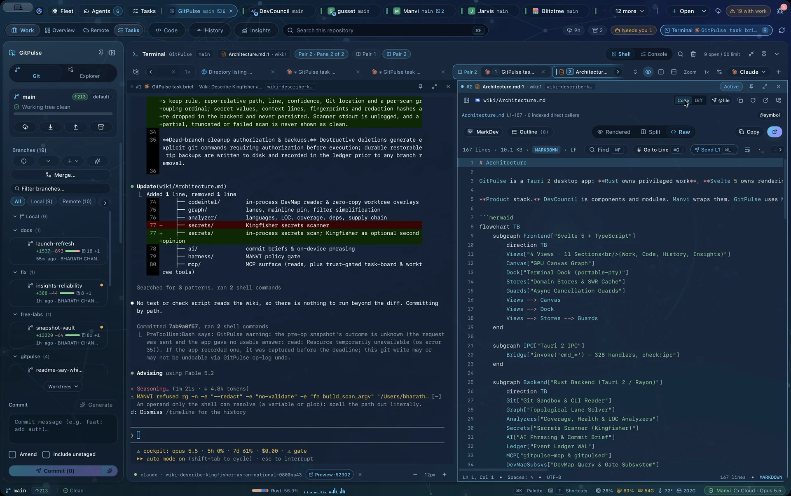
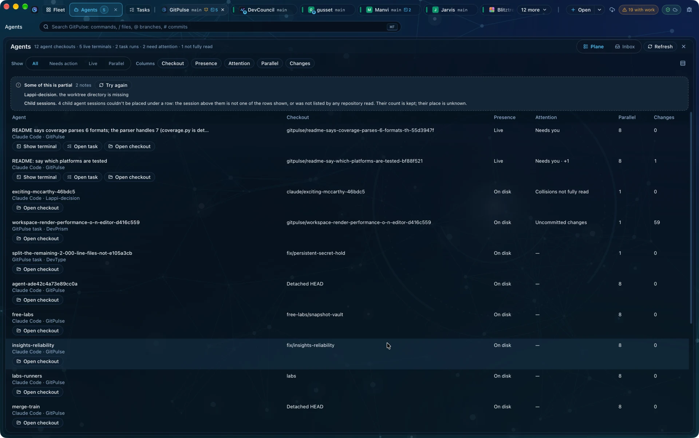
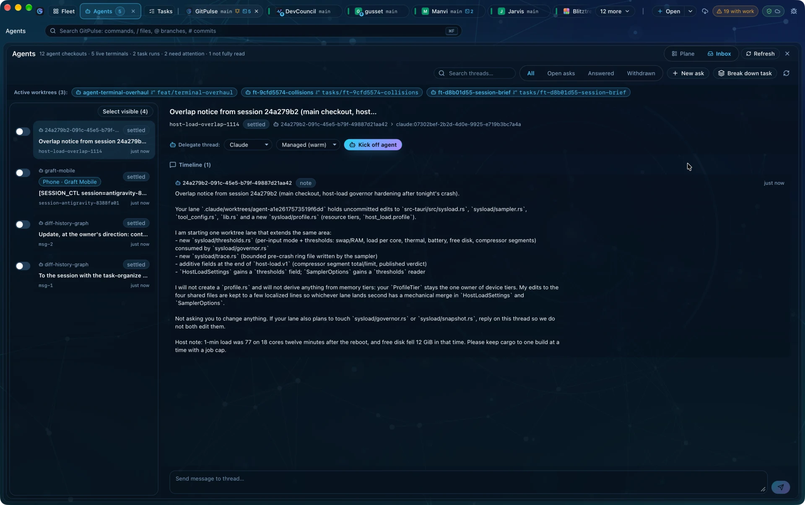
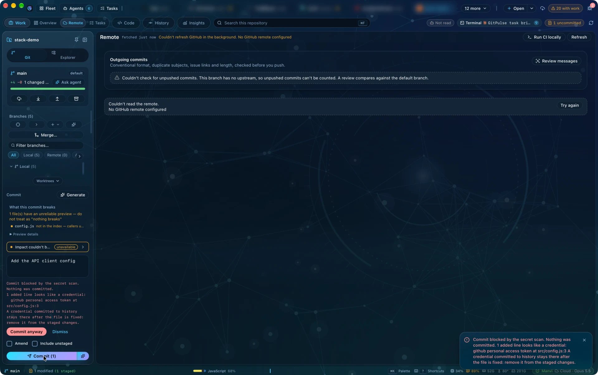
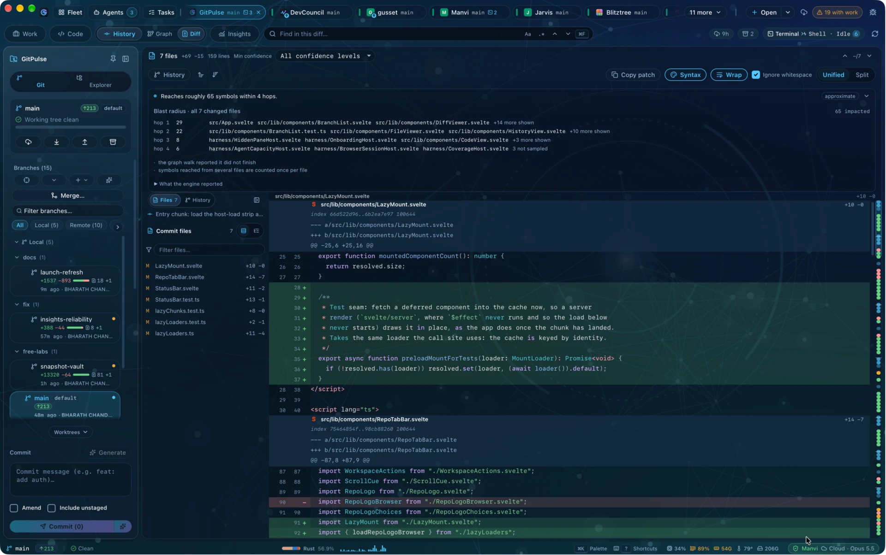
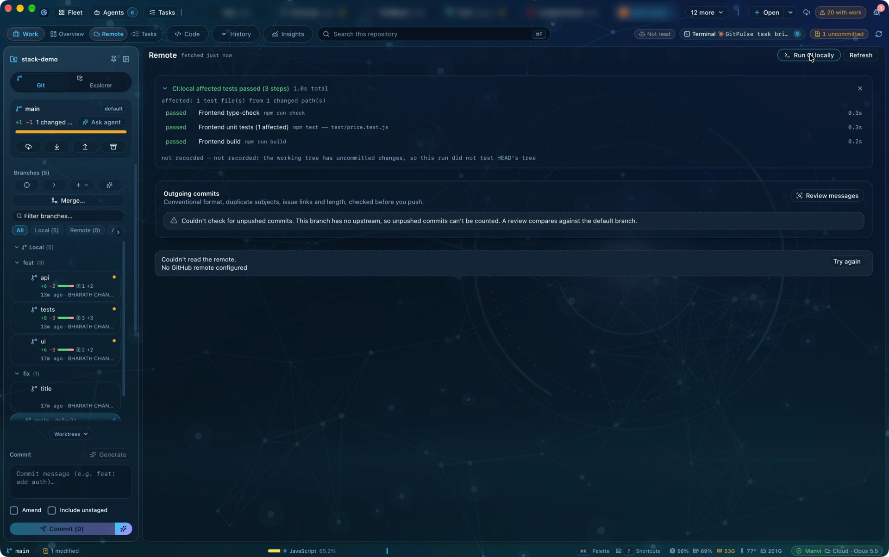
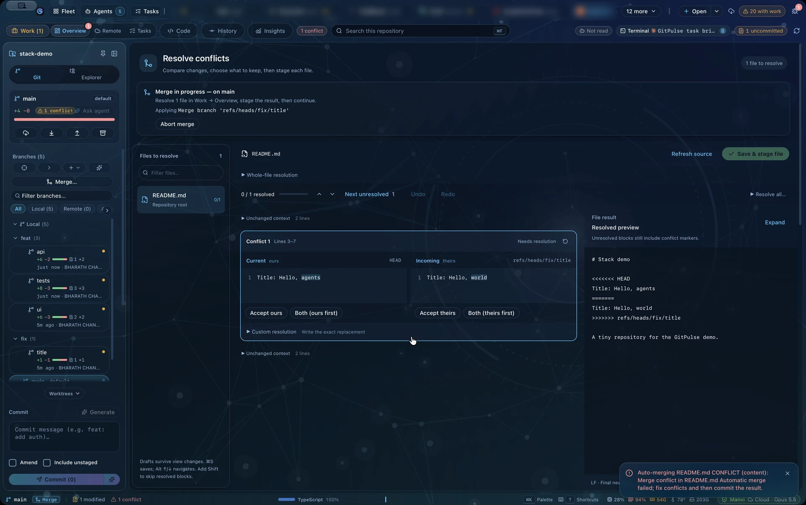
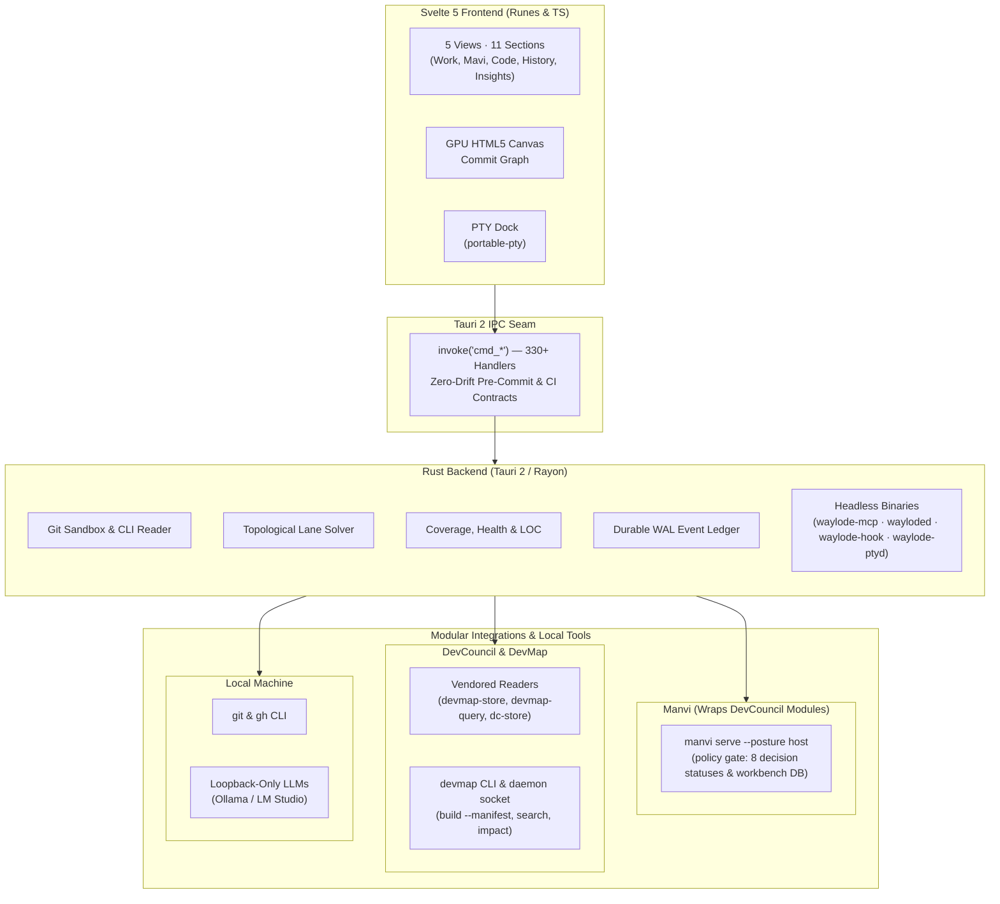

# Waylode

<p align="center">
  <a href="https://gitpulse.vbcr.dev/"></a>
  <a href="https://github.com/bharathvbcr/GitPulse/actions/workflows/ci.yml"></a>
  <a href="https://github.com/bharathvbcr/GitPulse/actions/workflows/coverage.yml"></a>
  <a href="https://scorecard.dev/viewer/?uri=github.com/bharathvbcr/GitPulse"></a>
  <a href="https://github.com/bharathvbcr/GitPulse/releases"></a>
  <a href="LICENSE"></a>
  
  
</p>

<p align="center"><sub>Tested on macOS; Windows and Linux builds are available but not yet tested.</sub></p>

**A workspace, not a chat window. Waylode — also called "Whale" out loud — is the local-first command centre for agentic coding.**

Waylode is built for the agentic era. It gives the same information and the same tools to the
people and to the agents doing the work. It runs Claude Code, Codex and other agents side by side
across all your repositories. Each agent gets its own worktree, a policy guard and a stacked code map, and
a host-load scheduler keeps the machine responsive. A full Git client sits in the same window. It is a
native Rust and Tauri 2 app with a Svelte 5 frontend, free and dual-licensed under `MIT OR Apache-2.0`.

[Download the 0.2.0 beta](https://github.com/bharathvbcr/GitPulse/releases/tag/v0.2.0-beta.1) ·
[Getting started](docs/GETTING_STARTED.md) ·
[Why Waylode](docs/WHY_WAYLODE.md) ·
[Agents guide](docs/AGENTS_GUIDE.md) ·
[Documentation](docs/README.md) ·
[Website](https://gitpulse.vbcr.dev/) ·
[Release notes](CHANGELOG.md) ·
[0.2.0 notes](docs/RELEASE_NOTES_v0.2.0.md)



## What sets Waylode apart

Across the agentic workspaces, editors, terminals, Git clients, code-index tools and coordination tools we checked against official documentation and public repositories on `2026-11-27` and `2026-11-28`, none combined all six of these capabilities in one local-first native app (details and sources in [Why Waylode](docs/WHY_WAYLODE.md) and the [Whale field guide](docs/launch/WHALE_FIELD_GUIDE.md)). "Not found" below means not found in the pages we read, not that no product has it:

| Differentiating Capability | Outcome & Shipped Mechanism | Typical ADE Gap (as of `2026-11-28`) |
| --- | --- | --- |
| **1. Code Index Integration (*Whale Sonic* · DevMap)** *(on `main` / upcoming 0.2.0)* | **Every agent knows what an edit breaks before writing.** Linked in-process DevMap \`StackedStore\` (\`stack_lease.json\` + sealed \`0444\` \`base.sqlite\` + lazy Tree-sitter \`delta.sqlite\` overlays across the worktrees Waylode creates for agents), layered blast radius with \`unattributed\`-line honesty, backward regression suspects, confidence-tiered dead symbols (\`0.9\` act-on vs \`0.4\` unconfirmed), and affected tests with scoped \`CI:local\`. | None of the major ADEs we checked (Cursor, Windsurf, Copilot, Claude Code, Kiro, JetBrains, Sourcegraph) documents blast radius plus affected tests for its agents; they rely on embeddings, grep, or single-symbol LSP lookups. Open-source MCP servers (codebase-memory-mcp, CodeGraph) do offer it. One shared index with each worktree's changes layered on top was **not found**. |
| **2. Cross-Vendor A2A & 3-Layer Collision Radar (*Whale Song* & *Whale Pod*)** | **Stop parallel agents from colliding—across vendors.** Live discovery of unlaunched \`claude\`, \`codex\`, \`antigravity\`, \`devcouncil\`, and \`manvi\` sessions; cross-vendor peer mailbox (\`waylode_agent_*\`), structured asks (\`waylode_inbox_*\`), worktree lane bus, **Send to agent**, and 3-layer CSR/ODB collision radar (agents check it on demand via \`waylode_worktree_radar\`) + file/symbol claims (advisory unless enforce mode is on) + a \`PreToolUse\` hook that asks before an edit to a file another worktree has changed. | MCP Agent Mail offers cross-vendor messaging and path-glob file reservations; Claude Code messages only Claude Code sessions; others isolate by branch/worktree or warn only in docs. A collision warning that checks the call graph, not just file paths, was **not found**. |
| **3. Pure-ODB Merge Train & \`git replay\` Stack Restacking** *(upcoming 0.2.0; not yet on `main`)* | **Land 10 agent branches without thrashing your working tree.** AIMD batched Land Queue (\`cmd_worktree_merge_batch\` / \`waylode-worktree land-batch\` via \`ObjectQuarantine\` \`git merge-tree --stdin\`; branches verified before submit, the combined batch is not re-tested), pure-ODB conflict proposals (created by the \`waylode-worktree\` CLI; the app opens them) (\`refs/gitpulse/proposals/\`), and \`git replay\` branch stack restacking with a disjoint-dirty fast path. | Hosted merge queues (GitHub, Graphite, Mergify) batch PRs on the server after push. Local, pre-push batch landing of agent worktrees was **not found** in the agent workspaces we checked. |
| **4. Load & Agent Scheduler (Host-Load Governor & APFS CoW Worktrees)** | **Run many agents without melting your Mac.** Memory-pressure agent launch admission (refuses an agent launch under memory pressure, or any input you set to refuse, with a human-only **Admit anyway**; heavy cargo/go builds queue for slots), build slot leases & queue (with queue position on the terminal pill), one-click idle agent session parking, macOS \`PRIO_DARWIN_PROCESS\` background QoS isolation + shared git spawn gate, live CPU/GPU/memory/thermal/storage host-load strip, and APFS \`clonefile\` dependency caches (one cloned \`target\` held \`1.8 MB\` of private bytes out of \`66 GB\` logical vs \`26.7 GB\` cold build on Waylode's repo; measured once, 2026-11-14). | Claude Code stops idle sessions once memory stays low (after the fact); Codex and Jules cap thread counts. Admission control before an agent or build starts was **not found**. \`worktrunk\` ships APFS \`clonefile\` CoW caches in a focused Rust CLI without a desktop ADE, load governor, \`StackedStore\`, or ODB merge train. |
| **5. Verification-Gated, Agent-Writable Task Board** | **Follow-up bugs become verified cards, not lost scroll-back.** Five-column cross-repo & saved-workspace Kanban board (up to 2,000 cards shared per fill), one-click agent launch from cards, \`waylode_add_task\` with duplicate gating + \`expected_revision\` concurrency protection, and \`waylode_complete_task\` requiring passed Manvi verification on the worktree's current \`HEAD\` before moving to \`Done\`. | Agents can file tasks elsewhere (Vibe Kanban's MCP server, Beads). `done` held until verification passes on the current `HEAD`, built in rather than a hook you write yourself (Claude Code's `TaskCompleted`), was **not found**. |
| **6. Manvi Guards, Provenance & Full Native Git GUI in Rust/Tauri 2** *(Mavi threads on `main` / upcoming 0.2.0)* | **Policy gates, undo snapshots, and a full Git GUI in one native window.** Manvi's 8-status command gate, \`HostScope\` checkout fences, desktop-only \`.git\` path/inode/birth-time trust, \`dc-redact\` secret gate, CAS pre-op undo (\`refs/gitpulse/ops/\`), Turn Checkpoints (\`refs/gitpulse/turns/\`), WAL provenance ledger, persistent \`waylode-ptyd\` + localhost Browser pane, Mavi structured threads, and a lane-solved Git GUI (\`~41 ms\` lane solve on 100k synthetic commits). | Most ADEs are Electron chat/editor shells without a full Git graph/reflog, CAS pre-op undo, WAL provenance, or a deterministic 8-status command gate; native Git GUIs lack agent A2A, code graphs, and load governors. |

## Why Waylode

Most agent apps are organised around a chat transcript: one agent, one conversation, and you scroll
to find out what happened. Waylode is organised around the work itself: repositories, worktrees,
tasks, sessions, code and machine load. It shows that state to you in the UI, and to your agents
through the same facts over MCP (66 tools: 55 `waylode_*` and 11 `devmap_*`, plus 4 prompts and 12 resource facets).

When you run several agents across several repositories, these are the problems Waylode is built for:

- **You lose the map (*Whale Pod* · Fleet & Agents Tree).** Live session detection finds agent sessions across your repositories, including ones Waylode did not launch (`claude`, `codex`, `antigravity`, `devcouncil`, `manvi`), and the agent tree nests them alongside Fleet (`⌘⇧F`).
- **Agents collide (*Whale Song* · A2A Peer Bus & 3-Layer Radar).** The 3-layer CSR/ODB collision radar, file claims, and `PreToolUse` collision guard hook warn before two agents' edits meet, while agents coordinate across vendors through the peer mailbox (`waylode_agent_*`), structured asks (`waylode_inbox_*`), worktree lane messages, and **Send to agent**.
- **Agents do damage.** Manvi's 8-status command gate, desktop-only inode-bound repository trust, the `dc-redact` secret gate on commits Waylode makes, Signal Guard, and CAS pre-operation undo snapshots (`refs/gitpulse/ops/`) limit what an agent can do.
- **Agents do not know the code (*Whale Sonic* · DevMap Code Graph).** Linked in-process via `StackedStore` (`stack_lease.json` + sealed `base.sqlite` + lazy Tree-sitter `delta.sqlite` overlays), DevMap gives you and them layered blast radius with `unattributed`-line honesty, backward regression suspects, confidence-tiered dead symbols (`0.9` vs `0.4`), and affected tests with scoped `CI:local`.
- **The laptop melts.** The Host-Load Governor refuses an agent launch under memory pressure (or any input you set to refuse), with a human-only **Admit anyway**; heavy cargo/go builds queue for slots. It also issues build slot leases, parks idle sessions, and isolates background spawns under macOS QoS.
- **You still need Git.** The commit graph, `git replay` branch stack tree, diffs, 3-way conflicts, pure-ODB conflict proposals, AIMD batched Land Queue, turn checkpoints, reflog, pull requests, and Actions are in the same window.

The task board is part of this. An agent that finds out-of-scope work files it with `waylode_add_task`,
and it lands on your board instead of scrolling away in a transcript. You can launch an agent from any
card.

Waylode does not replace Claude Code, Codex or your editor. It launches, watches, guards and lands their
work. [Waylode philosophy](docs/PHILOSOPHY.md) explains the design thesis ("a workspace, not a chat
window"), host-resource invariants, and deliberate boundaries with Manvi and DevCouncil; [Why Waylode](docs/WHY_WAYLODE.md) has the dated comparison with other tools, including where
they are stronger. The [agents guide](docs/AGENTS_GUIDE.md) covers running agents.

**Platforms.** Waylode is tested on macOS. Windows and Linux builds are produced by release CI but have not been tested.

- **Waylode Primary (Free & Open Source, `MIT OR Apache-2.0`):** Everything on your machine and on user-paid compute (**BYOK** SSH runners, `cloud_vms`, your own model keys) requires zero sign-in and has zero local paywalls—including the full desktop ADE, local DevCouncil engines (`devmap`, `dcstore`, `dcverify`, `dcgrep`, `dcredact`, public OSS PR Gate), local Manvi harness/policy enforcement/audit export, local MarkDev, and local Graft.

## Waylode 0.2.0 (beta) and `main`

Waylode 0.2.0 is out in beta as [`v0.2.0-beta.1`](https://github.com/bharathvbcr/GitPulse/releases/tag/v0.2.0-beta.1),
a GitHub pre-release for macOS; the stable 0.2.0 release follows (`main` ahead of the beta adds Mavi threads, `git replay` stack restacking, the AIMD batched Land Queue (upcoming 0.2.0; not yet on `main`), pure-ODB Conflict Proposals (created by the `waylode-worktree` CLI), `StackedStore` DevMap overlays, and Manvi System Steward). Versions restart at 0.x because
only macOS is tested so far, and 1.0.0 is kept for the first release tested on all three systems.
Releases come on two channels: betas are tagged `vX.Y.Z-beta.N`, stable releases `vX.Y.Z`. See the
[0.2.0 release notes](docs/RELEASE_NOTES_v0.2.0.md) and [versioning](docs/INSTALLATION.md#versions-and-channels).
The [feature reference](docs/FEATURES.md) lists every area.

- **Agents (*Whale Song* & *Whale Pod*):** six launchers (Shell, Claude, Codex, Manvi, Grok, Antigravity) plus a Browser tab (macOS), live cross-vendor session detection, a collapsible agent tree, a worktree per agent with APFS copy-on-write dependency caches, a cross-vendor peer mailbox (`waylode_agent_register`, `_peers`, `_send`, `_inbox`, `_wait` with bounded kqueue waits up to 45s), structured asks (`waylode_inbox_post`, `_read`, `_withdraw`), worktree lane messages, **Send to agent**, 3-layer CSR/ODB collision radar, file claims with `PreToolUse` guard hook, and turn checkpoints (`refs/gitpulse/turns/`). The `waylode-mcp` server exposes 66 tools (55 `waylode_*` — with legacy `gitpulse_*` aliases accepted and `WAYLODE_MCP_EXPOSE_LEGACY=1` to advertise them — plus 11 `devmap_*`, or 55 with `WAYLODE_MCP_NO_DEVMAP=1`), 4 prompts, and 12 `waylode://` resource facets.
- **A task board agents write to:** five columns (Backlog, Ready, In progress, Review, Done), cross-repository and saved-workspace boards, up to 2,000 cards shared across a board's columns per fill, launch an agent from a card, and `waylode_add_task` with duplicate gating and `expected_revision` concurrency protection. `waylode_complete_task` marks a task done only after a passed verification; otherwise the card moves to Review.
- **Guards:** Manvi's command gate classifies each decision into one of eight statuses (see [Security](docs/SECURITY.md)), repository trust is per repository (`.git` path, inode, and birth-time bound; only the desktop can grant it), Signal Guard prevents agents from killing Waylode, and allowed agent Git mutations take CAS pre-operation snapshots (`refs/gitpulse/ops/`) with a checked undo.
- **Code intelligence (*Whale Sonic* · DevMap):** `StackedStore` worktree graph (`stack_lease.json` + sealed `0444` `base.sqlite` + lazy Tree-sitter `delta.sqlite` overlays), layered blast radius with `unattributed`-line honesty, affected tests with scoped `CI:local`, backward regression suspects, confidence-tiered dead symbols (`0.9` act-on vs `0.4` unconfirmed), clones, `dcgrep` search, and symbol search (`:` / `::` / `~`) through the palette. Note that `waylode-mcp` is parser-free, so `devmap_preview` intentionally returns `available: false` and directs callers to `devmap preview` or the standalone `devmap mcp` server for unsaved-edit impact.
- **Load scheduler:** a memory-pressure governor for agent launches (with a human **Admit anyway** override), build leases with a queue for heavy builds, parking of idle agent sessions, macOS `PRIO_DARWIN_PROCESS` background QoS isolation, a shared git spawn gate, and a host-load strip with CPU, GPU, memory, thermal and storage indicators.
- **Terminal:** nested splits (up to 8 panes), split groups, command blocks, a Browser pane for local dev servers (with shell-scoped port probing), terminal spawn flags (`model`, `mode`, `settings`) and hooked/screen permission prompt detection, and sessions that survive quitting the app on Unix (`waylode-ptyd`, protocol 5).
- **Five views, 11 sections:** Work (`Overview · Remote · Tasks`), Mavi (agent conversations, inline approvals, `AskUserQuestion` cards, and live per-turn changes), Code (`Explorer · Map`), History (`Graph · Diff`) and Insights (`Pulse · Coverage · Health · Storage` with 13 Health sections), plus Fleet and an Agents plane.
- **Git client:** lane-solved commit graph with avatars, `git replay` branch stack tree with restack (and disjoint-dirty fast path), AIMD batched Land Queue (`cmd_worktree_merge_batch` / `waylode-worktree land-batch` with `git merge-tree --stdin`; branches verified before submit, the combined batch is not re-tested), pure-ODB conflict proposals (created by the `waylode-worktree` CLI; the app opens them) (`refs/gitpulse/proposals/`), hunk and line staging, a 3-way conflict editor, HEAD moves (reflog) with undo, WAL event ledger + provenance, and GitHub pull requests, issues, Actions and releases.
- **Customization:** 21 theme presets (including Cobalt Way-Arc brand presets *Waylode Cobalt*, *Waylode Lodestar*, *VBCR Oxblood*, and *Waylode Gilded*), a My themes shelf (24), 11 macOS wallpapers plus your own image, Cobalt Way-Arc logo styles and palettes, a command palette with 8 modes, and repository logos.

## Get started

1. [Install Waylode](docs/INSTALLATION.md) and Git for your platform.
2. Open a repository and review **Trust and Open**. Trust allows its hooks,
   helpers, and project tools to run with your account permissions.
3. Use **Work** for changes in flight, **History** to review a commit, and
   **Code** to explore files. Open the command palette with `⌘K` / `Ctrl+K`.
4. Replay the guided tour any time from **Settings → Appearance → Guided walkthrough**.

GitHub CLI, DevMap, Manvi, and local model servers are optional; install the
ones needed for the features you use. The [first repository guide](docs/GETTING_STARTED.md)
walks through a review, task creation, and optional setup.

## Quick install & agent setup

If you installed the packaged desktop app, **Settings → Agents → Connect** (or its **Copy setup prompt**) symlinks the bundled `waylode-mcp` and `waylode-hook` into `~/.local/bin` without needing a source checkout or Rust toolchain, and **Help → Set Up Optional Tools** installs DevMap, the analysis suite, or Manvi interactively.

To build and wire up **Waylode**, **DevCouncil** (`devmap`, `dcstore`, `dcverify`, `dcgrep`, `devcouncil`), **Manvi** (`manvi`), and MCP integrations from source (requires **Git**, **Bun 1.4.2**, **Rust 1.100+**, and **Go 1.27.4+**), paste this prompt into Claude Code, Codex, Antigravity, or Cursor (or run the fenced commands directly):

````text
Install and wire up the complete Waylode, DevCouncil, Manvi, and MCP toolchain on this machine, then verify every binary, schema, and host integration without skipping failing checks:

1. Preflight tools and checkouts:
   - Confirm `git`, `bun`, `rustc`/`cargo`, and `go` are on `PATH` (and `~/.local/bin` / Cargo / Go bin dirs are reachable).
   - Check whether sibling `GitPulse` (Waylode), `DevCouncil`, and `Manvi` checkouts already exist; otherwise ask where to clone `https://github.com/bharathvbcr/GitPulse.git` (and optionally `DevCouncil` / `Manvi`), and do not install system packages outside Cargo/Go/Bun user bins without asking.

2. Install Waylode MCP, hooks, and worktree/cache CLIs (`waylode-mcp`, `waylode-hook`, `waylode-worktree`, `waylode-rustc`):
   - From a Waylode checkout (or after `git clone https://github.com/bharathvbcr/GitPulse.git && cd GitPulse`):
     ```sh
     bun install --frozen-lockfile
     bun run mcp:install
     cargo install --path crates/waylode-worktree --locked --force
     ```
   - Skip rebuilding `waylode-mcp` / `waylode-hook` from source if I already linked them from the packaged app via Settings -> Agents -> Connect in `~/.local/bin`.

3. Install all DevCouncil components (`devmap`, `dcstore`, `dcverify`, `dcgrep`, `devcouncil`):
   - If a local `DevCouncil` checkout is present, run `bash scripts/install.sh`; otherwise install from GitHub:
     ```sh
     cargo install --git https://github.com/bharathvbcr/DevCouncil.git --locked --force devmap-cli
     cargo install --git https://github.com/bharathvbcr/DevCouncil.git --locked --force --bin dcstore dc-store
     cargo install --git https://github.com/bharathvbcr/DevCouncil.git --locked --force --bin dcverify dc-verify
     cargo install --git https://github.com/bharathvbcr/DevCouncil.git --locked --force --bin dcgrep dc-grep
     go install github.com/bharathvbcr/DevCouncil/backend/go_orchestrator/cmd/devcouncil@latest
     ```

4. Install Manvi (`manvi` policy harness, workbench host, and managed agent runner):
   - From a local `Manvi` checkout run `go -C manvi install ./cmd/manvi`, or install remotely:
     ```sh
     go install github.com/bharathvbcr/Manvi/manvi/cmd/manvi@latest
     ```

5. Configure MCP servers and agent plugins cleanly (preview before writing; preserve existing user-owned configs):
   - Register **either** the Waylode plugin (`plugins/waylode/` for Claude Code/Codex/Cursor or `plugins/waylode-agy/` for Antigravity) **or** a direct `waylode` MCP registration (`waylode-mcp`), **never both** — the plugin already registers the `waylode` server (repo insights, worktree coordination, collision radar, task board, and in-process `devmap_*`).
   - Run `devmap integrate <host> --dry-run` (and `devcouncil integrate <host> --dry-run` if using the orchestrator MCP) for my active agent client(s) (`claude`, `codex`, `cursor`, `antigravity`), show me the planned file changes (noting any `not_ours` protected files), and apply only with my approval (`--apply`) so `devmap mcp` (code graph) and `devcouncil mcp` (orchestrator/leases) sit cleanly alongside `waylode-mcp`.

6. Verify end-to-end and report exact tool outputs:
   ```sh
   bun run mcp:doctor
   bun run check:schema-parity
   devmap doctor && devcouncil doctor && manvi doctor
   dcstore --version && dcverify --version && dcgrep --help >/dev/null
   ```
   - Ensure `mcp:doctor` reports matching digests for `waylode-mcp` and `waylode-hook`, and `check:schema-parity` agrees across vendored crates, `devmap`, `dcstore`, `waylode-mcp`, and `manvi`.
   - In the target repository, run `devmap paths --json` and `devmap status --json` (and `devmap build --manifest` if missing or stale).

Report what succeeded, what could not run, exact paths of installed binaries, and any MCP/plugin config changes made or awaiting approval.
````

## Five views, one workspace

Waylode has 5 application views with 11 specialized sections. Each view keeps related sections together.

| View | What you do here | Sections |
| --- | --- | --- |
| **Work** | Track work in flight, resolve conflicts, organize tasks | Overview · Remote · Tasks |
| **Mavi** | Work with a coding agent as a conversation, here or on an SSH host: approve each tool call against the change it proposes, and review what every turn changed | One pane: threads · conversation · changes |
| **Code** | Browse, search and blame files, explore structure | Explorer (with Search and Blame toggles) · Map |
| **History** | Follow commits, review changes, find recovery points | Graph (commits, HEAD moves — the reflog — or regression suspects) · Diff |
| **Insights** | Inspect activity, coverage, dependencies, secrets, and disk usage | Pulse · Coverage · Health · Storage |

Graph's three lists and Diff share the selected commit; Explorer and Blame share the selected
file; Overview embeds branch stack hierarchy. **Fleet** compares repositories across the workspace (up to 1,000 open repository tabs, with at most 24 repositories watched at once and 24 recent repositories remembered),
**Tasks** opens global and saved-workspace boards with swimlanes and WIP limits, and the **Dock** stays available across views.

## From a change to the next step

- **Review and commit.** Canvas commit graph (the lane solver handles a synthetic 100,000-row history in about 41 ms, and assembling the window takes about 58 ms; see [performance notes](docs/PERFORMANCE.md)), unified and side-by-side diffs,
  word highlighting, symbol-grouped diff hunks, image comparisons, selective staging,
  stash previews, a three-way conflict resolver, and structured patch-brief commit
  phrasing with on-device Apple Intelligence fallback.
- **Manage worktrees and branches.** Zero-round-trip branch churn carry-forward on branch mutations,
  DevMap-guided `--cone` sparse worktrees, `StackedStore` zero-copy DevMap base snapshots (`stack_lease.json` + sealed `0444` `base.sqlite`) with lazy per-worktree Tree-sitter `delta.sqlite` overlays,
  APFS copy-on-write dependency cache sync (`node_modules`, `target`, `.venv`; one cloned `target` held 1.8 MB of private bytes out of 66 GB logical vs 26.7 GB cold build on Waylode's own repo, measured once on 2026-11-14), an opt-in `waylode-rustc` (`RUSTC_WRAPPER`)
  shared crate cache in the separately installed `waylode-worktree` CLI (the app itself does not use it), AIMD batched Land Queue (`cmd_worktree_merge_batch` / `waylode-worktree land-batch` via `git merge-tree --stdin`; branches verified before submit, the combined batch is not re-tested), pure-ODB conflict proposals (created by the `waylode-worktree` CLI; the app opens them) (`refs/gitpulse/proposals/`), `git replay` stack restacking with disjoint-dirty fast path, parallel agent coordination bus and 3-layer CSR/ODB collision radar (`waylode-worktree` CLI & `waylode-mcp`),
  dead-branch cleanup with durable WAL tip backups and authorized delete actions, macOS pre-exec background QoS band isolation,
  named localhost routes via portless, and trust-gated lifecycle hooks.
- **Organize the work.** Quick add parses priority, labels, owner, repository,
  due date, and notes. Board views with swimlanes (grouped by owner or label),
  saved views, column WIP limits, column "Load all" paging until the board holds 2,000 cards, with
  persistent reload depth, named hidden repository notices, task checklists with done states, cross-task links
  (parent, blocks, related, duplicate), the Archive dock with Deleted recovery,
  review drafting suggestions, and agent terminal handoff with per-launch model selection.
- **Explore and search the code.** File navigation and blame are built in. High-speed
  repository-wide text search (`git grep` over working tree or revisions with honest
  cancellation and truncation reporting). Add DevMap for structural navigation,
  symbol search, symbol-level collision detection, dependencies, impact, and candidate tests.
- **Inspect the repository.** Universal coverage reports across 7 formats (LCOV, Cobertura,
  Go cover, Istanbul, JaCoCo, Clover, SimpleCov; a coverage.py `.coverage` database is
  detected and asks for an export), multi-ecosystem dependency audits (`cargo-audit`,
  `npm audit`, `pip-audit`, `govulncheck`) with `cargo deny` and `cargo crev` parsers,
  redacted secrets scanning (in-process by default, Kingfisher as the deep scan) that locates each finding against Git, storage
  cleanup previews, and Pulse activity summaries distinguish results from scans that did not run.
  Capped results identify their limits.
- **Work from the desktop.** Native menus, a command palette (`⌘K`), the Dock (shell, agents, files and console)
  with expanded view isolation, WebGL context caching, DEC 2026 frame synchronization, and configurable bell prompts that reports what each session is running, reflog recovery (`reset --keep`), GitHub pull
  request actions (review, comment, approve, merge pinned to viewed commit), colour-coded repository
  tabs and collapsible inactive groups that survive a restart, and an optional macOS menu-bar status popover keep
  frequent actions close. Background windows stop their timers instead of polling.

The [feature reference](docs/FEATURES.md) describes each surface and its limits.
The [changelog](CHANGELOG.md) records release changes; [open qualification](https://github.com/bharathvbcr/GitPulse/blob/90362c2eaee356294574da6427a637c048fbcf18/docs/QUALIFICATION.md)
tracks remaining platform, provider, and performance checks.


| Task board | Agents |
| --- | --- |
|  |  |
| Agent inbox | Secrets check on commit |
|  |  |
| Blast radius | Local CI on affected tests |
|  |  |
| Conflict editor | Terminal splits |
|  |  |

Screenshots are captures from the macOS app; appearance varies by release and platform. Names of
private repositories are blurred.

## Local state and explicit permissions

Repository and task state are stored locally. The desktop app has no remote
telemetry. Git remotes, GitHub operations, Firebase App Hosting checks you ask for,
optional tool downloads, release checks, and configured agent providers can use the
network.

Built-in AI (commit messages, explanations, branch names, health and coverage plans)
runs on whatever Manvi itself is set to (`manvi use`), through Manvi's
`work.assist.complete`: a local model server in local mode, the Claude API in cloud
mode, and only in cloud mode does a diff leave the machine. Cloud mode has to be
chosen: with nothing saved, Manvi reports its built-in default (cloud) and Waylode
does not follow it. It uses its own loopback client instead, which asks before it
sends anything to a server it found, until a mode is chosen in the Manvi pane or with
`manvi use`. The loopback client is also the fallback when Manvi is not installed or
is too old. Task enhancement and agent
runs use their configured provider; supported Mac builds can also use Apple
Intelligence for task titles and descriptions. These are distinct execution paths.

Repository trust is an execution decision. A worktree is not an OS sandbox.
Policy verdicts preserve **unchecked** separately from **allowed**, and the
MCP server cannot grant repository trust. Read the
[security and trust model](docs/SECURITY.md) before configuring agents.

## Architecture

DevCouncil is **components and modules**. Manvi wraps them. Waylode uses Manvi
for policy, workbench, and agent hosting, and selected DevCouncil components
for code intelligence. Modules can be updated independently.



See [architecture](docs/ARCHITECTURE.md) for ownership and contracts, and
[module integration](docs/MODULE_INTEGRATION.md) for the boundaries between projects.
Waylode succeeds the deprecated [LiquiTask](https://github.com/bharathvbcr/LiquiTask)
workbench; this does not imply complete feature parity.

## Build and contribute

Use Bun 1.4.2, Node.js 22.x (22.12 or newer), Rust 1.100+ (stable), Go 1.27.4 (for `gusset:check`), Git, and your platform's native
build tools. The [contributor guide](CONTRIBUTING.md) covers setup and platform prerequisites.

```sh
git clone https://github.com/bharathvbcr/GitPulse.git
cd GitPulse
bun install --frozen-lockfile
git config core.hooksPath .githooks
bun run tauri dev
```

| Command | Purpose |
| --- | --- |
| `bun run check` | Svelte and TypeScript checks |
| `bun run test` | Frontend and contract tests |
| `bun run test:tz` | Local-time frontend tests across `America/New_York`, `Pacific/Auckland`, and `Asia/Kolkata` |
| `bun run check:ipc` | Match frontend calls to the native command registry |
| `bun run check:types` | Compare Rust and TypeScript wire contracts |
| `bun run check:release` | Check version manifest consistency |
| `bun run check:workflows` | Lint the GitHub Actions workflow definitions |
| `bun run test:browser:all` | Browser regressions under headless Chrome |
| `bun run test:webkit:all` | The same regressions under WKWebView (macOS only) |
| `bun run build` | Build the frontend bundle |
| `bun run tauri build` | Build native bundles for the host |
| `bun run ci:local` | The gates in `scripts/ci-local.mjs`: contracts, both renderers, format, clippy, Rust and frontend tests, coverage floors and the gusset check. It deletes the ~50 GiB instrumented coverage build when it is done with it; set `CI_LOCAL_KEEP_COVERAGE_BUILD=1` to keep it. It does not run `bun audit`, `cargo deny` (`bun-audit.yml`), the Go `vet` and `-race` jobs, the scheduled deep and parallel-test workflows, or the Linux and Windows builds, which only CI runs |

The browser regressions run twice in CI — under Chrome on Linux and under
WKWebView on macOS — because the two engines disagree often enough to matter: a
fixture can pass under one and fail under the other. `ci:local` runs both for
that reason, so prefer it over the individual commands before opening a pull
request.

A frontend build alone does not qualify the native application. Follow the
[release procedure](CONTRIBUTING.md) before publishing a build.

## Documentation

The [documentation index](docs/README.md) organizes user guides, integration
references, contributor contracts, and historical evidence. Start with
[installation](docs/INSTALLATION.md), [your first repository](docs/GETTING_STARTED.md),
[feature reference](docs/FEATURES.md), [tasks and workspaces](docs/TASKS_AND_WORKSPACES.md),
or [zero-copy agentic worktrees](docs/ZERO_COPY_AGENTIC_WORKTREES.md).

Bug reports, documentation, design, tests, and code contributions are welcome.
See [CONTRIBUTING.md](CONTRIBUTING.md) and [good first issues](docs/GOOD_FIRST_ISSUES.md).

### Getting help

Questions and open-ended proposals go to
[Discussions](https://github.com/bharathvbcr/GitPulse/discussions) — ask in
**Q&A**, where an answer can be marked accepted, or start in **Ideas**. Bugs,
scoped feature requests, and adapter proposals go through
[issues](https://github.com/bharathvbcr/GitPulse/issues/new/choose), which has a
template for each. Suspected vulnerabilities are the exception: report those
through GitHub Security Advisories as described in the
[security and trust model](docs/SECURITY.md), not as a public issue.

The bug template asks for a diagnostics report: open the command palette and
run **Open Diagnostics**, then use its copy button, which collects the version,
platform, and recent log lines. Read it before pasting — it can contain
repository paths.

### Contributors

Every kind of contribution is recognised here, not only code — documentation,
design, bug reports, testing, reviews, and ideas all count under the
[all-contributors](https://github.com/all-contributors/all-contributors)
specification. The list below is generated from `.all-contributorsrc`.

<!-- ALL-CONTRIBUTORS-LIST:START - Do not remove or modify this section -->
<!-- prettier-ignore-start -->
<!-- markdownlint-disable -->
<!-- ALL-CONTRIBUTORS-LIST:END -->
<!-- markdownlint-restore -->
<!-- prettier-ignore-end -->

To add someone (including yourself), comment on any issue or pull request:

```
@all-contributors please add @username for code, doc
```

The bot opens a pull request updating this section and `.all-contributorsrc`.
See the [emoji key](https://allcontributors.org/docs/en/emoji-key) for contribution
types.

---

## Topics, Tags & Discoverability

| Category | Metadata / Values |
| --- | --- |
| **GitHub Topics** | `git`, `git-client`, `git-gui`, `tauri`, `tauri-v2`, `rust`, `svelte5`, `svelte`, `local-first`, `code-intelligence`, `developer-tools`, `devtools`, `desktop-app`, `mcp`, `commit-graph`, `merge-conflict-resolver`, `reflog`, `test-coverage`, `terminal`, `privacy-first`, `zero-telemetry` |
| **Tech Stack** | Rust (Tauri 2, Rayon), Svelte 5 (Runes), TypeScript, Tailwind CSS, portable-pty, DevMap, Manvi |
| **Target Platforms** | Tested on macOS (universal build). Release CI also builds Linux x64 and arm64 (`.AppImage`, `.deb`) and Windows x64 and arm64 (`.msi`, `.exe`); those builds are not yet tested. |
| **License & Privacy** | Dual-licensed (`MIT OR Apache-2.0`) · 100% on-device · Zero telemetry |

---

## License & Acknowledgements

Dual-licensed under either the [MIT License](LICENSE-MIT) or the [Apache License, Version 2.0](LICENSE-APACHE) (`MIT OR Apache-2.0`), at your option — see [LICENSE](LICENSE). See [NOTICE](NOTICE) for third-party and vendored crate attributions. The Waylode name and logo are not covered by the MIT or Apache-2.0 licenses; see [TRADEMARKS.md](TRADEMARKS.md).

- **[The Tauri Programme (`tauri-apps`)](https://github.com/tauri-apps/tauri)** (`tauri`, `wry`, `tao`, `muda` — Apache-2.0 OR MIT) — Desktop shell runtime and patched crates under `src-tauri/framework/`.
- **[webkit2gtk-rs](https://github.com/tauri-apps/webkit2gtk-rs)** (`The Gtk-rs Project Developers` & `Antoni Boucher`, MIT), **[libappindicator-rs](https://github.com/qDot/libappindicator-rs)** (`Kyle Machulis / qDot`), and **[notify](https://github.com/notify-rs/notify)** (`Félix Saparelli & contributors`).
- **[MarkDev](https://github.com/bharathvbcr/MarkDev)** (`bharathvbcr/MarkDev`, MIT) — Embedded Rust Markdown/math/diagram rendering pipeline under `src-tauri/vendor/markdev/`.

© 2026 Bharath Chandra Vaddaram
