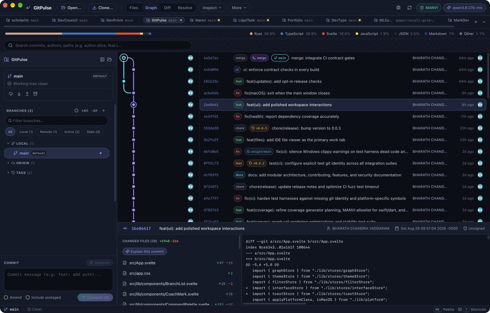
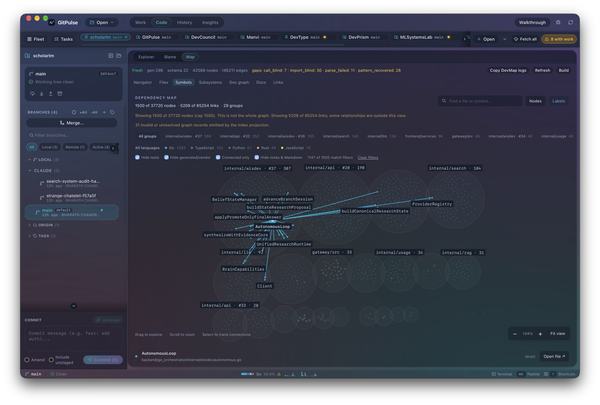
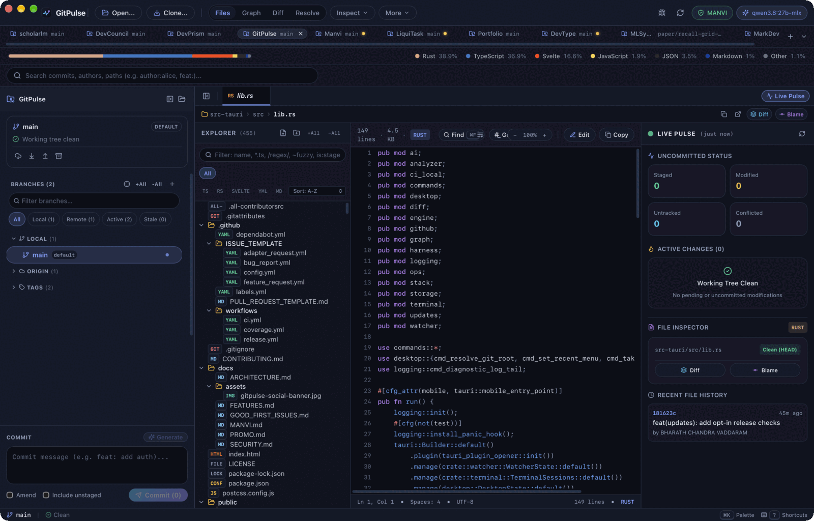
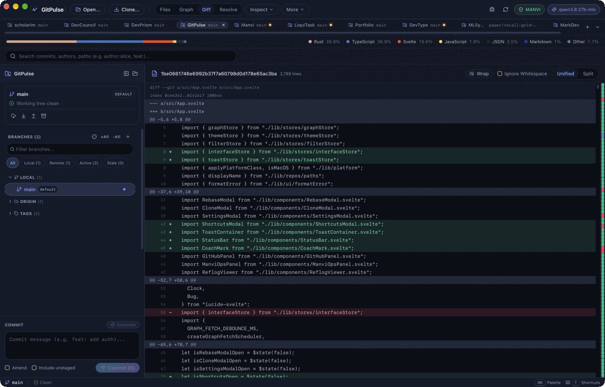
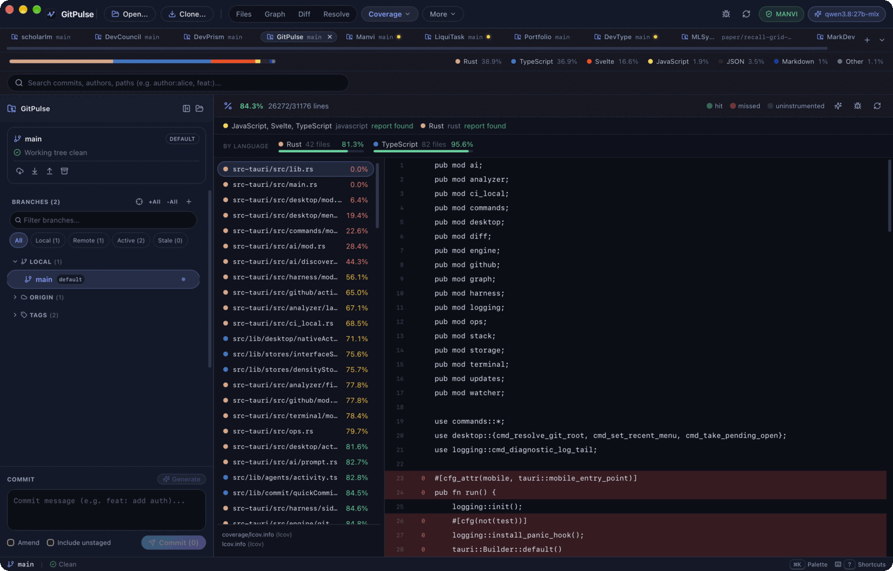
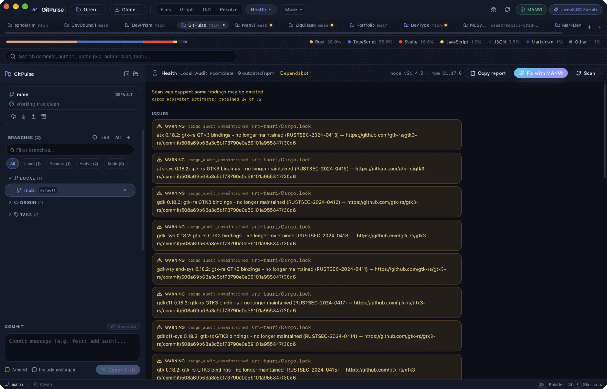
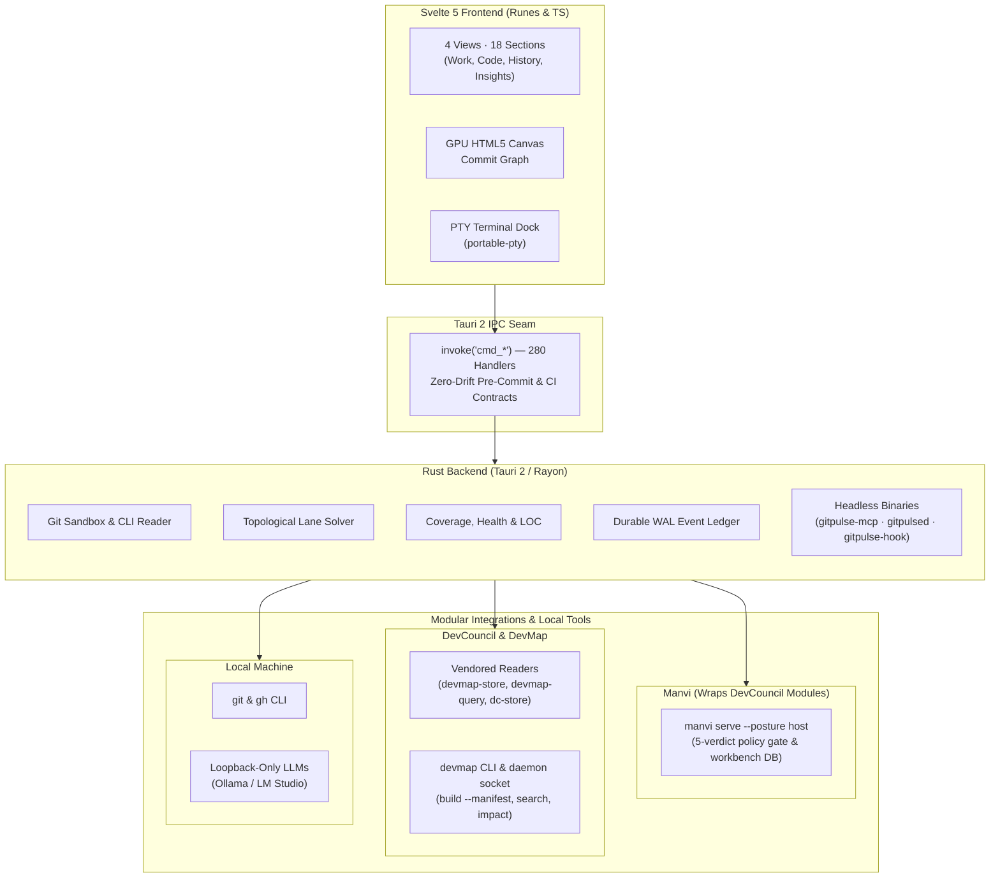

# GitPulse

<p align="center">
  <a href="https://gitpulse.vbcr.dev/"></a>
  <a href="https://github.com/bharathvbcr/GitPulse/actions/workflows/ci.yml"></a>
  <a href="https://github.com/bharathvbcr/GitPulse/actions/workflows/coverage.yml"></a>
  <a href="https://github.com/bharathvbcr/GitPulse/releases"></a>
  <a href="LICENSE"></a>
  
  
</p>

**Fast, local-first Git desktop client, code intelligence suite, and task workspace.**

Review changes with GPU acceleration, resolve 3-way conflicts, follow branch and commit
history, search across repositories, organize tasks with board swimlanes, and inspect repository
health from a native Rust / Tauri 2 app with a Svelte 5 frontend. 100% on-device, private-by-design,
zero telemetry.

[Download](https://github.com/bharathvbcr/GitPulse/releases/latest) ·
[Getting started](docs/GETTING_STARTED.md) ·
[Documentation](docs/README.md) ·
[Website](https://gitpulse.vbcr.dev/) ·
[Release notes](CHANGELOG.md)



## Get started

1. [Install GitPulse](docs/INSTALLATION.md) and Git for your platform.
2. Open a repository and review **Trust and Open**. Trust allows its hooks,
   helpers, and project tools to run with your account permissions.
3. Use **Work** for changes in flight, **History** to review a commit, and
   **Code** to explore files. Open the command palette with `⌘K` / `Ctrl+K`.
4. Replay the guided tour any time from **Settings → Appearance → Guided walkthrough**.

GitHub CLI, DevMap, Manvi, and local model servers are optional; install the
ones needed for the features you use. The [first repository guide](docs/GETTING_STARTED.md)
walks through a review, task creation, and optional setup.

## Four views, one workspace

GitPulse has 4 application views with 18 specialized sections. Each view keeps related sections together.

| View | What you do here | Sections |
| --- | --- | --- |
| **Work** | Track work in flight, resolve conflicts, organize tasks | Overview · Resolve · Remote · Policy · Tasks |
| **Code** | Browse files, inspect authorship, search text, explore structure | Explorer · Blame · Search · Map |
| **History** | Follow commits, review changes, find recovery points | Graph · Diff · Reflog · Suspects |
| **Insights** | Inspect activity, coverage, dependencies, secrets, and disk usage | Pulse · Coverage · Health · Secrets · Storage |

Graph, Diff and Suspects share the selected commit; Explorer and Blame share the selected
file; Overview embeds branch stack hierarchy. **Fleet** compares repositories across the workspace (scaling to 1,000 repositories with 24 active watches),
**Tasks** opens global and saved-workspace boards with swimlanes and WIP limits, and the **terminal dock** stays available across views.

## From a change to the next step

- **Review and commit.** Canvas commit graph (100K+ commits at 60/120 FPS), unified and side-by-side diffs,
  word highlighting, symbol-grouped diff hunks, image comparisons, selective staging,
  stash previews, a three-way conflict resolver, and structured patch-brief commit
  phrasing with on-device Apple Intelligence fallback.
- **Manage worktrees and branches.** Dead-branch cleanup with durable tip backups
  in the WAL ledger and authorized delete commands, copy-on-write build cache sync
  (`node_modules`, `target`, `.venv`), named localhost routes via portless, and
  trust-gated lifecycle hooks.
- **Organize the work.** Quick add parses priority, labels, owner, repository,
  due date, and notes. Board views with swimlanes (grouped by owner or label),
  saved views, column WIP limits, task checklists with done states, cross-task links
  (parent, blocks, related, duplicate), the Archive dock with Deleted recovery,
  review drafting suggestions, and agent terminal handoff with per-launch model selection.
- **Explore and search the code.** File navigation and blame are built in. High-speed
  repository-wide text search (`git grep` over working tree or revisions with honest
  cancellation and truncation reporting). Add DevMap for structural navigation,
  symbol search, symbol-level collision detection, dependencies, impact, and candidate tests.
- **Inspect the repository.** Universal coverage reports across 6 formats (LCOV, Cobertura,
  Go cover, Istanbul, JaCoCo, Clover), multi-ecosystem dependency audits (`cargo-audit`,
  `npm audit`, `pip-audit`, `govulncheck`) with `cargo deny` and `cargo crev` parsers,
  Kingfisher redacted secrets scanning that locates each finding against Git, storage
  cleanup previews, and Pulse activity summaries distinguish results from scans that did not run.
  Capped results identify their limits.
- **Work from the desktop.** Native menus, a command palette (`⌘K`), a docked PTY terminal
  that reports what each session is running, reflog recovery (`reset --keep`), GitHub pull
  request actions (review, comment, approve, merge pinned to viewed commit), colour-coded repository
  tabs and groups that survive a restart, and an optional macOS menu-bar status popover keep
  frequent actions close. Background windows stop their timers instead of polling.

The [feature reference](docs/FEATURES.md) describes each surface and its limits.
The [changelog](CHANGELOG.md) records release changes; [open qualification](docs/QUALIFICATION.md)
tracks remaining platform, provider, and performance checks.



| File explorer | Diff review |
| --- | --- |
|  |  |
| Coverage | Dependency health |
|  |  |

Screenshots are captures from the macOS app; appearance varies by release and platform.

## Local state and explicit permissions

Repository and task state are stored locally. The desktop app has no remote
telemetry. Git remotes, GitHub operations, Firebase App Hosting checks you ask for,
optional tool downloads, release checks, and configured agent providers can use the
network.

Built-in local AI connects to loopback model servers. Task enhancement and agent
runs use their configured provider; supported Mac builds can also use Apple
Intelligence for task titles and descriptions. These are distinct execution paths.

Repository trust is an execution decision. A worktree is not an OS sandbox.
Policy verdicts preserve **unchecked** separately from **allowed**, and the
read-only MCP server cannot grant repository trust. Read the
[security and trust model](docs/SECURITY.md) before configuring agents.

## Architecture

DevCouncil is **components and modules**. Manvi wraps them. GitPulse uses Manvi
for policy, workbench, and agent hosting, and selected DevCouncil components
for code intelligence. Modules can be updated independently.



See [architecture](docs/ARCHITECTURE.md) for ownership and contracts, and
[module integration](docs/MODULE_INTEGRATION.md) for the boundaries between projects.
GitPulse succeeds the deprecated [LiquiTask](https://github.com/bharathvbcr/LiquiTask)
workbench; this does not imply complete feature parity.

## Build and contribute

Use Bun 1.4.2, Node.js 22.x (22.12 or newer), stable Rust, Git, and your platform's native
build tools. The [contributor guide](CONTRIBUTING.md) covers setup and platform prerequisites.

```sh
git clone https://github.com/bharathvbcr/GitPulse.git
cd GitPulse
bun install --frozen-lockfile
git config core.hooksPath .githooks
bun run tauri dev
```

| Command | Purpose |
| --- | --- |
| `bun run check` | Svelte and TypeScript checks |
| `bun run test` | Frontend and contract tests |
| `bun run check:ipc` | Match frontend calls to the native command registry |
| `bun run check:types` | Compare Rust and TypeScript wire contracts |
| `bun run check:release` | Check version manifest consistency |
| `bun run check:workflows` | Lint the GitHub Actions workflow definitions |
| `bun run test:browser:all` | Browser regressions under headless Chrome |
| `bun run test:webkit:all` | The same regressions under WKWebView (macOS only) |
| `bun run build` | Build the frontend bundle |
| `bun run tauri build` | Build native bundles for the host |
| `bun run ci:local` | The gates in `scripts/ci-local.mjs`: contracts, both renderers, format, clippy, Rust and frontend tests, coverage floors and the gusset check. It does not run `bun audit`, `cargo deny` (`bun-audit.yml`), the Go `vet` and `-race` jobs, the scheduled deep and parallel-test workflows, or the Linux and Windows builds, which only CI runs |

The browser regressions run twice in CI — under Chrome on Linux and under
WKWebView on macOS — because the two engines disagree often enough to matter: a
fixture can pass under one and fail under the other. `ci:local` runs both for
that reason, so prefer it over the individual commands before opening a pull
request.

A frontend build alone does not qualify the native application. Follow the
[release procedure](CONTRIBUTING.md) before publishing a build.

## Documentation

The [documentation index](docs/README.md) organizes user guides, integration
references, contributor contracts, and historical evidence. Start with
[installation](docs/INSTALLATION.md), [your first repository](docs/GETTING_STARTED.md),
or [tasks and workspaces](docs/TASKS_AND_WORKSPACES.md).

Bug reports, documentation, design, tests, and code contributions are welcome.
See [CONTRIBUTING.md](CONTRIBUTING.md) and [good first issues](docs/GOOD_FIRST_ISSUES.md).

### Getting help

Questions and open-ended proposals go to
[Discussions](https://github.com/bharathvbcr/GitPulse/discussions) — ask in
**Q&A**, where an answer can be marked accepted, or start in **Ideas**. Bugs,
scoped feature requests, and adapter proposals go through
[issues](https://github.com/bharathvbcr/GitPulse/issues/new/choose), which has a
template for each. Suspected vulnerabilities are the exception: report those
through GitHub Security Advisories as described in the
[security and trust model](docs/SECURITY.md), not as a public issue.

The bug template asks for a diagnostics report: open the command palette and
run **Open Diagnostics**, then use its copy button, which collects the version,
platform, and recent log lines. Read it before pasting — it can contain
repository paths.

### Contributors

Every kind of contribution is recognised here, not only code — documentation,
design, bug reports, testing, reviews, and ideas all count under the
[all-contributors](https://github.com/all-contributors/all-contributors)
specification. The list below is generated from `.all-contributorsrc`.

<!-- ALL-CONTRIBUTORS-LIST:START - Do not remove or modify this section -->
<!-- prettier-ignore-start -->
<!-- markdownlint-disable -->
<!-- ALL-CONTRIBUTORS-LIST:END -->
<!-- markdownlint-restore -->
<!-- prettier-ignore-end -->

To add someone (including yourself), comment on any issue or pull request:

```
@all-contributors please add @username for code, doc
```

The bot opens a pull request updating this section and `.all-contributorsrc`.
See the [emoji key](https://allcontributors.org/docs/en/emoji-key) for contribution
types.

---

## Topics, Tags & Discoverability

| Category | Metadata / Values |
| --- | --- |
| **GitHub Topics** | `git`, `git-client`, `git-gui`, `tauri`, `tauri-v2`, `rust`, `svelte5`, `svelte`, `local-first`, `code-intelligence`, `developer-tools`, `devtools`, `desktop-app`, `mcp`, `commit-graph`, `merge-conflict-resolver`, `reflog`, `test-coverage`, `terminal`, `privacy-first`, `zero-telemetry` |
| **Tech Stack** | Rust (Tauri 2, Rayon), Svelte 5 (Runes), TypeScript, Tailwind CSS, portable-pty, DevMap, Manvi |
| **Target Platforms** | macOS (Apple Silicon & Intel Universal dmg), Linux (.AppImage, .deb), Windows (.msi, .exe) |
| **License & Privacy** | MIT License · 100% on-device · Zero telemetry |

---

## License

Distributed under the MIT License. See [LICENSE](LICENSE) for details.

© 2026 Bharath Chandra Vaddaram
