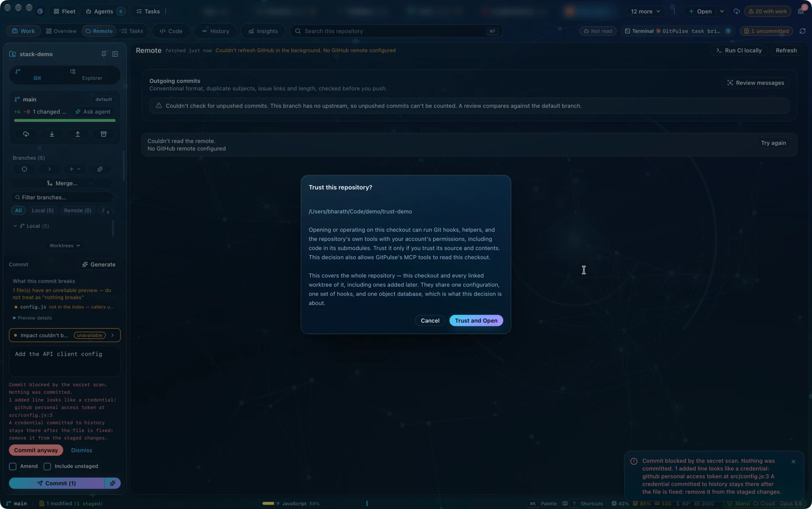
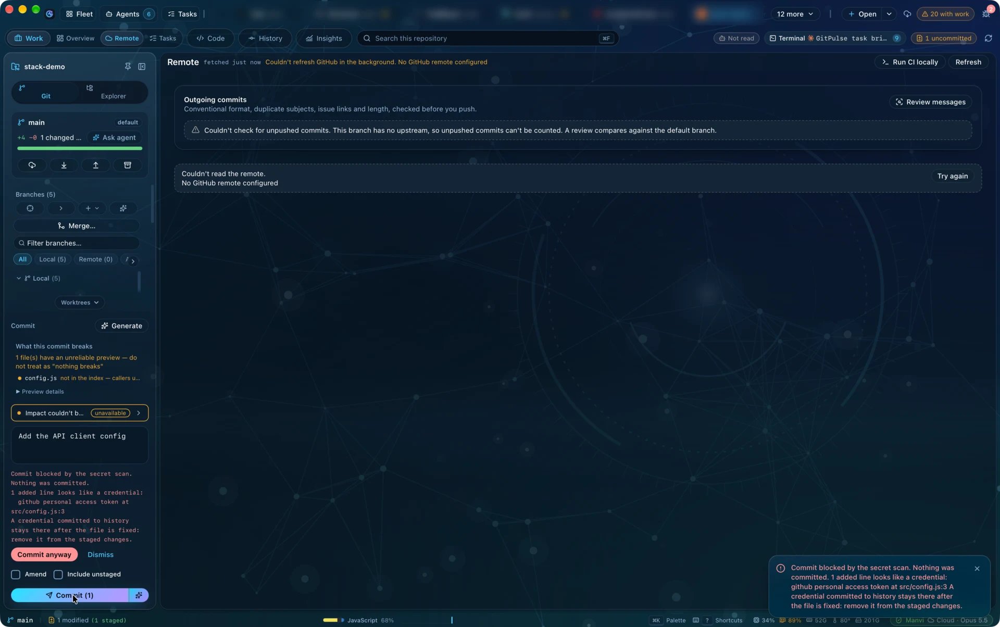
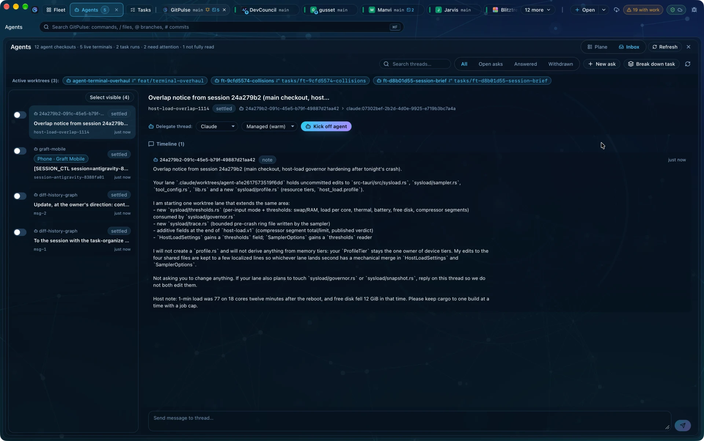

# Running agents in Waylode

[Documentation index](README.md) · [Getting started](GETTING_STARTED.md) · [Why Waylode](WHY_WAYLODE.md) · [Tasks and workspaces](TASKS_AND_WORKSPACES.md) · [MCP and Agents (wiki)](../wiki/MCP%20and%20Agents.md)

Waylode launches coding agents, watches them, guards them and lands their work. It does not replace
the agents: Claude Code, Codex, Antigravity, Grok and Manvi still run as their own CLIs, under their own
permissions. This guide covers the parts that Waylode adds around them. The tool-by-tool MCP reference
is the wiki page [MCP and Agents](../wiki/MCP%20and%20Agents.md).

Contents: [Connect an agent](#connect-an-agent) · [Launch from the task board](#launch-from-the-task-board) ·
[Guards and trust](#guards-and-trust) · [Agent-to-agent messaging](#agent-to-agent-messaging) ·
[The collision workflow](#the-collision-workflow) · [Agents file follow-up tasks](#agents-file-follow-up-tasks) ·
[Limits](#limits-to-know)

## Connect an agent

Open **Settings → Agents → Connect your agent**. It shows a plan first and changes nothing until you apply
it. On apply it links the app's bundled `waylode-mcp` and `waylode-hook` into `~/.local/bin` and registers
the `waylode` MCP server with Claude Code and Codex through their own `mcp add` commands (plus legacy `gitpulse-mcp`/`gitpulse-hook` compat links where needed). If the Waylode
Claude Code plugin is installed, it already provides the server and the hooks, so use the plugin or the
direct registration, not both.

The MCP server gives an agent the same facts the UI shows you: `waylode_insights` for worktrees, live
sessions, collisions, ledger and code-graph health, plus `waylode_sessions`, `waylode_collision_risk`,
`waylode_change_context`, the task-board tools, the `devmap_*` code-graph tools and the worktree
coordination tools (legacy `gitpulse_*` tool aliases also resolve, and `WAYLODE_MCP_EXPOSE_LEGACY=1` advertises them). The server exposes 66 tools and 4 prompts. The hooks are what enforce the guards, so a
missing `waylode-hook` leaves them off while sessions look normal. `bun run mcp:doctor` (source checkouts)
and the Settings card both report that.

## Launch from the task board

The board is where you start agents. In **Work → Tasks**, or the global **Tasks** board, choose
**Send to agent** on a card. The form asks for:

- **Agent**: Claude, Codex, Grok or Antigravity, and how it runs: **Terminal** (a task-bound session in the
  dock) or **Managed** (Manvi supervises the run and shows its requests in Waylode; the form says which
  agents support it). Shell sessions are for your own use.
- **Working checkout**: an open repository tab, or the folder beside that repository's git directory.
- **Permission mode**: remembered for next time, except `Bypass permissions`, which you must choose again,
  with its acknowledgement, for every attempt.
- **Model, effort and advisor for this launch** (terminal handoffs): Claude Code takes model, effort and
  advisor; Antigravity takes effort. A blank field keeps the default from **Settings → Agents**. The
  values are recorded on the attempt and are not remembered for the next launch. A Manvi managed attempt
  takes none of these, because Manvi sets its model.
- **Run in a new worktree**: Waylode creates `.gitpulse/worktrees/<task>-<id>` on a new
  `gitpulse/<task>-<id>` branch, hidden from `git status` through `.git/info/exclude`. When the selected
  checkout already holds an agent, the form says which task holds it and selects a new worktree for you.

Each launch is one tracked attempt. A terminal attempt opens a task-bound session in the terminal dock;
finishing the process does not accept the task. The agent's brief names the task on its `Task:` line, so
the agent can read it back with `waylode_get_task`.

**Done means verified.** When the agent calls `waylode_complete_task` with `done`, the card moves to Done
only if Manvi's verification passed for the head the agent's worktree is still on. Otherwise the card
moves to Review with the reason (`held_for_review`), and no argument changes that. An agent never reopens
a card that is already Done.

You can run several attempts at once. The limit is **Settings → Agents → Agents running at once**, from 1
to 64 (8 until you change it); terminal sessions are capped separately, 32 across repositories by default.
When a launch is refused or a worktree is not needed after all, Waylode removes the worktree and branch it
created for the attempt. An attempt holds its checkout until its process is known to have ended.

You can also start sessions directly from the dock, without a task: the launchers are Shell, Claude,
Manvi, Codex, Grok and Antigravity, plus a Browser tab for local dev servers.

## Guards and trust

**Per-repository trust.** Opening a checkout asks for **Trust and Open**. Trust is per repository (bound to
its common Git directory), is stored outside the repository, and can be revoked from the tab. Only the
desktop can grant it: the MCP server refuses writes in an untrusted repository (`untrusted_repository`)
and cannot grant trust itself. Trust permits the repository's hooks and project tools to run under your
account. It is an execution decision, not an OS sandbox.

**The Manvi command gate.** Where the plugin's hooks are registered, each agent shell command passes
`waylode-hook command-gate` before it runs, and each file write passes `collision-guard`. The gate is
Manvi's policy engine. It returns one of three actions (`allow`, `warn`, `deny`), and Waylode renders every
decision as one of eight statuses, defined in [`contracts/verdict.schema.json`](../contracts/verdict.schema.json):

| Status | Meaning |
| --- | --- |
| Allowed | The rules passed with nothing overriding them (`clean` in the contract) |
| Warned | Proceeds with an advisory recorded |
| Demoted | A posture or gate mode downgraded a denial to an allow |
| Granted | An override cleared a soft block |
| Widened | The write was allowed by scope the executor appended to its own task |
| Degraded | A check could not run, so the decision is not the one a full check would reach |
| Blocked | Refused (`denied` in the contract); the reason names the rule |
| Unchecked | No decision exists, for example the harness is missing. Never rendered as allowed |

Each rule has a severity. Hard rules (for example force push, a protected reset, a path outside the root,
a secret path, or command substitution and heredocs inside a gated command) cannot be cleared by any grant.
Soft rules (task-scope and lease rules) can be demoted by posture or cleared by a grant. When a session is bound to a task scope, writes into
another checkout of the same repository are refused too. Hooks never answer `allow` on their own, so they
cannot override your own permission rules, and a hook failure never blocks a tool call.

**Other guards.** The secret gate (`dc-redact`) scans commits and pushes that Waylode makes; it does not
catch an agent's own `git commit`. Allowed agent Git mutations record pre-operation snapshots under
`refs/gitpulse/ops/`, which you can restore with a checked undo from HEAD moves. Opt-in turn checkpoints
under `refs/gitpulse/turns/` capture the working tree at a turn's start and end. A signal guard stops
agents from killing Waylode.

## Agent-to-agent messaging

Agents on different worktrees can talk to each other instead of overwriting each other's work. The peer
inbox tools are:

| Tool | Use |
| --- | --- |
| `waylode_agent_register` | Register a live session (Claude, Antigravity or Codex) with a role and a wake mode (`boundary` or `auto`) |
| `waylode_agent_peers` | List live and resumable peers across the repository's worktrees |
| `waylode_agent_send` | Send a message to one peer, up to 16 KiB; `in_reply_to` answers an earlier message. An ambiguous target is refused rather than guessed |
| `waylode_agent_inbox` | Read unread messages, deduplicated. A read only peeks; pass `ack: true` to acknowledge what it returns. A `for_peer` that matches several peers is refused with their `peer_id`s; a failed acknowledgement is reported in `ack_error` and `acked_count` counts only what succeeded |
| `waylode_agent_wait` | Block for up to 45 seconds for a reply, with at most 4 waiters at a time per server process. It acknowledges what it returns (`ack` defaults to true); pass `ack: false` with `since_seq` and `since_mailbox_ms` to wait without consuming (see below). Like the inbox, it returns `has_more` and `dropped_before_seq` |

A session also sees unread peer messages when it starts and after tool calls, through the `peer-inbox`
hook. Separately, the `waylode_worktree_*` family carries lane-level handoff messages
(`waylode_worktree_send_message`, `waylode_worktree_inbox`), for example an interface-change notice to
every sibling lane. You can send an agent a message yourself with **Send to agent** on a live session;
Waylode shows a preview and waits for your confirmation before delivering it.

The `waylode_agent_send` result has a `mailbox` object saying whether the recipient's mailbox took the message (`deposited`, with a `reason` of `full`, `refused`, `no_session`, `unavailable` or `hop_limit` when it did not). A peer may hold at most 7 pending messages per session; the last slot carries one notice per repository pointing the recipient at `waylode_agent_inbox`. A `delivery_outcome` of `bus_only` means the message is on the bus but not in the mailbox, so only an inbox or wait call will show it. A message that has reached its hop limit has `delivery_outcome` `paused_hop_limit` and is not deposited in the mailbox at all (`mailbox.reason` `hop_limit`): the bus row is the record, and the recipient or a person can read it with `waylode_agent_inbox`. Envelopes paused at the limit by an earlier version may still sit in a mailbox; a session waiting there (a `Stop` wait, for example) looks past such a refused message to the first deliverable one and keeps waiting while only refused ones are pending.

To page or to wait without consuming, pass `ack: false` and resume from the previous result: `next_since_seq` goes in `since_seq` (it is the last bus seq returned when the page was cut, else `latest_seq`, so a cut page loses no row) and `mailbox_cursor_ms` goes in `since_mailbox_ms`. Envelopes the bus does not hold (a person's message, or a peer or steward message whose bus row was evicted) have no bus seq to page by, so they page by `since_mailbox_ms`, the creation time in milliseconds; each mailbox stamps its envelopes strictly increasing in publish order (on Unix, where the stamp is assigned under the session's file lock), so "newer than the cursor" is exact. Passing `since_mailbox_ms` also makes an evicted steward envelope page by it instead of `since_seq`.

To answer a message, pass its `msg_id` as `in_reply_to`. The message must still be on the bus, or the send is refused. A delivered message's header tells the reader to reply with `in_reply_to` set to its `msg_id`, so the reply carries the hop count even without a thread. An exact retry (same `msg_id`, same payload) reports the stored message's hop and mailbox outcome rather than recomputing them, and does not wake or deposit for the recipient again once an earlier delivery of that row succeeded (`mailbox.reason` `already_delivered`; the guarantee holds within one MCP server process, which remembers the delivery, or once the recipient has read the row, which the bus records): `replayed: true` means `delivery_outcome` is the stored outcome of that earlier delivery, and a `delivery_outcome` of `already_delivered` means the recipient had already read the row. A retry after a failed or timed-out delivery still delivers. An `in_reply_to` naming a row the bus no longer holds is refused, also when the row is evicted while the send is in flight. The reply joins the answered message's thread when you name none. The server, not the caller, derives the hop of a `waylode_agent_send` message, under the bus lock so a concurrent send cannot read a stale thread: it is the highest of an explicit `hop`, the `in_reply_to` message's hop plus one, the thread's last hop plus one, and 1. A chain of replies therefore reaches the hop limit even without a shared `thread_key`, and the hop never goes down. `max_hops` (1 to 32, default 6) can only be lowered within a thread: the stored value is the request cut down to the smallest ceiling any agent message in the thread carries, so a reply cannot raise it. A person's or the steward's message does not count towards that minimum. `waylode_worktree_send_message` and the other lane-message posts keep hop 1 and are not derived. A sender that never registered as a peer can still be answered: when `to_peer` exactly matches the `from_peer` of a message on the bus and no peer matches, the reply goes to the bus only (`liveness` `unregistered`, `delivery_outcome` `bus_only`, mailbox `reason` `no_session`). A prefix or a different case does not match.

The bus keeps the newest 256 messages. When it is full, the oldest message goes first, except that open
asks and each recipient's unread direct messages from the last 2 hours (up to 8 per recipient, 64 in
all) are kept for as long as anything else can go instead. A body may hold line breaks and tabs but no
other control characters, and the 16 KiB limit counts the body as stored, where a quote or backslash
takes two bytes. If the bus file ever outgrows its 8 MiB limit (an older build counted body bytes, not stored bytes), the next post or acknowledgement drops
the oldest rows to bring it back under, logs a warning, and never reuses a sequence number. The bus refuses to issue a sequence number above 2^53 - 1, the largest integer JSON readers keep exactly, and says to move `messages.json` aside by hand. Because the kept rows can be older than rows that were dropped, an inbox or
wait response lists them in `pinned_below_dropped_before_seq`: `dropped_before_seq` still means no dropped
row has a sequence at or above it, and those listed rows are the exceptions below it.

A `messages.json` that is over 32 MiB, or that is damaged so it does not parse, is not loaded. The next write (a post, or an acknowledgement that names a message) moves it aside as `messages.json.oversized-<unix>` or `messages.json.corrupt-<unix>`, keeps the two newest such files, and starts a fresh bus whose sequence continues above the old one, so a number a reader has seen is never issued again. The unread messages in the old file are not carried over; they stay only in the aside file. A read never repairs: it refuses the file and says so. A file that parses but has a different shape was written by another Waylode version; it is refused and left in place rather than repaired, and the remedy is to upgrade or reinstall so every Waylode binary on the machine is the same version, or to move the file aside by hand.

## The collision workflow

Two agents editing one file in different worktrees is the case Waylode warns about before the merge does.

1. **Look.** `waylode_insights` shows worktrees, live sessions and overlapping files. In the UI, Work →
   Overview and the Agents plane (`⌘⇧A`) show the worktrees, terminals and task attempts.
2. **Radar.** `waylode_worktree_radar` combines three layers: file and symbol claims, one-hop call-graph
   neighbours from DevMap across dirty worktrees, and a quarantined `git merge-tree` over committed work.
   `waylode_collision_risk` lists files dirty in more than one worktree; pass `path` to ask about one file
   before the first edit, because a clean worktree sees no overlap on its own.
3. **Claim.** Before editing in a parallel lane, an agent calls `waylode_worktree_claim` with the files
   and symbols it intends to change, checks `waylode_worktree_inbox` for notices, and calls
   `waylode_worktree_release` when done. A card's planned files are claimed when its run starts.
4. **Guard.** The `collision-guard` hook asks the user when another worktree holds uncommitted changes to the
   file an agent is about to write, and refuses writes outside the bound task scope.
5. **Message.** The agent that finds the overlap messages the other through the peer inbox instead of
   proceeding.
6. **Predict the merge.** `waylode_merge_conflicts` reports, pair by pair, whether the worktrees' committed
   work would merge, running in an object quarantine that is deleted afterwards.

An empty overlap list is not proof of no collision when `unscanned_worktrees` is non-zero or `sessions_ok`
is false: check each facet's `ok` field. Two sessions in the same checkout never show as an overlap,
because there is only one worktree to compare.

## Agents file follow-up tasks

An agent that finds work outside its task should not bury it in a transcript. It files it on your board
with `waylode_add_task`, and the card appears in Backlog while Waylode's window is on screen (and when the
window is next shown otherwise).

- The board refuses a new card that looks like open work (two shared title words, or one and a shared
  label) until the agent has reviewed the related cards. It then folds its work into one of them, or names
  every one to say its task is separate. Done cards never count.
- Edits use `expected_revision`, so a change you made after the agent read the card is refused rather than
  replaced. Fields you locked stay as you set them.
- `waylode_import_tasks` puts a repository's `tasks/*.md` briefs on the board. It is not duplicate-checked.
- `waylode_merge_tasks` and `waylode_delete_task` keep the board small. Both require a reason, which is
  kept in the card's history, and an agent cannot delete or merge away a card another agent is running.
  MCP has no undelete; a deleted card is recoverable from the archive's Deleted view.
- Writes require a trusted repository and never start an agent run.

## Limits to know

- Waylode is tested on macOS. Windows and Linux builds exist but are not yet tested.
- The hooks exist only where the plugin's hooks are registered. An agent under another profile, or one
  started outside Waylode, has no gate until that profile registers them.
- Antigravity has no `PreToolUse` hooks from Waylode, so its shell commands and file writes are not gated
  by the command gate or the collision guard. It keeps the session brief, the peer inbox and notifications.
- A worktree is not an OS sandbox. A process that leaves the agent's process group writes with no tool call
  for a hook to judge.
- Commands whose write targets are not in the command text (`git apply`, `xargs`, `find -exec`) cannot be
  judged against a task scope, so with a scope bound they are refused.
