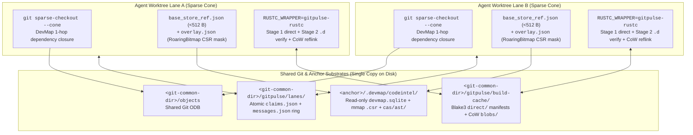
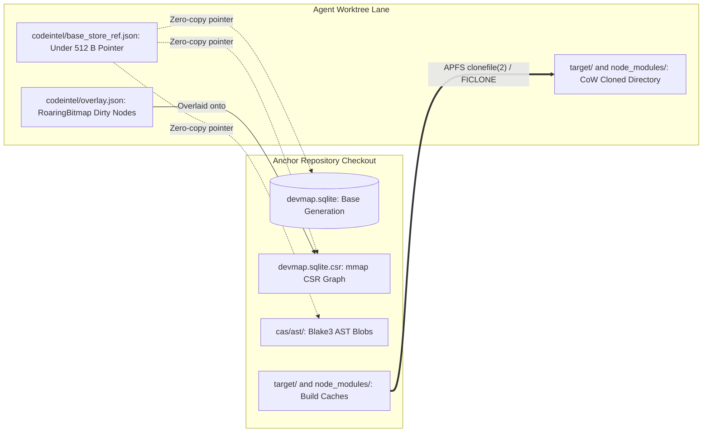
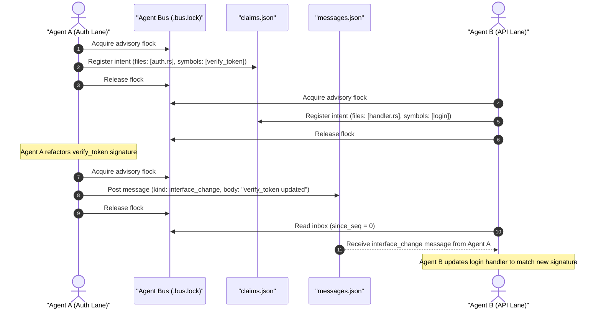
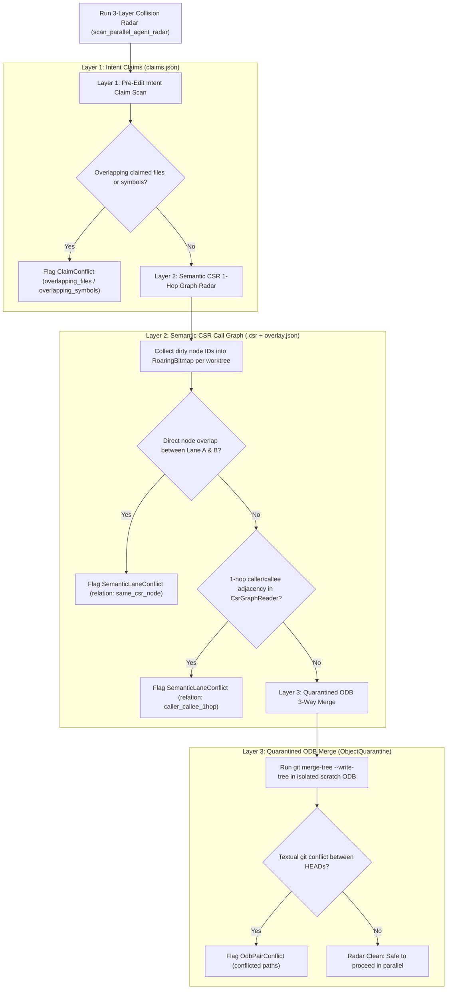

# Zero-Copy Agentic Worktrees, Parallel DevMap Overlays & Shared Build Caching

[Documentation index](README.md) · [Feature reference](FEATURES.md) · [Architecture](ARCHITECTURE.md)

This document records the systems research, failure-mode analysis, and architectural design behind GitPulse's zero-copy branching, sparse worktree provisioning, parallel DevMap delta overlays, content-addressed `gitpulse-rustc` build cache, and multi-agent coordination bus.

---

## 1. Industry & Open-Source Landscape

Running multiple autonomous coding agents in parallel against one repository stresses assumptions that traditional Git workflows never had to satisfy: humans rarely create ten checkouts in five seconds, compile all ten simultaneously, and edit interdependent call-graph neighbors without speaking to one another.

| System | Core Mechanism | Working-Tree Storage | Code-Graph / Index Strategy | Build Artifact Sharing | Agent Coordination | Trade-Off for Local-First Git |
| --- | --- | --- | --- | --- | --- | --- |
| **Anthropic Internal Scion** (*"Redesigning source control at Anthropic"*, Oct 2026) | Server-centric VCS (`scion-daemon` → `scion-cache` → `scion-server`) built to scale from ~2.5k to >30k merges/day across ~100 GB history and >25 GB trees | Virtual / sparse checkouts; server-side commits, rebases, and merges avoid shipping multi-GB packfiles to clients (>99% cache hit rate) | Server-hosted metadata + optimistic pre-deploy verification | Paired with remote build execution | Optimistic merge queues + server-side rebase | Requires dedicated `scion-server` + `scion-cache` fleet; not drop-in for arbitrary local Git remotes |
| **Google `GoogleCloudPlatform/scion`** (open-source) | Multi-agent orchestration testbed pairing **worktree-per-agent** with OCI container + `tmux` runtime isolation | Full `git worktree` per container | Per-worktree local state | Isolated container filesystems unless host cache mounted | Per-agent secret scoping + CLI messaging | Strong runtime sandboxing, but naive worktrees duplicate source trees, indexes, and cold `target/` builds |
| **Jujutsu (`jj`)** | Working-copy-as-a-commit + lock-free concurrent operation log (`op log`) + first-class conflict objects | Full working tree per `jj workspace add` | Git ODB shared; external code indexes remain per-workspace | None built-in | Conflict-tolerant rebasing after the fact | Eliminates `.git/index.lock` contention, but still materializes full trees and cold build directories |
| **Meta Sapling & EdenFS** | Scalable commit graph + FUSE / NFS / ProjFS virtualized filesystem | Lazy on-read file materialization | Server-backed commit & path indexes | Paired with Buck2 remote execution | Commit-stack workflows | Kernel/userspace virtual FS daemons require elevated entitlements, notarization exceptions, and remote backing servers |
| **GitButler Virtual Branches** | Multiple virtual lanes multiplexed inside a single working directory | Single working tree | Single shared index | Single `target/` directory | Disjoint hunk assignment in one tree | Breaks down when two parallel agents edit the same file or run incompatible build/test processes simultaneously |
| **Dagger `container-use` & Worktrunk** | Ephemeral container checkouts (`container-use`) or branch-addressed Git worktrees with CoW cache copy (`Worktrunk`) | Container layer or full Git worktree |Copied or rebuilt per lane | Whole-directory `target/` reflink when unlocked | Post-hoc merge / PR review | When an active build holds `.cargo-lock`, whole-directory `target/` cloning must skip the build directory |
| **`sccache` (`RUSTC_WRAPPER`)** | Content-addressed compiler wrapper hashing `rustc -vV`, flags, and pre-processed/source inputs | N/A (compiler layer) | N/A | Shared `.rlib` / `.rmeta` object cache across directories | N/A | Copies bytes into `--out-dir` rather than APFS/FICLONE CoW reflinking; external daemon setup required |
| **GitPulse Zero-Copy Engine** | Carried-churn branching + DevMap-guided `--cone` sparse checkouts + `<512 B` DevMap base pointers + Blake3/CAS AST overlays + `gitpulse-rustc` CoW cache + `<git-common-dir>` lane bus | Only transitive `--cone` directories materialized on disk | Shared anchor `devmap.sqlite` + mmap `.csr` + per-lane `overlay.json` & `RoaringBitmap` dirty CSR mask | Whole-`target/` CoW clone when idle **plus** lock-free per-crate `gitpulse-rustc` CoW cache when `.cargo-lock` is held | Pre-edit file/symbol claims + bounded message ring + 3-layer CSR/ODB collision radar | Zero server infrastructure, zero FUSE kernel extensions, 100% compatible with standard Git remotes |

---

## 2. Five Failure Modes of Naive `git worktree` Under Parallel Agents

1. **Working-Tree & Git-Index Multiplication**:
   `git worktree add` checks out every tracked file in `HEAD`. Ten parallel agents on a 50,000-file monorepo write 500,000 files and ten full `.git/worktrees/<id>/index` tables even when each agent touches two modules.
2. **Cold Code-Graph Rebuilds vs. SQLite Hardlink Corruption**:
   Copying `.devmap/codeintel/devmap.sqlite` per worktree wastes disk and I/O; hardlinking SQLite across worktrees (`nlink > 1`) corrupts WAL/SHM state the first time one lane writes; and reading the anchor SQLite directly without an overlay misreports `store_meta.repo_root` and misses uncommitted edits.
3. **`.cargo-lock` Contention & Cold Compiler Rebuilds**:
   Copy-on-Write (`clonefile(2)` / `FICLONE`) cloning of `target/` is fast when the anchor checkout is idle. As soon as one agent or developer holds `<target>/<profile>/.cargo-lock`, cloning an in-flight `target/` directory races half-written `.rmeta`/`.rlib` outputs, so safe CoW cloning must skip `target/` (`"anchor build in progress"`). Every subsequent agent then pays a full cold `cargo build`.
4. **Blind Concurrent Editing (Semantic & Textual Collisions)**:
   Standard worktrees share only committed Git objects. Agent A changing a function signature in `packages/shared/lib.rs` and Agent B adding a new call site in `packages/app/main.rs` produce zero Git merge conflicts yet break compilation upon integration.
5. **Redundant Post-Mutation Branch Churn Sweeps & Orphaned Processes**:
   Creating, renaming, or deleting a branch in a desktop client traditionally invalidates the branch list and triggers a fresh `git rev-list` / diffstat pass even when every surviving branch tip SHA was already measured; meanwhile, dev servers and test watchers spawned inside agent worktrees linger as orphan processes after `git worktree remove`.

---

## 3. GitPulse's Five-Pillar Zero-Copy Architecture



### Pillar 1: Zero-Round-Trip Branch Churn Carry-Forward
- **Owner**: [`../src/lib/stores/repoStore.ts`](../src/lib/stores/repoStore.ts) (`withCarriedChurn`, `hydrateFacet`, `fetchBranchStats`).
- **Mechanism**: Branch mutations (`createBranch`, `renameBranch`, `deleteBranch`) refresh only the `"branches"` facet rather than the full repository snapshot. `withCarriedChurn` matches each branch's commit tip SHA (plus upstream state) against previously verified branch records; a newly created branch pointing at `HEAD` or an existing base SHA immediately inherits verified `ahead`, `behind`, `insertions`, and `deletions` (`churnVerified = true`). When every eligible non-current branch is already verified against an unchanged default base, `fetchBranchStats` returns immediately without invoking `cmd_branch_stats`.

### Pillar 2: DevMap-Guided `--cone` Sparse Worktrees & Selective CoW Cache Sync
- **Owners**: [`../src-tauri/src/engine/worktree.rs`](../src-tauri/src/engine/worktree.rs) (`expand_sparse_cone_with_devmap`, `add_sparse_worktree_zero_copy`), [`../src-tauri/src/engine/cow_clone.rs`](../src-tauri/src/engine/cow_clone.rs) (`reflink_copy_file`, `clone_ignored_caches`), [`../src-tauri/src/commands/worktrees.rs`](../src-tauri/src/commands/worktrees.rs) (`cmd_add_worktree`), [`../src/lib/components/WorktreesPanel.svelte`](../src/lib/components/WorktreesPanel.svelte).
- **Mechanism**:
  1. Given an agent's target files or directories, `expand_sparse_cone_with_devmap` queries the anchor's DevMap `files` and `file_deps` tables for 1-hop inbound and outbound dependencies, producing a minimal directory closure.
  2. `add_sparse_worktree_zero_copy` runs `git worktree add --no-checkout`, enables `extensions.worktreeConfig`, configures `git sparse-checkout set --cone <dirs...>`, and checks out only root files plus the expanded cone directories.
  3. Ignored dependency caches (`node_modules`, `.venv`, nested package caches) are cloned selectively inside materialized cone directories using `clonefile(2)` on macOS APFS or `FICLONE` on Linux Btrfs/XFS, running in parallel (`std::thread::scope`) with zero-copy DevMap provisioning.

### Pillar 3: `<512 B` Zero-Copy DevMap Base Pointers & Blake3/CAS Delta Overlays
- **Owner**: [`worktree_overlay.rs`](file:///Users/bharath/Code/devtools/GitPulse/src-tauri/src/codeintel/worktree_overlay.rs#L1-L125) (`provision_worktree_devmap_zero_copy`, `sync_worktree_overlay`, `load_zero_copy_base_ref`, `load_worktree_overlay`).
- **Data Sharing Architecture Across Parallel Worktrees**:



- **Mechanism**:
  - Instead of copying `devmap.sqlite` into every worktree (which violates SQLite inode locks and `pending_state.repo_root` ownership), `provision_worktree_devmap_zero_copy` writes a `<512 B` atomic JSON pointer ([`ZeroCopyBaseRef`](file:///Users/bharath/Code/devtools/GitPulse/src-tauri/src/codeintel/worktree_overlay.rs#L64-L73) at `codeintel/base_store_ref.json`) referencing the anchor repository's read-only `devmap.sqlite`, mmap `.csr` edge index, and content-addressed `cas/ast/` store, pinned to `anchor_generation_id` and `anchor_head_sha`.
  - When an agent modifies, adds, or deletes files in its worktree, `sync_worktree_overlay` diffs the lane against `anchor_head_sha` (including untracked files), stores Blake3-addressed symbol AST blobs under `<anchor>/.devmap/codeintel/cas/ast/<2-hex>/<blake3>.ast`, computes a `RoaringBitmap` of invalidated CSR node IDs (`dirty_nodes`), and atomically writes `overlay.json`. Unchanged files consume zero per-worktree graph storage.
  - Dependency build caches are cloned using filesystem Copy-on-Write ([`cow_clone.rs`](file:///Users/bharath/Code/devtools/GitPulse/src-tauri/src/engine/cow_clone.rs#L1-L60)), sharing physical disk blocks across worktrees with bounds enforced by `CowCaps` (`MAX_COW_DEPTH = 64`, `MAX_COW_ENTRIES = 1,000,000`, `MAX_COW_BYTES = 8 GiB`).
  - Active agent processes (Claude Code, Codex, Antigravity) are tracked via host load process scanning ([`live_sessions.rs`](file:///Users/bharath/Code/devtools/GitPulse/src-tauri/src/insights/live_sessions.rs#L1-L50)), and overlapping file edits are classified by joining uncommitted diff intervals against DevMap symbol spans ([`entity_collision.rs`](file:///Users/bharath/Code/devtools/GitPulse/src-tauri/src/insights/entity_collision.rs#L1-L40)).

### Pillar 4: Two-Stage Zero-Copy Compiler Wrapper (`gitpulse-rustc` & `gitpulse-worktree build`)
- **Owners**: [`../crates/gitpulse-worktree/src/build_cache.rs`](../crates/gitpulse-worktree/src/build_cache.rs), [`../crates/gitpulse-worktree/src/bin/gitpulse-rustc.rs`](../crates/gitpulse-worktree/src/bin/gitpulse-rustc.rs), [`../crates/gitpulse-worktree/src/main.rs`](../crates/gitpulse-worktree/src/main.rs).
- **Problem Solved**: Shares compiled `.rlib`, `.rmeta`, `.dylib`, `.so`, and `.dll` crate outputs across sibling worktrees with zero lock contention even when an active anchor build holds `<target>/<profile>/.cargo-lock` and `target/` could not be CoW-cloned.
- **Two-Stage Soundness Protocol**:
  1. **Stage 1 (Direct Key)**: Expands bounded `@<rspfile>` response files, hashes compiler toolchain identity (`rustc -vV` cached in `compilers.json` by canonical binary path, byte size, and mtime nanoseconds), normalized `rustc` flags (stripping worktree-local `--out-dir`, `-L`, and canonical/symlinked source prefixes while preserving `-C metadata` and `-C extra-filename` so `StableCrateId` and symbol mangling remain sound), sorted `CARGO_PKG_*` / `CARGO_CFG_*` / `CARGO_FEATURE_*` / `RUSTFLAGS` environment variables, the entry `.rs` file's Blake3 digest, and sorted `--extern` crate artifact Blake3 digests. Library, `rlib`, `proc-macro`, `dylib`, `cdylib`, and `staticlib` crates are cached; compiler probes (`-vV`, `--print`), `build_script_build` / binary / `--test` targets, and `-C incremental` invocations pass straight through to `rustc`.
  2. **Stage 2 (`.d` Dep-Info & `# env-dep:` Verification)**: On a Stage 1 match, `verify_stage2_manifest` re-hashes every file dependency recorded in `rustc`'s emitted `.d` dep-info across `$OUT_DIR` (`CargoBuildOutRel`), worktree-relative (`WorktreeRel`), and external (`ExternalAbs`) scopes — catching submodule edits, `include_str!`, `include_bytes!`, and build-script generated files — and verifies every `# env-dep:KEY=VAL` environment dependency read by `env!` / `option_env!` (allowing cross-worktree reuse when `OUT_DIR` is used exclusively inside compile-time `include*!(concat!(env!("OUT_DIR"), ...))` macros whose target files are Blake3-verified in `deps`, while invalidating runtime `env!("OUT_DIR")` embeddings). Any mismatch increments `stage2_invalidations` and falls through to a fresh `rustc` compile.
  3. **Zero-Copy Materialization & Pipelined Stderr Rewriting**: Verified hits clone cached artifacts from `<git-common-dir>/gitpulse/build-cache/blobs/<2-hex>/<blake3>` into a process-unique sibling path via `reflink_copy_file` (`clonefile` / `FICLONE`) and atomically `rename(2)` into Cargo's `--out-dir`. Both the emitted `.d` dep-info file and `rustc`'s JSON `"$message_type": "artifact"` lines on stderr are path-rewritten across canonical and symlinked checkout paths so Cargo's pipelined compilation remains coherent.

### Pillar 5: Multi-Agent Coordination Bus & 3-Layer Collision Radar (CLI + MCP)
- **Owners**: [`agent_bus.rs`](file:///Users/bharath/Code/devtools/GitPulse/src-tauri/src/engine/agent_bus.rs#L1-L142), [`mod.rs`](file:///Users/bharath/Code/devtools/GitPulse/src-tauri/src/mcp/mod.rs), [`main.rs`](file:///Users/bharath/Code/devtools/GitPulse/crates/gitpulse-worktree/src/main.rs#L1-L135).
- **Decoupled Common State**: Coordination state lives exclusively under `<git-common-dir>/gitpulse/lanes/` and never inside working trees or Git references, ensuring parallel agent actions do not taint working directories or Git status.
- **Concurrency & File Locking Model**:
  - Inter-process synchronization uses advisory `libc::flock` on `.bus.lock` with exponential backoff (1–25 ms) and a 10-second timeout (`BUS_LOCK_TIMEOUT`).
  - Thread-level access within a single process is serialized via cached `Arc<Mutex<()>>` locks per common directory.
  - Updates are written atomically via temporary staging files and atomic file renames.



- **Pre-Edit Intent Claim Registry (`claims.json`)**:
  - Tracks active agent lanes via [`AgentLaneClaim`](file:///Users/bharath/Code/devtools/GitPulse/src-tauri/src/engine/agent_bus.rs#L46-L56) (`agent_id`, `branch`, `worktree_path`, `sparse_cone`, `claimed_files`, `claimed_symbols`, and `updated_at_ms`).
  - Bounded to `MAX_ACTIVE_LANES = 64` lanes and `MAX_CLAIMED_ITEMS = 128` files/symbols per lane.
  - Lanes are registered via `register_or_update_lane` (CLI `gitpulse-worktree claim`) and released via `release_lane` or during worktree merge/prune teardown so lane slots never leak.
- **Monotonic Coordination Message Ring (`messages.json`)**:
  - Implements a bounded ring buffer via [`AgentBusMessage`](file:///Users/bharath/Code/devtools/GitPulse/src-tauri/src/engine/agent_bus.rs#L63-L80) (`seq`, `from_agent`, `to_agent`, `kind`, `body`, `branch`, `created_at_ms`).
  - Capped at `MAX_BUS_MESSAGES = 256` messages with a maximum body length of `MAX_MESSAGE_BODY_BYTES = 16 KiB`.
  - Supports targeted point-to-point delivery as well as broadcast messages (`to_agent: None`). Agents poll via cursor pagination (`since_seq`), receiving an [`AgentInboxPage`](file:///Users/bharath/Code/devtools/GitPulse/src-tauri/src/engine/agent_bus.rs#L82-L89) with `latest_seq` and `dropped_before_seq`.
- **Three-Layer Collision Radar (`scan_parallel_agent_radar`)**:



  - **Layer 1 — Pre-Edit Intent Claims**: Scans `claims.json` for path-prefix overlaps and shared symbol names before edits occur ([`compute_claim_conflicts`](file:///Users/bharath/Code/devtools/GitPulse/src-tauri/src/engine/agent_bus.rs#L600-L636)).
  - **Layer 2 — 1-Hop CSR Semantic Call-Graph Collisions**: Loads `RoaringBitmap` dirty node sets from each worktree's `overlay.json` and evaluates them against the zero-copy mmap [`CsrGraphReader`](file:///Users/bharath/Code/devtools/DevCouncil/rust/devmap-store/src/csr/graph.rs#L126-L140) ([`compute_semantic_conflicts`](file:///Users/bharath/Code/devtools/GitPulse/src-tauri/src/engine/agent_bus.rs#L638-L693)). Flags both direct symbol mutations (`same_csr_node`) and caller/callee cross-file editing hazards (`caller_callee_1hop`).
  - **Layer 3 — ODB-Quarantined Pairwise Merge-Tree**: Runs non-destructive `git merge-tree --write-tree` in an isolated scratch object quarantine directory across active worktree branches to detect committed textual merge conflicts before merging.

---

## 4. CLI & MCP Reference

### Standalone Binaries (`crates/gitpulse-worktree`)

```bash
# 1. Create a DevMap-guided sparse worktree with a <512B zero-copy DevMap pointer and register an agent lane
gitpulse-worktree create \
  --repo /path/to/repo \
  --branch agent/auth-refactor \
  --sparse packages/auth \
  --zero-copy \
  --agent claude-auth \
  --json

# 2. Compile uncommitted changes into overlay.json + Blake3 CAS ASTs + RoaringBitmap CSR mask
gitpulse-worktree compile-overlay --worktree /path/to/worktree --json

# 3. Coordinate intent, handoffs, and 3-layer collision radar across parallel agents
gitpulse-worktree claim --repo /path/to/repo --agent claude-auth --branch agent/auth-refactor \
  --files packages/auth/lib.rs --symbols verify_token --json
gitpulse-worktree msg-send --repo /path/to/repo --from claude-auth --kind interface_change \
  --body "Updated verify_token signature in packages/auth/lib.rs" --json
gitpulse-worktree msg-inbox --repo /path/to/repo --agent claude-api --since-seq 0 --json
gitpulse-worktree radar --repo /path/to/repo --json

# 4. Build in any worktree using zero-copy content-addressed gitpulse-rustc caching
gitpulse-worktree build --repo /path/to/repo --worktree /path/to/worktree --json -- build --workspace

# 5. Inspect or prune <git-common-dir>/gitpulse/build-cache
gitpulse-worktree cache-stats --repo /path/to/repo --prune --max-bytes 2147483648 --json
```

`gitpulse-rustc` can also wrap standard `cargo` directly in any Git worktree:

```bash
CARGO_INCREMENTAL=0 RUSTC_WRAPPER=gitpulse-rustc cargo check --workspace
```

| `gitpulse-worktree` Subcommand | Purpose | Key Flags |
| --- | --- | --- |
| `create` | Create a full, `--zero-copy`, or DevMap-expanded `--sparse` `--cone` worktree and optionally register an agent lane | `--repo`, `--branch`, `--base`, `--target`, `--sparse <p1,p2>`, `--zero-copy`, `--no-cache`, `--exec <cmd>`, `--agent <id>` |
| `switch` | Resolve an existing worktree path for a branch, or create one on demand | `--repo`, `--branch`, `--create`, `--base` |
| `isolate` | Provision CoW dependency caches and zero-copy or CoW DevMap state into an existing worktree | `--repo`, `--worktree`, `--zero-copy`, `--include-venv` |
| `compile-overlay` | Diff a worktree against `anchor_head_sha` and emit `overlay.json`, Blake3 CAS ASTs, and `RoaringBitmap` CSR dirty nodes | `--worktree` |
| `expand-cone` | Expand repo-relative file or directory paths across 1-hop DevMap `file_deps` into `--cone` directories | `--repo`, `--paths <p1,p2>` |
| `status` | Report linked worktrees, zero-copy vs local DevMap state, active `overlay.json` counts, and registered agent lanes | `--repo` |
| `claim` | Atomically register or update an agent lane's file and symbol intent claims and return immediate overlaps | `--repo`, `--agent`, `--branch`, `--worktree`, `--sparse`, `--files`, `--symbols` |
| `release` | Remove a completed agent lane's active claim record from `claims.json` | `--repo`, `--agent` |
| `msg-send` | Append a direct or broadcast coordination message (up to 16 KiB) to `messages.json` | `--repo`, `--from`, `--to`, `--kind`, `--body`, `--branch` |
| `msg-inbox` | Read direct and broadcast messages with `seq > since_seq` | `--repo`, `--agent`, `--since-seq` |
| `radar` | Run the read-only 3-layer collision radar (intent claims + 1-hop CSR call-graph + quarantined `git merge-tree`) | `--repo` |
| `verify` | Run the 6-point branch integration check (ancestry, patch-id, ODB tree equality, squash-diff emptiness, remote tracking, working-tree cleanliness) | `--repo`, `--branch`, `--target` |
| `merge` | Execute ODB-quarantined squash or non-squash merge, CAS `update-ref`, optional clean `--ff-only`, and worktree teardown | `--repo`, `--source`, `--target`, `--no-squash`, `--message`, `--keep-worktree` |
| `prune` | Reap orphan processes inside worktree roots and remove clean, 6-point-integrated worktrees | `--repo`, `--branch`, `--dry-run`, `--force`, `--no-reap` |
| `build` | Invoke `cargo` inside a worktree with `RUSTC_WRAPPER=gitpulse-rustc` wired to `<git-common-dir>/gitpulse/build-cache` | `--repo`, `--worktree`, `--rustc-wrapper`, `-- <cargo args...>` |
| `cache-stats` | Measure `<git-common-dir>/gitpulse/build-cache` hits/misses/bytes and optionally evict oldest blobs down to a byte budget | `--repo`, `--prune`, `--max-bytes` |

### MCP Tools (`gitpulse-mcp`)

| Tool | Role | Safety & Gate Contract |
| --- | --- | --- |
| `gitpulse_worktree_create` | Create full, `--zero-copy`, or DevMap-expanded sparse worktrees | Repository trust + harness gate |
| `gitpulse_worktree_switch` | Locate an existing branch worktree (or create when requested) | Repository trust + harness gate on create |
| `gitpulse_worktree_isolate` | Provision CoW caches and DevMap state into an existing worktree | Repository trust + harness gate |
| `gitpulse_worktree_overlay_sync` | Compile dirty/untracked files into `overlay.json` + CAS ASTs + CSR dirty bitmap | Repository trust + canonical containment |
| `gitpulse_worktree_claim` | Atomically register/update file & symbol intent claims and return immediate conflicts | Repository trust + `.bus.lock` serialization |
| `gitpulse_worktree_release` | Release an agent lane's active claim record on completion | Repository trust + `.bus.lock` serialization |
| `gitpulse_worktree_send_message` | Post direct or broadcast coordination messages to `messages.json` | Repository trust + 16 KiB payload cap |
| `gitpulse_worktree_inbox` | Read direct + broadcast coordination messages since `since_seq` | Read-only (`readOnlyHint: true`) |
| `gitpulse_worktree_radar` | Run 3-layer collision radar (claims + 1-hop CSR call-graph + ODB merge-tree) | Read-only (`readOnlyHint: true`), capped within 64 KiB MCP wire budget |
| `gitpulse_worktree_merge` | ODB-quarantined squash or merge-commit integration + worktree teardown | Repository trust + harness gate (`destructiveHint: true`) |
| `gitpulse_worktree_prune` | Reap orphan processes and prune 6-point-integrated worktrees | Repository trust + harness gate (`destructiveHint: true`) |

---

## 5. Desktop UI & Frontend Store Integration

- **Worktrees Panel (`WorktreesPanel.svelte`)**: Exposes checkboxes for **Copy-on-Write dependency caches** (`node_modules`, `target`) and **Zero-copy DevMap base pointer** (`zeroCopyDevmap`, on by default), plus a **Sparse cone paths** field that passes repo-relative directories or files to `cmd_add_worktree` (`add_worktree_configured`). When `sparsePaths` are supplied, the backend runs `add_sparse_worktree_zero_copy` and returns the DevMap-expanded cone alongside CoW cache and `.gitpulse/hooks.toml` execution reports.
- **Map & Health Status Honesty (`OpenedRepoStore::ZeroCopy`)**: In-process DevMap readers (`src-tauri/src/codeintel/store.rs`) recognize `base_store_ref.json` when a linked worktree has no local `devmap.sqlite`, verify that the worktree and anchor share the exact canonical `<git-common-dir>` (`evaluate_zero_copy_status`), and open the anchor's read-only SQLite snapshot without copying it while preserving explicit `stale` freshness reasons whenever `HEAD`, `overlay.json`, or dirty files diverge from `anchor_head_sha`.
- **Single-Facet Branch Refresh (`repoStore.ts`)**: `createBranch`, `renameBranch`, and `deleteBranch` call `hydrateFacet(path, "branches")` rather than reloading unrelated status, commit-graph, or stash facets. `withCarriedChurn` carries verified `ahead`/`behind`/`insertions`/`deletions` across matching commit tips (including unshadowed remote-tracking tips), and `sessionBook.statsDrained` short-circuits progressive `fetchBranchStats` sweeps once all eligible branches are verified against the current default base.

---

## 6. Security, Concurrency & Fail-Closed Boundaries

- **Cross-Repo Pointer Verification**: Both `load_zero_copy_base_ref` and `OpenedRepoStore::open` verify via `resolve_git_common_dir` that `anchor_repo_root` belongs to the same Git repository family as the linked worktree and contains no `..` traversal components; crafted `base_store_ref.json` files pointing at unrelated repositories or arbitrary SQLite files are refused.
- **Managed Task-Lane Directory Reservation**: `refuse_gitpulse_lane_target` rejects manual, CLI, and MCP worktree targets inside `<repo>/.gitpulse/worktrees/` so user or external agent checkouts cannot collide with GitPulse's managed task-attempt lanes.
- **Path-Traversal & Payload Bounds on the Agent Bus**: `sanitize_claim_paths` rejects absolute paths, `..` segments, and NUL bytes. Advisory `flock(2)` on `<git-common-dir>/gitpulse/lanes/.bus.lock` serializes concurrent readers and writers across processes, enforcing hard caps of 64 active lanes, 128 claimed files/symbols per lane, 256 retained messages, 16 KiB per message body, and a 64 KiB MCP wire ceiling on `gitpulse_worktree_radar` (which sets `truncated: true` rather than exceeding the frame limit).
- **Bounded Compiler Wrapper Inputs & Sound `OUT_DIR` Reuse**: `gitpulse-rustc` refuses `@<rspfile>` response files larger than 8 MiB or nested deeper than four levels, skips caching whenever `-C incremental` or `build_script_build` is active, and strips comments and string literals (`has_compile_only_out_dir_tokens`) before exempting `# env-dep:OUT_DIR` so crates embedding `env!("OUT_DIR")` at runtime never reuse another worktree's path.
