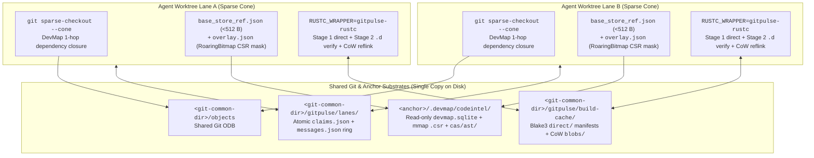
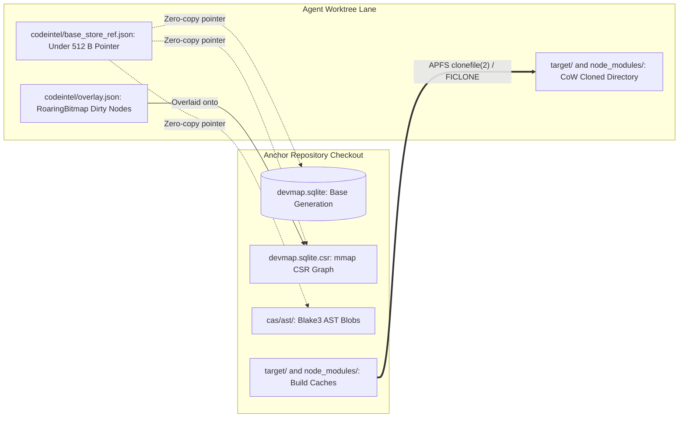
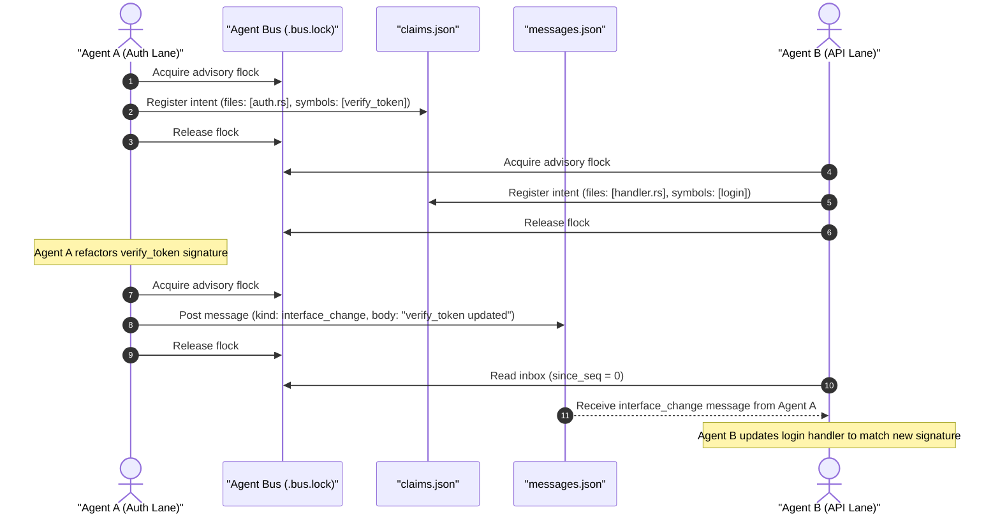
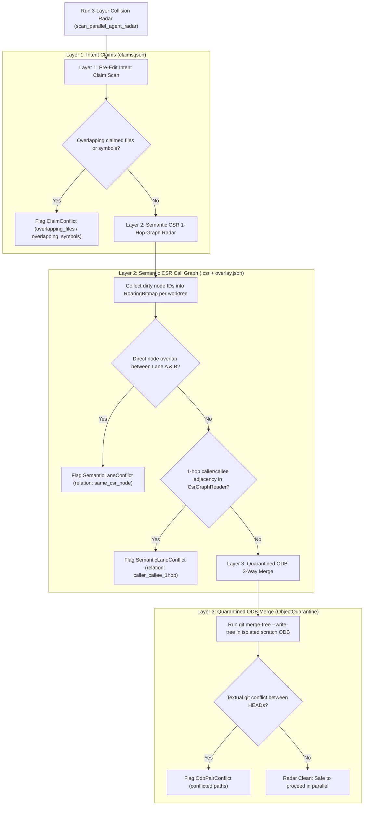

# Zero-Copy Agentic Worktrees, Parallel DevMap Overlays & Shared Build Caching

[Documentation index](README.md) · [Feature reference](FEATURES.md) · [Architecture](ARCHITECTURE.md)

This document records the systems research, failure-mode analysis, and architectural design behind GitPulse's zero-copy branching, sparse worktree provisioning, parallel DevMap delta overlays, content-addressed `gitpulse-rustc` build cache, and multi-agent coordination bus.

---

## 1. Industry & Open-Source Landscape

Running multiple autonomous coding agents in parallel against one repository stresses assumptions that traditional Git workflows never had to satisfy: humans rarely create ten checkouts in five seconds, compile all ten simultaneously, and edit interdependent call-graph neighbors without speaking to one another.

| System | Core Mechanism | Working-Tree Storage | Code-Graph / Index Strategy | Build Artifact Sharing | Agent Coordination | Trade-Off for Local-First Git |
| --- | --- | --- | --- | --- | --- | --- |
| **Anthropic Internal Scion** (*"Redesigning source control at Anthropic"*, Oct 2026) | Server-centric VCS (`scion-daemon` → `scion-cache` → `scion-server`) built to scale from ~2.5k to >30k merges/day across ~100 GB history and >25 GB trees | Virtual / sparse checkouts; server-side commits, rebases, and merges avoid shipping multi-GB packfiles to clients (>99% cache hit rate) | Server-hosted metadata + optimistic pre-deploy verification | Paired with remote build execution | Optimistic merge queues + server-side rebase | Requires dedicated `scion-server` + `scion-cache` fleet; not drop-in for arbitrary local Git remotes |
| **Google `GoogleCloudPlatform/scion`** (open-source) | Multi-agent orchestration testbed pairing **worktree-per-agent** with OCI container + `tmux` runtime isolation | Full `git worktree` per container | Per-worktree local state | Isolated container filesystems unless host cache mounted | Per-agent secret scoping + CLI messaging | Strong runtime sandboxing, but naive worktrees duplicate source trees, indexes, and cold `target/` builds |
| **Jujutsu (`jj`)** | Working-copy-as-a-commit + lock-free concurrent operation log (`op log`) + first-class conflict objects | Full working tree per `jj workspace add` | Git ODB shared; external code indexes remain per-workspace | None built-in | Conflict-tolerant rebasing after the fact | Eliminates `.git/index.lock` contention, but still materializes full trees and cold build directories |
| **Meta Sapling & EdenFS** | Scalable commit graph + FUSE / NFS / ProjFS virtualized filesystem | Lazy on-read file materialization | Server-backed commit & path indexes | Paired with Buck2 remote execution | Commit-stack workflows | Kernel/userspace virtual FS daemons require elevated entitlements, notarization exceptions, and remote backing servers |
| **GitButler Virtual Branches** | Multiple virtual lanes multiplexed inside a single working directory | Single working tree | Single shared index | Single `target/` directory | Disjoint hunk assignment in one tree | Breaks down when two parallel agents edit the same file or run incompatible build/test processes simultaneously |
| **Dagger `container-use` & Worktrunk** | Ephemeral container checkouts (`container-use`) or branch-addressed Git worktrees with CoW cache copy (`Worktrunk`) | Container layer or full Git worktree |Copied or rebuilt per lane | Whole-directory `target/` reflink when unlocked | Post-hoc merge / PR review | When an active build holds `.cargo-lock`, whole-directory `target/` cloning must skip the build directory |
| **`sccache` (`RUSTC_WRAPPER`)** | Content-addressed compiler wrapper hashing `rustc -vV`, flags, and pre-processed/source inputs | N/A (compiler layer) | N/A | Shared `.rlib` / `.rmeta` object cache across directories | N/A | Copies bytes into `--out-dir` rather than APFS/FICLONE CoW reflinking; external daemon setup required |
| **GitPulse Zero-Copy Engine** | Carried-churn branching + DevMap-guided `--cone` sparse checkouts + `<512 B` DevMap base pointers + Blake3/CAS AST overlays + `gitpulse-rustc` CoW cache + `<git-common-dir>` lane bus | Only transitive `--cone` directories materialized on disk | Shared anchor `devmap.sqlite` + mmap `.csr` + per-lane `overlay.json` & `RoaringBitmap` dirty CSR mask | Whole-`target/` CoW clone when idle **plus** lock-free per-crate `gitpulse-rustc` CoW cache when `.cargo-lock` is held | Pre-edit file/symbol claims + bounded message ring + 3-layer CSR/ODB collision radar | Zero server infrastructure, zero FUSE kernel extensions, 100% compatible with standard Git remotes |

---

## 2. Five Failure Modes of Naive `git worktree` Under Parallel Agents

1. **Working-Tree & Git-Index Multiplication**:
   `git worktree add` checks out every tracked file in `HEAD`. Ten parallel agents on a 50,000-file monorepo write 500,000 files and ten full `.git/worktrees/<id>/index` tables even when each agent touches two modules.
2. **Cold Code-Graph Rebuilds vs. SQLite Hardlink Corruption**:
   Copying `.devmap/codeintel/devmap.sqlite` per worktree wastes disk and I/O; hardlinking SQLite across worktrees (`nlink > 1`) corrupts WAL/SHM state the first time one lane writes; and reading the anchor SQLite directly without an overlay misreports `store_meta.repo_root` and misses uncommitted edits.
3. **`.cargo-lock` Contention & Cold Compiler Rebuilds**:
   Copy-on-Write (`clonefile(2)` / `FICLONE`) cloning of `target/` is fast when the anchor checkout is idle. As soon as one agent or developer holds `<target>/<profile>/.cargo-lock`, cloning an in-flight `target/` directory races half-written `.rmeta`/`.rlib` outputs, so safe CoW cloning must skip `target/` (`"anchor build in progress"`). Every subsequent agent then pays a full cold `cargo build`.
4. **Blind Concurrent Editing (Semantic & Textual Collisions)**:
   Standard worktrees share only committed Git objects. Agent A changing a function signature in `packages/shared/lib.rs` and Agent B adding a new call site in `packages/app/main.rs` produce zero Git merge conflicts yet break compilation upon integration.
5. **Redundant Post-Mutation Branch Churn Sweeps & Orphaned Processes**:
   Creating, renaming, or deleting a branch in a desktop client traditionally invalidates the branch list and triggers a fresh `git rev-list` / diffstat pass even when every surviving branch tip SHA was already measured; meanwhile, dev servers and test watchers spawned inside agent worktrees linger as orphan processes after `git worktree remove`.

---

## 3. GitPulse's Five-Pillar Zero-Copy Architecture



### Pillar 1: Zero-Round-Trip Branch Churn Carry-Forward
- **Owner**: [`../src/lib/stores/repoStore.ts`](../src/lib/stores/repoStore.ts) (`withCarriedChurn`, `hydrateFacet`, `fetchBranchStats`).
- **Mechanism**: Branch mutations (`createBranch`, `renameBranch`, `deleteBranch`) refresh only the `"branches"` facet rather than the full repository snapshot. `withCarriedChurn` matches each branch's commit tip SHA (plus upstream state) against previously verified branch records; a newly created branch pointing at `HEAD` or an existing base SHA immediately inherits verified `ahead`, `behind`, `insertions`, and `deletions` (`churnVerified = true`). When every eligible non-current branch is already verified against an unchanged default base, `fetchBranchStats` returns immediately without invoking `cmd_branch_stats`.

### Pillar 2: DevMap-Guided `--cone` Sparse Worktrees & Selective CoW Cache Sync
- **Owners**: [`../src-tauri/src/engine/worktree.rs`](../src-tauri/src/engine/worktree.rs) (`expand_sparse_cone_with_devmap`, `add_sparse_worktree_zero_copy`), [`../src-tauri/src/engine/cow_clone.rs`](../src-tauri/src/engine/cow_clone.rs) (`reflink_copy_file`, `clone_ignored_caches`), [`../src-tauri/src/commands/worktrees.rs`](../src-tauri/src/commands/worktrees.rs) (`cmd_add_worktree`), [`../src/lib/components/WorktreesPanel.svelte`](../src/lib/components/WorktreesPanel.svelte).
- **Mechanism**:
  1. Given an agent's target files or directories, `expand_sparse_cone_with_devmap` queries the anchor's DevMap `files` and `file_deps` tables for 1-hop inbound and outbound dependencies, producing a minimal directory closure.
  2. `add_sparse_worktree_zero_copy` runs `git worktree add --no-checkout`, enables `extensions.worktreeConfig`, configures `git sparse-checkout set --cone <dirs...>`, and checks out only root files plus the expanded cone directories.
  3. Ignored dependency caches (`node_modules`, `.venv`, nested package caches) are cloned selectively inside materialized cone directories using `clonefile(2)` on macOS APFS or `FICLONE` on Linux Btrfs/XFS, running in parallel (`std::thread::scope`) with zero-copy DevMap provisioning.

### Pillar 3: `<512 B` Zero-Copy DevMap Base Pointers & Blake3/CAS Delta Overlays
- **Owner**: [`worktree_overlay.rs`](file:///Users/bharath/Code/devtools/GitPulse/src-tauri/src/codeintel/worktree_overlay.rs#L1-L125) (`provision_worktree_devmap_zero_copy`, `sync_worktree_overlay`, `load_zero_copy_base_ref`, `load_worktree_overlay`).
- **Data Sharing Architecture Across Parallel Worktrees**:



- **Mechanism**:
  - Instead of copying `devmap.sqlite` into every worktree (which violates SQLite inode locks and `pending_state.repo_root` ownership), `provision_worktree_devmap_zero_copy` writes a `<512 B` atomic JSON pointer ([`ZeroCopyBaseRef`](file:///Users/bharath/Code/devtools/GitPulse/src-tauri/src/codeintel/worktree_overlay.rs#L64-L73) at `codeintel/base_store_ref.json`) referencing the anchor repository's read-only `devmap.sqlite`, mmap `.csr` edge index, and content-addressed `cas/ast/` store, pinned to `anchor_generation_id` and `anchor_head_sha`.
  - When an agent modifies, adds, or deletes files in its worktree, `sync_worktree_overlay` diffs the lane against `anchor_head_sha` (including untracked files), stores Blake3-addressed symbol AST blobs under `<anchor>/.devmap/codeintel/cas/ast/<2-hex>/<blake3>.ast`, computes a `RoaringBitmap` of invalidated CSR node IDs (`dirty_nodes`), and atomically writes `overlay.json`. Unchanged files consume zero per-worktree graph storage.
  - Dependency build caches are cloned using filesystem Copy-on-Write ([`cow_clone.rs`](file:///Users/bharath/Code/devtools/GitPulse/src-tauri/src/engine/cow_clone.rs#L1-L60)), sharing physical disk blocks across worktrees with bounds enforced by `CowCaps` (`MAX_COW_DEPTH = 64`, `MAX_COW_ENTRIES = 1,000,000`, `MAX_COW_BYTES = 8 GiB`).
  - **Limit (measured 2026-11-06, [§7](#7-measured-what-a-new-agent-lane-gets-from-devmap)):** the pointer is read only by GitPulse's in-process readers. The `devmap` binary that agents query (CLI and `devmap mcp`) does not read `base_store_ref.json`: in a pointer-only lane `devmap status` answers `query_ready: false`, and DevMap's SessionStart hook starts a cold `devmap build` there, which lands a full ~289 MB store beside the pointer. For agent lanes, the CoW-cloned store (`provision_worktree_devmap`, `DevmapMode::Copy`) is the seamless mode.
  - Active agent processes (Claude Code, Codex, Antigravity) are tracked via host load process scanning ([`live_sessions.rs`](file:///Users/bharath/Code/devtools/GitPulse/src-tauri/src/insights/live_sessions.rs#L1-L50)), and overlapping file edits are classified by joining uncommitted diff intervals against DevMap symbol spans ([`entity_collision.rs`](file:///Users/bharath/Code/devtools/GitPulse/src-tauri/src/insights/entity_collision.rs#L1-L40)).

### Pillar 4: Two-Stage Zero-Copy Compiler Wrapper (`gitpulse-rustc` & `gitpulse-worktree build`)
- **Owners**: [`../crates/gitpulse-worktree/src/build_cache.rs`](../crates/gitpulse-worktree/src/build_cache.rs), [`../crates/gitpulse-worktree/src/bin/gitpulse-rustc.rs`](../crates/gitpulse-worktree/src/bin/gitpulse-rustc.rs), [`../crates/gitpulse-worktree/src/main.rs`](../crates/gitpulse-worktree/src/main.rs).
- **Problem Solved**: Shares compiled `.rlib`, `.rmeta`, `.dylib`, `.so`, and `.dll` crate outputs across sibling worktrees with zero lock contention even when an active anchor build holds `<target>/<profile>/.cargo-lock` and `target/` could not be CoW-cloned.
- **Two-Stage Soundness Protocol**:
  1. **Stage 1 (Direct Key)**: Expands bounded `@<rspfile>` response files, hashes compiler toolchain identity (`rustc -vV` cached in `compilers.json` by canonical binary path, byte size, and mtime nanoseconds), normalized `rustc` flags (stripping worktree-local `--out-dir`, `-L`, and canonical/symlinked source prefixes while preserving `-C metadata` and `-C extra-filename` so `StableCrateId` and symbol mangling remain sound), sorted `CARGO_PKG_*` / `CARGO_CFG_*` / `CARGO_FEATURE_*` / `RUSTFLAGS` environment variables, the entry `.rs` file's Blake3 digest, and sorted `--extern` crate artifact Blake3 digests. Library, `rlib`, `proc-macro`, `dylib`, `cdylib`, and `staticlib` crates are cached; compiler probes (`-vV`, `--print`), `build_script_build` / binary / `--test` targets, and `-C incremental` invocations pass straight through to `rustc`.
  2. **Stage 2 (`.d` Dep-Info & `# env-dep:` Verification)**: On a Stage 1 match, `verify_stage2_manifest` re-hashes every file dependency recorded in `rustc`'s emitted `.d` dep-info across `$OUT_DIR` (`CargoBuildOutRel`), worktree-relative (`WorktreeRel`), and external (`ExternalAbs`) scopes — catching submodule edits, `include_str!`, `include_bytes!`, and build-script generated files — and verifies every `# env-dep:KEY=VAL` environment dependency read by `env!` / `option_env!` (allowing cross-worktree reuse when `OUT_DIR` is used exclusively inside compile-time `include*!(concat!(env!("OUT_DIR"), ...))` macros whose target files are Blake3-verified in `deps`, while invalidating runtime `env!("OUT_DIR")` embeddings). Any mismatch increments `stage2_invalidations` and falls through to a fresh `rustc` compile.
  3. **Zero-Copy Materialization & Pipelined Stderr Rewriting**: Verified hits clone cached artifacts from `<git-common-dir>/gitpulse/build-cache/blobs/<2-hex>/<blake3>` into a process-unique sibling path via `reflink_copy_file` (`clonefile` / `FICLONE`) and atomically `rename(2)` into Cargo's `--out-dir`. Both the emitted `.d` dep-info file and `rustc`'s JSON `"$message_type": "artifact"` lines on stderr are path-rewritten across canonical and symlinked checkout paths so Cargo's pipelined compilation remains coherent.

### Pillar 5: Multi-Agent Coordination Bus & 3-Layer Collision Radar (CLI + MCP)
- **Owners**: [`agent_bus.rs`](file:///Users/bharath/Code/devtools/GitPulse/src-tauri/src/engine/agent_bus.rs#L1-L142), [`mod.rs`](file:///Users/bharath/Code/devtools/GitPulse/src-tauri/src/mcp/mod.rs), [`main.rs`](file:///Users/bharath/Code/devtools/GitPulse/crates/gitpulse-worktree/src/main.rs#L1-L135).
- **Decoupled Common State**: Coordination state lives exclusively under `<git-common-dir>/gitpulse/lanes/` and never inside working trees or Git references, ensuring parallel agent actions do not taint working directories or Git status.
- **Concurrency & File Locking Model**:
  - Inter-process synchronization uses advisory `libc::flock` on `.bus.lock` with exponential backoff (1–25 ms) and a 10-second timeout (`BUS_LOCK_TIMEOUT`).
  - Thread-level access within a single process is serialized via cached `Arc<Mutex<()>>` locks per common directory.
  - Updates are written atomically via temporary staging files and atomic file renames.



- **Pre-Edit Intent Claim Registry (`claims.json`)**:
  - Tracks active agent lanes via [`AgentLaneClaim`](file:///Users/bharath/Code/devtools/GitPulse/src-tauri/src/engine/agent_bus.rs#L46-L56) (`agent_id`, `branch`, `worktree_path`, `sparse_cone`, `claimed_files`, `claimed_symbols`, and `updated_at_ms`).
  - Bounded to `MAX_ACTIVE_LANES = 64` lanes and `MAX_CLAIMED_ITEMS = 128` files/symbols per lane.
  - Lanes are registered via `register_or_update_lane` (CLI `gitpulse-worktree claim`) and released via `release_lane` or during worktree merge/prune teardown so lane slots never leak.
- **Monotonic Coordination Message Ring (`messages.json`)**:
  - Implements a bounded ring buffer via [`AgentBusMessage`](file:///Users/bharath/Code/devtools/GitPulse/src-tauri/src/engine/agent_bus.rs#L63-L80) (`seq`, `from_agent`, `to_agent`, `kind`, `body`, `branch`, `created_at_ms`).
  - Capped at `MAX_BUS_MESSAGES = 256` messages with a maximum body length of `MAX_MESSAGE_BODY_BYTES = 16 KiB`.
  - Supports targeted point-to-point delivery as well as broadcast messages (`to_agent: None`). Agents poll via cursor pagination (`since_seq`), receiving an [`AgentInboxPage`](file:///Users/bharath/Code/devtools/GitPulse/src-tauri/src/engine/agent_bus.rs#L82-L89) with `latest_seq` and `dropped_before_seq`.
- **Three-Layer Collision Radar (`scan_parallel_agent_radar`)**:



  - **Layer 1 — Pre-Edit Intent Claims**: Scans `claims.json` for path-prefix overlaps and shared symbol names before edits occur ([`compute_claim_conflicts`](file:///Users/bharath/Code/devtools/GitPulse/src-tauri/src/engine/agent_bus.rs#L600-L636)).
  - **Layer 2 — 1-Hop CSR Semantic Call-Graph Collisions**: Loads `RoaringBitmap` dirty node sets from each worktree's `overlay.json` and evaluates them against the zero-copy mmap [`CsrGraphReader`](file:///Users/bharath/Code/devtools/DevCouncil/rust/devmap-store/src/csr/graph.rs#L126-L140) ([`compute_semantic_conflicts`](file:///Users/bharath/Code/devtools/GitPulse/src-tauri/src/engine/agent_bus.rs#L638-L693)). Flags both direct symbol mutations (`same_csr_node`) and caller/callee cross-file editing hazards (`caller_callee_1hop`).
  - **Layer 3 — ODB-Quarantined Pairwise Merge-Tree**: Runs non-destructive `git merge-tree --write-tree` in an isolated scratch object quarantine directory across active worktree branches to detect committed textual merge conflicts before merging.

---

## 4. CLI & MCP Reference

### Standalone Binaries (`crates/gitpulse-worktree`)

```bash
# 1. Create a DevMap-guided sparse worktree with a <512B zero-copy DevMap pointer and register an agent lane
gitpulse-worktree create \
  --repo /path/to/repo \
  --branch agent/auth-refactor \
  --sparse packages/auth \
  --zero-copy \
  --agent claude-auth \
  --json

# 2. Compile uncommitted changes into overlay.json + Blake3 CAS ASTs + RoaringBitmap CSR mask
gitpulse-worktree compile-overlay --worktree /path/to/worktree --json

# 3. Coordinate intent, handoffs, and 3-layer collision radar across parallel agents
gitpulse-worktree claim --repo /path/to/repo --agent claude-auth --branch agent/auth-refactor \
  --files packages/auth/lib.rs --symbols verify_token --json
gitpulse-worktree msg-send --repo /path/to/repo --from claude-auth --kind interface_change \
  --body "Updated verify_token signature in packages/auth/lib.rs" --json
gitpulse-worktree msg-inbox --repo /path/to/repo --agent claude-api --since-seq 0 --json
gitpulse-worktree radar --repo /path/to/repo --json

# 4. Build in any worktree using zero-copy content-addressed gitpulse-rustc caching
gitpulse-worktree build --repo /path/to/repo --worktree /path/to/worktree --json -- build --workspace

# 5. Inspect or prune <git-common-dir>/gitpulse/build-cache
gitpulse-worktree cache-stats --repo /path/to/repo --prune --max-bytes 2147483648 --json
```

`gitpulse-rustc` can also wrap standard `cargo` directly in any Git worktree:

```bash
CARGO_INCREMENTAL=0 RUSTC_WRAPPER=gitpulse-rustc cargo check --workspace
```

| `gitpulse-worktree` Subcommand | Purpose | Key Flags |
| --- | --- | --- |
| `create` | Create a full, `--zero-copy`, or DevMap-expanded `--sparse` `--cone` worktree and optionally register an agent lane | `--repo`, `--branch`, `--base`, `--target`, `--sparse <p1,p2>`, `--zero-copy`, `--no-cache`, `--exec <cmd>`, `--agent <id>` |
| `switch` | Resolve an existing worktree path for a branch, or create one on demand | `--repo`, `--branch`, `--create`, `--base` |
| `isolate` | Provision CoW dependency caches and zero-copy or CoW DevMap state into an existing worktree | `--repo`, `--worktree`, `--zero-copy`, `--include-venv` |
| `compile-overlay` | Diff a worktree against `anchor_head_sha` and emit `overlay.json`, Blake3 CAS ASTs, and `RoaringBitmap` CSR dirty nodes | `--worktree` |
| `expand-cone` | Expand repo-relative file or directory paths across 1-hop DevMap `file_deps` into `--cone` directories | `--repo`, `--paths <p1,p2>` |
| `status` | Report linked worktrees, zero-copy vs local DevMap state, active `overlay.json` counts, and registered agent lanes | `--repo` |
| `claim` | Atomically register or update an agent lane's file and symbol intent claims and return immediate overlaps | `--repo`, `--agent`, `--branch`, `--worktree`, `--sparse`, `--files`, `--symbols` |
| `release` | Remove a completed agent lane's active claim record from `claims.json` | `--repo`, `--agent` |
| `msg-send` | Append a direct or broadcast coordination message (up to 16 KiB) to `messages.json` | `--repo`, `--from`, `--to`, `--kind`, `--body`, `--branch` |
| `msg-inbox` | Read direct and broadcast messages with `seq > since_seq` | `--repo`, `--agent`, `--since-seq` |
| `radar` | Run the read-only 3-layer collision radar (intent claims + 1-hop CSR call-graph + quarantined `git merge-tree`) | `--repo` |
| `verify` | Run the 6-point branch integration check (ancestry, patch-id, ODB tree equality, squash-diff emptiness, remote tracking, working-tree cleanliness) | `--repo`, `--branch`, `--target` |
| `merge` | Execute ODB-quarantined squash or non-squash merge, CAS `update-ref`, optional clean `--ff-only`, and worktree teardown | `--repo`, `--source`, `--target`, `--no-squash`, `--message`, `--keep-worktree` |
| `prune` | Reap orphan processes inside worktree roots and remove clean, 6-point-integrated worktrees | `--repo`, `--branch`, `--dry-run`, `--force`, `--no-reap` |
| `build` | Invoke `cargo` inside a worktree with `RUSTC_WRAPPER=gitpulse-rustc` wired to `<git-common-dir>/gitpulse/build-cache` | `--repo`, `--worktree`, `--rustc-wrapper`, `-- <cargo args...>` |
| `cache-stats` | Measure `<git-common-dir>/gitpulse/build-cache` hits/misses/bytes and optionally evict oldest blobs down to a byte budget | `--repo`, `--prune`, `--max-bytes` |

### MCP Tools (`gitpulse-mcp`)

| Tool | Role | Safety & Gate Contract |
| --- | --- | --- |
| `gitpulse_worktree_create` | Create full, `--zero-copy`, or DevMap-expanded sparse worktrees | Repository trust + harness gate |
| `gitpulse_worktree_switch` | Locate an existing branch worktree (or create when requested) | Repository trust + harness gate on create |
| `gitpulse_worktree_isolate` | Provision CoW caches and DevMap state into an existing worktree | Repository trust + harness gate |
| `gitpulse_worktree_overlay_sync` | Compile dirty/untracked files into `overlay.json` + CAS ASTs + CSR dirty bitmap | Repository trust + canonical containment |
| `gitpulse_worktree_claim` | Atomically register/update file & symbol intent claims and return immediate conflicts | Repository trust + `.bus.lock` serialization |
| `gitpulse_worktree_release` | Release an agent lane's active claim record on completion | Repository trust + `.bus.lock` serialization |
| `gitpulse_worktree_send_message` | Post direct or broadcast coordination messages to `messages.json` | Repository trust + 16 KiB payload cap |
| `gitpulse_worktree_inbox` | Read direct + broadcast coordination messages since `since_seq` | Read-only (`readOnlyHint: true`) |
| `gitpulse_worktree_radar` | Run 3-layer collision radar (claims + 1-hop CSR call-graph + ODB merge-tree) | Read-only (`readOnlyHint: true`), capped within 64 KiB MCP wire budget |
| `gitpulse_worktree_merge` | ODB-quarantined squash or merge-commit integration + worktree teardown | Repository trust + harness gate (`destructiveHint: true`) |
| `gitpulse_worktree_prune` | Prune 6-point-integrated worktrees; skips (with a reason) any with a live process inside unless `reap_processes: true` opts in to reaping; per-worktree `outcomes` | Repository trust + harness gate (`destructiveHint: true`) |

---

## 5. Desktop UI & Frontend Store Integration

- **Worktrees Panel (`WorktreesPanel.svelte`)**: Exposes checkboxes for **Copy-on-Write dependency caches** (`node_modules`, `target`) and **Seed DevMap index** (`seedDevmap`, on by default: a CoW-cloned store, then built for the worktree, §7), with the **Zero-copy DevMap pointer** opt-in (`zeroCopyDevmap`, off by default; only GitPulse reads it), plus a **Sparse cone paths** field that passes repo-relative directories or files to `cmd_add_worktree` (`add_worktree_configured`). When `sparsePaths` are supplied, the backend runs `add_sparse_worktree_zero_copy` and returns the DevMap-expanded cone alongside CoW cache and `.gitpulse/hooks.toml` execution reports.
- **Map & Health Status Honesty (`OpenedRepoStore::ZeroCopy`)**: In-process DevMap readers (`src-tauri/src/codeintel/store.rs`) recognize `base_store_ref.json` when a linked worktree has no local `devmap.sqlite`, verify that the worktree and anchor share the exact canonical `<git-common-dir>` (`evaluate_zero_copy_status`), and open the anchor's read-only SQLite snapshot without copying it while preserving explicit `stale` freshness reasons whenever `HEAD`, `overlay.json`, or dirty files diverge from `anchor_head_sha`.
- **Single-Facet Branch Refresh (`repoStore.ts`)**: `createBranch`, `renameBranch`, and `deleteBranch` call `hydrateFacet(path, "branches")` rather than reloading unrelated status, commit-graph, or stash facets. `withCarriedChurn` carries verified `ahead`/`behind`/`insertions`/`deletions` across matching commit tips (including unshadowed remote-tracking tips), and `sessionBook.statsDrained` short-circuits progressive `fetchBranchStats` sweeps once all eligible branches are verified against the current default base.

---

## 6. Security, Concurrency & Fail-Closed Boundaries

- **Cross-Repo Pointer Verification**: Both `load_zero_copy_base_ref` and `OpenedRepoStore::open` verify via `resolve_git_common_dir` that `anchor_repo_root` belongs to the same Git repository family as the linked worktree and contains no `..` traversal components; crafted `base_store_ref.json` files pointing at unrelated repositories or arbitrary SQLite files are refused.
- **Managed Task-Lane Directory Reservation**: `refuse_gitpulse_lane_target` rejects manual, CLI, and MCP worktree targets inside `<repo>/.gitpulse/worktrees/` so user or external agent checkouts cannot collide with GitPulse's managed task-attempt lanes.
- **Path-Traversal & Payload Bounds on the Agent Bus**: `sanitize_claim_paths` rejects absolute paths, `..` segments, and NUL bytes. Advisory `flock(2)` on `<git-common-dir>/gitpulse/lanes/.bus.lock` serializes concurrent readers and writers across processes, enforcing hard caps of 64 active lanes, 128 claimed files/symbols per lane, 256 retained messages, 16 KiB per message body, and a 64 KiB MCP wire ceiling on `gitpulse_worktree_radar` (which sets `truncated: true` rather than exceeding the frame limit).
- **Bounded Compiler Wrapper Inputs & Sound `OUT_DIR` Reuse**: `gitpulse-rustc` refuses `@<rspfile>` response files larger than 8 MiB or nested deeper than four levels, skips caching whenever `-C incremental` or `build_script_build` is active, and strips comments and string literals (`has_compile_only_out_dir_tokens`) before exempting `# env-dep:OUT_DIR` so crates embedding `env!("OUT_DIR")` at runtime never reuse another worktree's path.

---

## 7. Measured: What a New Agent Lane Gets from DevMap

Measured 2026-11-06 on this repository (main at `5394f4d3`, 3,193 indexed files, 55k symbols), `devmap` 0.2.5, macOS on APFS. The scratch tree was a `git clone --shared` placed on a dedicated 40 GB APFS sparse image, so every disk number below is an exact `df` free-space delta on a volume nothing else wrote to. `du` would report a clone's full logical size and was not used. Graph parity is the SHA-256 of `code_graph.json` after `jq -S` normalization with the lane path replaced.

**What the managed lanes actually held.** Each of the six task lanes under `.gitpulse/worktrees/` carried its own 289–308 MB `devmap.sqlite` at generation 1, with `repo_root` set to the lane, plus a 71 MB `code_graph.json`. The main checkout's store was at generation 4,624. Each lane store was therefore a cold full build, about 2 GB of duplicated index across the lanes. Cause: `workbench::agent_worktree` created lanes through `add_worktree_cached`, which asks for `DevmapMode::None`. DevMap's SessionStart hook (`unindexed_worktree_notice` in DevCouncil `devmap-cli/src/hook.rs`) answers a linked worktree with no store, when its main checkout is indexed, by starting a cold `devmap build` in the background. Until that build lands, every `devmap_*` query in the lane answers "nothing".

| Arm (n) | Time to a queryable store | CPU | Disk written | Graph |
| --- | --- | --- | --- | --- |
| Cold `devmap build --manifest` (3) | 7.56 / 7.61 / 7.79 s | ~38.7 CPU-s | 366 MB per lane | `ba04666f…` |
| Bare CoW clone: `clonefile` store + manifests, rebind `repo_root` in shell (3) | 0.077 / 0.079 / 0.098 s (`query_ready: true`) | — | 3.9–16.5 MB | — |
| …then incremental `devmap build --manifest` (3) | +2.41 / 2.41 / 2.77 s | — | +0.4 MB | `ba04666f…` (identical) |
| **GitPulse's `provision_worktree_devmap`** (the seed lanes now get; debug build, separate run on a rebuilt anchor) (3) | 1.13 / 1.14 / 1.19 s (`is_cow: true`, `query_ready: true`, `is_fresh: true`). The second over the bare clone is the seeder's own work, most likely building the CSR sidecar the anchor lacks (not profiled) | — | 7.3–19.8 MB | — |
| …then incremental `devmap build --manifest` (3) | +2.47 / 2.49 / 2.56 s | — | +0.4 MB | identical to a cold lane with `generation_id` masked (`5ae26d36…`) |
| Zero-copy pointer only (1) | never: `query_ready: false`, and the hook cold-builds a 289 MB store beside the pointer | as cold | as cold | — |
| 8 lanes at once, cold (1 run of 8) | 40.7–41.5 s each, 41.6 s wall | 8 × cold | 2.93 GB | 8/8 `ba04666f…` |
| 8 lanes at once, bare clone + incremental (1 run of 8) | 8.3–8.8 s each, 9.3 s wall | — | 69 MB | 8/8 identical to cold except `generation_id` |

**Break tests:**
- **Stale or dirty anchor.** The anchor was given an uncommitted edit and rebuilt, then a clean lane was seeded from it. `devmap status` in the lane answered honestly: `is_fresh: false`, `source_freshness: false`. One incremental build (6.2 s) produced a graph that differs from a cold lane's only in `generation_id`. Seeding from a store that describes a different working state never presented itself as fresh. (The check that the dirty symbol was in the anchor's dirty generation used the wrong JSON filter, so that half of the test is inconclusive. The convergence and the stale verdict are measured.)
- **Anchor with a live WAL.** A writer kept 6.6 MB of uncheckpointed frames in the anchor's `-wal` while copying:
  - `VACUUM INTO`, today's fallback in `provision_worktree_devmap`: 0.58 s and 284 MB written, consistent.
  - Cloning the db file alone: lost a committed table (`no such table`), which matches SQLite's documented hazard.
  - Read-transaction-pinned clone (`BEGIN; SELECT …;` then `clonefile` the db, then `clonefile` the `-wal`, then `COMMIT`): 0.023 s, about 0 bytes, `quick_check` ok, and at least as many rows as the pinned reader saw.
  - That pinned clone is sound by SQLite's mechanics, not by documented guarantee: a reader's read mark stops a checkpoint past it, and the WAL cannot be reset while the reader holds it. The order matters (db first, then wal).
  - **Stress:** 25 pinned clones of a 289 MB store, taken while a separate writer process committed continuously with `wal_autocheckpoint=50` so that checkpoints wrote into the db file during the clone. Result: 25/25 passed `PRAGMA integrity_check` and held at least the rows the pinned reader saw. Clone time was min 0.011 s, median 0.078 s, max 0.127 s.
  - The negative control was weak in that run: a db-only clone also passed 25/25 at that checkpoint rate. It lost data only in the run above, where the writer kept frames uncheckpointed. Treat this as evidence, not proof. Shipping it needs `quick_check` on every clone, with a fallback.
- **Concurrency.** Eight cold builds in parallel took 5.3× longer each than one alone (41 s vs 7.7 s) on 18 cores. Eight seeded lanes stayed at about 8.5 s each, because the incremental build only re-checks. The cold path is what makes a wave of parallel agents slow and disk-hungry, not git.

- **A seed alone leaves the lane stale (found while reviewing the fix).** The anchor got a new commit and its store was not rebuilt, as on this machine, where main's store was built at `7b200385` while HEAD was `5394f4d3`. A lane seeded from it answered `is_fresh: false`, `rebuild_required: false`. DevMap's SessionStart hook then reported "ready (source moved)" and started nothing, because it builds only where no store exists. Twenty seconds later the lane was still stale, and the new symbol on the lane's HEAD was absent from its index. Before the fix, the cold build gave a correct index in about 8 s. A seed on its own would have traded that for an instant but stale index.

**Fix (this change):** `workbench::agent_worktree::provision_with`, the only creator of managed agent lanes, now does two things:
1. It creates lanes through `add_worktree_with_devmap(…, DevmapMode::Copy)`. The store is cloned and rebound before the agent starts, so the hook finds a store and starts no cold build.
2. Once the lane's setup has completed, it asks GitPulse's own live refresh for the lane (`devmap::live::start_refresh(lane, false)`). This is the same gate every open repository gets: it probes `devmap status`, builds only when the store is not fresh, runs the incremental build on a supervised background thread under the lane's writer slot, and returns without waiting.

The lane is therefore queryable at once, and is honestly marked stale until its own build lands, about 2.5 s later on this repository. Like the build caches, a skipped or failed seed is logged and never refuses the lane, because DevMap's hook still covers it. `a_lane_cut_from_an_indexed_checkout_gets_its_own_seeded_devmap_store` fails against the previous code. `a_seeded_lane_whose_index_is_not_fresh_gets_its_own_build_started` fails with the refresh removed: a stub `devmap` reporting `is_fresh: false` must see a `build` run in the lane. **Not measured:** the seed's cost when the anchor's store trails HEAD by many commits (a larger overlay diff), and when the anchor's `-wal` is live, which takes the `VACUUM INTO` path (284 MB written, above). The 1.2 s figure is for a clean anchor at the same HEAD. The general `add_worktree_cached` API stays opt-in, so `a_worktree_created_without_asking_seeds_no_devmap_store_and_says_so` still holds.

**Every GitPulse seeding path, one owner.** `devmap::live::refresh_seeded_worktree` is the single "seed, then bring it to this tree" step. Every path that CoW-seeds a store calls it, and none runs a build of its own:

| Path | Seeds | Then |
| --- | --- | --- |
| Task lanes (`workbench::agent_worktree`) | always | background refresh after setup |
| Worktrees panel (`cmd_add_worktree`) | by default: new `seedDevmap`, on. The pointer is now opt-in (`zeroCopyDevmap`, off) | background refresh |
| MCP `gitpulse_worktree_create` / `switch` / `isolate` | unless `zero_copy` | background refresh (long-lived server) |
| CLI `gitpulse-worktree create` / `switch --create` / `isolate` | unless `--zero-copy`. `create` used to seed only with `--no-cache`, so the default `--share-cache` left every such worktree unseeded | inline refresh, because the process exits on return |

A pointer-only worktree is never refreshed, since that would be the cold build the seed exists to avoid. Tests:
- `seed_devmap_clones_the_store_and_starts_the_worktrees_own_build` (panel command);
- `isolate_seeds_the_store_and_starts_the_worktrees_own_build` and `isolate_with_the_zero_copy_pointer_starts_no_build` (MCP);
- `cli_create_seeds_the_worktree_store_and_builds_it_in_place` (CLI).

The lane, MCP and CLI tests each failed with the change removed. The CLI test failed on `devmap_seeded:false` with `cache_shared:true`. Not covered by a test: MCP `gitpulse_worktree_create` and `switch`, because the tool places the worktree beside the repository, outside a test sandbox. They take the same `DevmapOutcome::Provisioned { zero_copy: false }` branch. The schema-conformance test that calls them builds no DevMap store, so it seeds nothing and never reaches `devmap`.

**Fixed (`b53767c9`): background refresh outcomes of removed worktrees.** A `Background` refresh parks its outcome in `devmap::live`'s `finished_builds` map until the next live-refresh ask for that path, and the map was unbounded. A long-lived app or `gitpulse-mcp` kept one stdout-capped outcome per seeded worktree that was never asked about again.
- **The rule now:** a park first drops outcomes for paths that no longer exist, then, at the cap of 64, any one other.
- **Why dropping is safe:** an ask that finds nothing parked probes `devmap status`, as for any repository.
- **Tests:** they run the rule on a local map, so they never evict other tests' outcomes. Each half failed when mutated away, and the prune test repeats over ten fresh maps so arbitrary eviction can't pass it by luck.

**Owned elsewhere or deferred, named:**
1. **DevCouncil hook (owner: DevCouncil).** Worktrees made outside GitPulse (Claude Code `.claude/worktrees/`, Codex, Cursor, Conductor) still get a cold build. The fix belongs in `devmap`:
   - `devmap build --seed-from <main checkout>` clones the main store when the target store is missing, rebinds `pending_state.repo_root` and `generations.repo_root`, then continues as an incremental build;
   - `unindexed_worktree_notice` passes `--seed-from` in `detach_build` when the main checkout is indexed.
   
   It lands as a DevCouncil branch, then a `devmap` reinstall and `bun run check:schema-parity`. It changes no schema. Once it lands, GitPulse's seed and that hook agree, and the pointer is redundant for agents.

   **Built, not landed:** DevCouncil branch `feat/devmap-seed-from` (`d1ca9808`, on the integration branch's head `e5f87197`; 8 files, +895/−10, no dependency change).
   - **Tests:** the 3 seed integration tests and the 3 hook tests pass when re-run here. The seed tests cover graph equality with a cold build, refusal of unrelated, sibling and forged sources, and a live-WAL source read through SQLite.
   - **Measured** (release build, GitPulse clone, n=3): a clean seeded worktree in 0.27 / 0.28 / 0.38 s with 16–33 MB physical, against 5.98 / 6.07 / 8.55 s and ~700 MB cold.
   - **Clippy:** the repository's clippy gate was already red on `e5f87197`, in files the branch does not touch, so there is no clean clippy proof for the new files.
   - **Linux:** checked in a `rust:1.99.0` container (aarch64, overlay filesystem). `devmap-store` and `devmap-cli` compile for all targets, including the `FICLONE` path. The 3 seed tests pass; overlay has no reflink, so this ran the plain-copy fallback. The 3 new hook tests pass. The one failure, `an_unremovable_stale_lock_terminates`, is pre-existing: it cannot build its condition as root ("running as root?").
   - **Unexplained, not yet trusted:** the agent reported ~440–510 MB `df` growth after a 20-file incremental build in a seeded worktree. That was a different run from the page-level measurement below: its own binary and seed path, measured by `df` on a shared volume. The two are not yet reconciled. One candidate is that its seed took the `VACUUM INTO` fallback, which happens whenever the source's `-wal` is non-empty and is a full ~290 MB rewrite. Re-measure its binary on a dedicated APFS image before relying on that number.

**How much sharing survives the first real build (measured).** A lane was CoW-seeded on GitPulse's path, 20 Rust files in it were edited, and `devmap build --manifest` ran (6.6 s).
- **The store is written in place:** its inode is unchanged, so APFS keeps every block nobody wrote shared.
- **What diverged:** a 16 KiB-page comparison against the seed found 1,838 changed or new pages, 28.7 MiB, which is 10% of the store. Of that, 16.8 MiB is one index (`idx_payload_literals_value`), and the rest is mostly `generations`, `generation_dead_symbols` and the payload rows of the edited files. The `repo_root` rebind alone touches 4 MiB (`generations`).
- **The largest unshared cost is outside the store:** `code_graph.json` (71 MB) and `repo_map.json` (0.9 MB) are rewritten whole on every manifest build.

So a seeded lane costs about 100 MB once it diverges, not the full 366 MB of a cold build, and 70% of that is the JSON export.
2. **Pinned live-WAL clone instead of `VACUUM INTO`: measured, deferred.** A clone is a new file, so its `PRAGMA quick_check` is a cold read: 2.18 s on the 363 MB store (0.26–0.27 s warm, n=3). The pinned clone plus its check therefore costs about 2.3 s, against 0.58 s for `VACUUM INTO`, and saves only the 284 MB write. Shipping it unchecked would rest on a 25-run stress result whose negative control also passed. The path is also rare: devmap checkpoints on close, so main's `-wal` is non-empty only mid-build. `VACUUM INTO` stays.

## 8. Research Notes: Where Others Spend the Bytes (2026-11-06)

Gathered by four research agents from primary sources. Each claim below was checked against its cited page. The agents' recalled-only claims were left out.

- **Agent hosts duplicate everything ignored.**
  - Claude Code puts worktrees in `.claude/worktrees/<name>`. It copies only gitignored files listed in `.worktreeinclude`. Its `WorktreeCreate` hook *replaces* git creation and receives `name` plus `cwd` ([docs](https://code.claude.com/docs/en/hooks.md)).
  - Codex keeps the 15 most recent worktrees under `$CODEX_HOME/worktrees` ([docs](https://learn.chatgpt.com/docs/environments/git-worktrees)).
  - Cursor runs `.cursor/worktrees.json` setup commands with `ROOT_WORKTREE_PATH` and caps at 25 worktrees ([docs](https://cursor.com/docs/configuration/worktrees)).
  - Reported costs: 13.8 GB across 13 Claude Code worktrees ([anthropics/claude-code#26725](https://github.com/anthropics/claude-code/issues/26725), open since 2026-02-18), and about 140 GB in a week of Cursor worktrees ([forum, 2025-12-13](https://forum.cursor.com/t/146189)).
  - None of these hosts seeds a code index. A post-creation setup script or `SessionStart` is where one could. That is why the seed belongs in `devmap` itself (§7 item 1).
- **Per-file reflink, not directory clone.** Worktrunk moved macOS from whole-directory `clonefile()` to per-file reflink after directory cloning saturated disk I/O ([changelog](https://docs.rs/crate/worktrunk/0.14.2/source/CHANGELOG.md)). The `clonefile(2)` man page itself discourages cloning directories. Clone writes can fail with `ENOSPC` because space is not reserved, so a seeded lane is not a disk reservation.
- **Cargo.**
  - `build.build-dir` has been stable since Cargo 1.91 (2025-10-30), with `{workspace-path-hash}` templates. It lets every lane's intermediates live under one deletable root outside the repository.
  - Cargo still has no shared artifact cache: rust-lang/cargo#5931 and #17453 are open, and the latter is a content-addressed store that reflinks build units.
  - Fine-grained `build-dir` locking landed in 2025–26. Plain `cargo build`s sharing one target still serialize.
  - Sharing one `CARGO_TARGET_DIR` across live lanes risks a false "Fresh" verdict on path crates. That risk is a third-party report and was not reproduced here. Don't share a target between live lanes.
- **sccache.** v0.19.0 (2026-10-24) still copies on a hit; reflink PR #2640 was closed unmerged. `SCCACHE_BASEDIRS` normalizes worktree roots. This matches Pillar 4's premise for `gitpulse-rustc`, which reflinks.
- **JS and Python already clone.** bun's install backend is `clonefile` on macOS, from one global cache. uv's `link-mode` defaults to `clone`. pnpm's `auto` mode tries clone first. Per-lane `node_modules` is near-free on APFS, so `target/` and the DevMap store were the remaining multipliers.
- **Code-index prior art.**
  - Glean stacks an immutable base DB under per-change overlays that hide changed units ([2022-12-01](https://glean.software/blog/incremental)).
  - Sourcegraph serves an unindexed commit from the nearest indexed ancestor, then adjusts for the line diff.
  - Bazel's action cache keys output by input hash, shared across workspaces.
  - SQLite documents the backup API, `VACUUM INTO` and a quiescent file copy *with its `-wal`* as safe. It names a db-only copy during a transaction, and hard links, as corruption risks ([howtocorrupt](https://sqlite.org/howtocorrupt.html)).

### Solutions Matrix: How Each Option Handles a New Agent Worktree

Each option is judged on the five things a new agent worktree needs:
- **Create:** how long until the agent can work.
- **Isolate:** whether one worktree's writes can reach another's.
- **Lazy:** what is copied up front versus on demand.
- **Store:** bytes held per worktree.
- **Share:** how caches are shared with the main checkout.

"Measured" means measured on this repository in §7; anything else names its source or says it is unmeasured.

| # | Option | Create | Isolate | Lazy | Store per worktree | Share with main | Evidence | Verdict |
|---|---|---|---|---|---|---|---|---|
| 1 | Cold `devmap build` per worktree (before) | 7.6 s, 38 CPU-s; 41 s each with 8 at once | Full | None | 366 MB | None | Measured | Replaced |
| 2 | Zero-copy pointer (`base_store_ref.json`) | Instant for GitPulse; never for the `devmap` agents run | Reads the anchor | Total | under 1 KB, plus a cold build the hook adds anyway | Read-only anchor | Measured: `query_ready:false`, cold build lands beside it | Opt-in only. Redundant once 4 lands |
| 3 | **CoW-clone the store, rebind, refresh** (shipped in GitPulse) | ~1.2 s seeder (debug), then ~2.5 s own build | Own inode, `nlink` 1, own `repo_root` | Block-level CoW: only written pages diverge | 7–20 MB, then ~29 MiB of pages + ~72 MB of JSON (71 MB `code_graph.json` + 0.9 MB `repo_map.json`) after a 20-file build | APFS blocks with main until written | Measured | **Shipped** for lanes, panel, MCP, CLI |
| 4 | **`devmap build --seed-from`** in DevCouncil's hook | 0.27–0.38 s for a clean seed (release) | As 3 | As 3 | As 3; one ~440–510 MB figure unexplained (§7) | As 3 | Measured by its agent; tests re-run on macOS and on Linux (copy fallback) | **Built**: DevCouncil branch, owner to land |
| 5 | **Block-stable manifest rewrite**: `code_graph.json` written by clone-and-patch (stage a CoW clone of the old file, rewrite only the 4 KiB blocks that differ, read back, rename), with JSON-whitespace padding so unchanged records keep their offsets | Build ~4.7 s against ~4.5 s (agent-measured) | Unchanged: atomic rename kept | Block-level: only changed blocks are written | 20-file edit: **93 of 18,956 blocks** (0.49%) against 14,689 of 17,511 (84%); **~0.45 MiB** physical against ~68 MiB (n=3, isolated APFS image); file +8.3% | Patched file keeps sharing blocks with the one it was cloned from | Agent-measured. I re-ran its CLI block test (1/1) and layout tests (12/12). JSON value unchanged; consumers in DevCouncil, GitPulse and Manvi checked (see below). End to end with the installed `devmap`: a hook-seeded lane after 20 edits differs from main's graph in **113 of 18,957 blocks (0.60%)**, n=3 | **Landed and installed** (DevCouncil `c03c1a84`, then `fc5bb329`) |
| 6 | Index churn: `idx_payload_literals_value` rewrote 16.8 of 28.7 MiB on a 20-file build | — | — | — | ~−17 MB per diverged worktree | — | Measured, page-level | Next: insert in key order, or move literals to a per-file blob |
| 7 | Shared content-addressed extraction cache (blob SHA + extractor version) under the git common dir | Cold builds in new repos reuse parses | Read-mostly shared CAS; per-worktree generations | Parse once per blob, across all worktrees | Saves parse CPU more than bytes: payload rows are only ~1.1 MiB of a 20-file divergence | Every worktree and the main checkout | Measured divergence says bytes are not the bottleneck; CPU is unmeasured | **Deprioritized**: a schema change across DevCouncil, GitPulse, Manvi and Jarvis, for little storage |
| 8 | Glean-style base + overlay read path in `devmap` | Instant | Overlay per worktree | Total | Overlay only | Base DB | Glean 2022 post; not built | Only if 3–6 still cost too much; every query path must learn overlays |
| 9 | Pinned live-WAL clone instead of `VACUUM INTO` | 0.02–0.13 s copy plus 2.18 s cold `quick_check` | As 3 | Block-level | ~0 instead of 284 MB | As 3 | Measured: 25/25 consistent; control weak | **Deferred**: slower than `VACUUM INTO` once checked, and rare |
| 10 | Sparse cone checkout (`--sparse`) | Fewer files written | Full | Directory-level | Proportional to the cone | Object store | Existing GitPulse feature; not re-measured | Keep for narrow tasks; DevMap-expanded cone |
| 11 | Virtual file system (EdenFS / ProjFS / FUSE) | Instant | Full | File-level on read | Materialized files only | Server or daemon | §8 research | Rejected: daemon, entitlements, server |
| 12 | One working tree, many lanes (GitButler style) | Instant | **None between agents' builds** | — | 0 | Total | §8 research | Rejected for parallel agents |
| 13 | Build artifacts: per-lane `target/` CoW clone, `build.build-dir` under one root, cleanup on teardown | Seconds to clone; path crates rebuild | Per lane | Block-level | Diverges at the first build (14 lanes ate 250 GiB) | Until the first build | Memory notes plus Cargo docs (§8) | **Measured 2026-11-07 (below):** `gitpulse-rustc` saves the same ~1.1 GiB per lane as a `cp -c` target clone and no CPU, so it is not wired in by default. Teardown of an in-tree `target/` already reclaims it, and a test pins that. Sccache and Cargo's CAS store are third-party or not yet shipped |
| 14 | Warm pool of pre-seeded worktrees | Hidden behind the pool | Full | — | Pool × (3) | As 3 | Idea (§8) | Worth it only if 3's 1.2 s matters to users |

**Option 5 in detail.** Built by a Sonnet agent on DevCouncil `feat/devmap-manifest-blocks` (`bccaf1eb`, 8 files, +1,268/−11, no schema or dependency change).
- **Consumers it checked:**
  - Readers that load the whole file and parse it: DevCouncil `devmap-query` `host.rs`, which GitPulse also uses; the Go `repomap` loader (run on a padded file, `DeepEqual` to the compact one); the streaming `artifact.go` (run as well); and Manvi's `json.load`.
  - The stamp reader in `artifacts.rs`: it uses size, mtime and inode, and fails closed by regenerating.
  - None hashes the file or depends on its exact bytes.
- **Agent-reported costs:**
  - The first `--manifest` after upgrading rewrites the file once, because an unpadded file has no layout to keep.
  - An older `devmap` writing over a padded file strips the padding, so the two versions can thrash, though never corrupt.
  - Peak memory holds both the old and the new file.
  - The Linux `FICLONE` path was compile-checked only.
- **The flaky test, measured before landing:** `hook_conformance::briefs_agree_with_status_across_many_worktrees_under_concurrency` was run 20 times each on the base `f632b69e` and on the branch, interleaved, under load average ~8–9. It failed **4/20 on the base and 2/20 on the branch**: a pre-existing flake the branch does not worsen.
- **The two features did not compose at first (found end to end).** With only the store seeded, a hook-seeded lane had no `code_graph.json`, so its first manifest build laid the graph out afresh: **14,668 of 18,960 blocks (77%)** differed from main's. DevCouncil `fc5bb329` makes `--seed-from` also clone main's `repo_map.json`, `code_graph.json` and compact graph, and makes the seeding build write the manifest (by patching those clones). That gives **113 of 18,957 (0.60%)**, n=3.
  - Time to `query_ready` is unchanged: 0.97–1.77 s against 0.92–1.80 s, n=5 interleaved under load ~13. With the installed binary on a quieter machine it was 0.44–0.57 s.
  - Its test fails with the artifact clone removed and with the forced manifest removed. The four-crate suite is 3,978/0.

**Lane build cache: `gitpulse-rustc` against a per-lane `target/` (2026-11-07, branch `b1106w5/buildcache` from `ee34b538`).**

*Question.* A second lane on a nearby commit: what does the shared CAS save over that lane building its own `target/` cold, and over a warm `target/` cloned with `cp -c` (the strongest cheap baseline, and what a lane gets today because `target` is in `STANDARD_CACHE_DIRS`)?

*Setup.*
- Hardware: Apple M5 Pro, 18 cores, 64 GiB, macOS (Darwin 27.2.0), APFS. Rust and Cargo from `~/.cargo/bin` (via the slot gate), registry and git sources already downloaded, `CARGO_NET_OFFLINE=true`.
- Workload: `cargo build --lib --locked --manifest-path src-tauri/Cargo.toml` (debug, `CARGO_INCREMENTAL=0` on every arm, because the wrapper never caches `-C incremental` units). Lane A at `ee34b538` primes; lane B at `a92a68dc` (`ee34b538~6`, 7 files, +700/-52 under `src-tauri/src` and `crates`) is the measured lane.
- Everything lived on a dedicated 70 GiB sparse APFS image, so `df` on the image counts clone and CoW bytes exactly (`du` does not). Bytes below are the `df` used-space delta over the arm, including the clone and any CAS growth. The image was detached and deleted afterwards, and so were the scratch worktrees.
- Arms, each on a fresh lane B worktree and a fresh target, run interleaved (round 1 cold, cp, cas; round 2 reversed; round 3 cp, cas, cas-same-commit, cold). The CAS is re-cloned from the one primed copy before each CAS run, so no run sees the previous run's own artifacts. n=3 per arm.
- Reproduce: `crates/gitpulse-worktree` `gitpulse-rustc` built from the lane; `RUSTC_WRAPPER=<gitpulse-rustc> GITPULSE_BUILD_CACHE_DIR=<dir> CARGO_INCREMENTAL=0 CARGO_TARGET_DIR=<fresh> cargo build --lib --locked --manifest-path src-tauri/Cargo.toml`; counters from `<dir>/stats.json`. Driver scripts and raw logs: session scratchpad `.../scratchpad/w5/bc/` (`arm.sh`, `results.tsv`, `log-*.txt`).

*Results* (CPU is `/usr/bin/time -l` user+sys over the whole `cargo` run; disk is the `df` delta; wall is Cargo's own "Finished in", which excludes the slot-gate wait):

| Arm | Run | CPU s | Disk GiB | Wall s (load avg at start) | Cache counters (this run) |
|---|---|---|---|---|---|
| Cold per-lane `target/` | 1 / 2 / 3 | 201.5 / 212.8 / 207.0 | 2.96 / 2.96 / 2.96 | 49.1 (19) / 57.6 (40) / 58.2 (29) | none |
| Warm `target/` of lane A cloned with `cp -c` | 1 / 2 / 3 | 97.1 / 85.7 / 85.5 | 1.81 / 1.85 / 1.85 (+0.002 for the clone, 0.9–1.2 s) | 130 (10) / 49.3 (63) / 53.5 (41) | none |
| `gitpulse-rustc`, CAS primed by lane A | 1 / 2 / 3 | 222.4 / 221.3 / 212.1 | 1.86 / 1.85 / 1.85 | 195 (72) / 141 (82) / 84 (32) | 334 hits, all zero-copy; 19 misses; 65 passthroughs; 1.11 GiB saved; 1 store failure |
| `gitpulse-rustc`, lane A's own commit (control) | 3 | 205.6 | 1.85 | 75 (33) | same 334 / 19 / 65 |
| Priming (lane A cold): plain, then through the wrapper with an empty CAS | 0 | 226.2, then 394.5 | 2.97, then 2.97 | 61 (11), then 93 (15) | 0 hits, 353 misses, 1.44 GiB stored |

*Reading it.*
- **Wrapper ran and hit (verified).** Each CAS run adds exactly 334 hits and 334 zero-copy hits to `stats.json`, with `restore_failures` 0 and `stage2_invalidations` 0. The control at lane A's own commit gives the same 334/19/65, so the 19 misses are units that are keyed by the lane path or inputs, not the commit difference.
- **Correctness (verified).** `cargo test --lib workbench::agent_worktree` on lane B built from the CAS and on lane B built cold both give 10 passed, 1 failed, and the failure is the same test in both (`a_lane_cut_from_an_indexed_checkout_gets_its_own_seeded_devmap_store`, at `a92a68dc`; it is not a cache effect, since the cold build fails it too). Raw: `log-testcas-1.txt`, `log-testcold-1.txt`.
- **Disk.** The CAS saves 1.11 GiB of 2.96 GiB per extra lane (37%), exactly what a `cp -c` clone saves (1.85 GiB each). Both leave the same 1.85 GiB, which is the workspace crate and its build-script outputs, and neither arm shares those.
- **CPU.** `cp -c` halves CPU (about 90 s against about 207 s) because Cargo keeps every fresh unit. The CAS saves none: it is about 7% above cold. This is inferred from the counters and the source, not instrumented per unit: `build_script_build` is never cached (`build_cache.rs`, `classify_rustc_args`), proc-macros are cached only when allow-listed, and the passthrough counter is 65 per lane, so each lane still compiles and runs its build scripts and proc-macros and hashes every hit.
- **Cold-miss cost.** The first lane through the wrapper pays +74% CPU and +52% wall (394.5 against 226.2 CPU-s; 93 against 61 s) to fill a 1.44 GiB CAS. One run each.
- **Wall time is not decidable here.** The machine ran at load 10–82 (other lanes were building), and the same arm varies 49 to 130 s (`cp -c`) and 84 to 195 s (CAS). Do not read the wall column as an effect. CPU and bytes are the evidence. n=3 per arm, CPU spread 11 s for cold, 12 s for `cp -c` (the first run is the outlier), 10 s for CAS.
- **Not measured.** Release or `--all-targets` profiles (this repo's main `target/` is 67 GiB, mostly those); more than two lanes sharing one CAS; a cold lane with no warm sibling; CAS pruning cost; a quiet machine.

*Recommendation.* Do not wire `gitpulse-rustc` into agent lanes by default. At this scale it matches the existing CoW target clone on bytes, loses to it on CPU, and costs 74% extra CPU on the lane that fills it. Keep the clone. The CAS has one real edge the clone lacks: it does not need an idle anchor, because `cp -c` of a `target/` that is mid-build races half-written files (§2 failure mode). If that matters, offer it as an opt-in for lanes cut while the anchor is building. The 14-lanes-ate-250-GiB case came from lanes that stayed alive and diverged, so the lever is reclaiming the `target/` of idle kept lanes, not sharing artifacts (inferred: 14 lanes at 2.96 GiB is 41 GiB for this debug build, so the 250 GiB had to come from release or test profiles).

*Teardown (verified by test).* GitPulse creates only in-tree `target/` (the CoW copy at provision; nothing in `src-tauri` sets `CARGO_TARGET_DIR` or `RUSTC_WRAPPER`, and nothing in `src-tauri` uses `gitpulse-worktree`), and `reclaim` on an unclaimed lane removes the whole worktree directory, `target/` included, with nothing left beside it. The CAS lives under the git common dir, is shared, and is bounded by `cache-stats --prune`, so nothing in it belongs to a lane. Two tests in `workbench::agent_worktree` pin this, including that a `target` symlink to a shared directory is unlinked and never followed. What remains uncovered: a lane whose attempt was claimed is never reclaimed by this module, and a `CARGO_TARGET_DIR` that an agent sets outside the tree is unknown to GitPulse.

**Ranked next steps, from the measurements:**
1. ~~Land 3, 4 and 5~~: landed on 2026-11-06 with owner approval, and the binaries were reinstalled from clean trees.
   - GitPulse main is at `b53767c9` (includes the `finished_builds` bound); `gitpulse-mcp` and `gitpulse-hook` are reinstalled and `mcp:doctor` is OK.
   - DevCouncil is at `fc5bb329`, and `devmap` is build `fc5bb3298668`.
   - `check:schema-parity` is 8/8.
   - GitPulse.app is not yet rebuilt; the owner will do that, and the app's own lane and panel seeding goes live then.
2. Option 6.
3. ~~Lane teardown that reclaims `target/` (option 13)~~: measured 2026-11-07, see "Lane build cache" below. Teardown already reclaims an in-tree `target/`; what is left is reclaiming the `target/` of lanes that are kept but idle, which is a new feature and not built.
4. Options 7 and 8 only if 2–3 leave a cost worth a cross-app schema change. The owner chose to skip the extraction cache (7) on the measured evidence.
