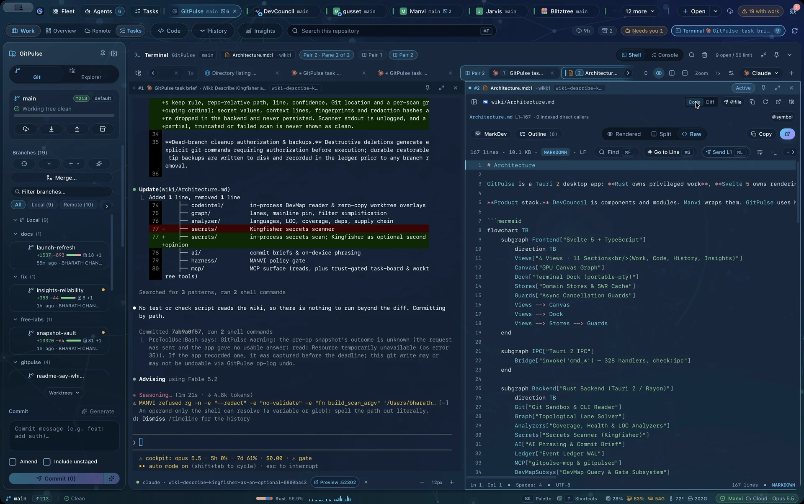
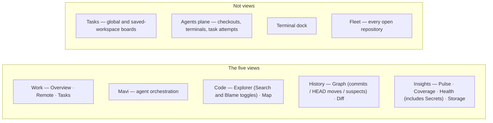

# Waylode Wiki

**Waylode (also called "Whale" out loud) is a workspace, not a chat window: a local-first command centre for agentic coding.** It is built for the agentic era and gives the same information and the same tools to the people and to the agents doing the work. It runs Claude Code, Codex, Antigravity, Grok, and Manvi side by side across your repositories, each in its own worktree with a policy guard and a code map, and keeps a full Git client, a task board and a terminal in the same window. A native Rust backend (Tauri 2) owns every privileged operation; a Svelte 5 frontend renders the graph, diffs, and audits. Nothing is sent to a Waylode server — there isn't one. Waylode is free and dual-licensed under `MIT OR Apache-2.0`. It is tested on macOS; Windows and Linux builds exist but have not been tested.

Key coordination and `HEAD` highlights:
- **DevMap Code Graph (*Whale Sonic*):** In-process DevMap AST graph with zero-copy `StackedStore` worktree sharing (`stack_lease.json` + sealed `base.sqlite` + lazy Tree-sitter `delta.sqlite`), layered blast radius with unattributed-line disclosure, backward regression suspects, confidence-tiered dead symbols (`0.9` vs `0.4`), affected tests, and scoped `CI:local`.
- **A2A Peer Bus (*Whale Song*):** Cross-vendor peer mailbox for Claude Code, Antigravity, Codex and Manvi (`waylode_agent_*`), structured asks (`waylode_inbox_*`), file/symbol claims, and a 3-layer CSR/ODB collision radar that agents check on demand (`waylode_worktree_radar`); a `PreToolUse` hook asks before an edit to a file another worktree has changed, and claims are advisory unless enforce mode is on.
- **Fleet & Agents Tree (*Whale Pod*):** Workspace-wide Fleet grid (`⌘⇧F`, up to 1,000 open tabs / 24 watched) and collapsible Agents plane (`⌘⇧A`) detecting live Claude Code, Codex, Antigravity, DevCouncil, and Manvi sessions (including sessions Waylode did not launch), alongside Mavi structured threads.
- **Pure-ODB Land Queue & Checkpoints:** AIMD batched Land Queue (`git merge-tree --stdin`; branches verified before submit, the combined batch is not re-tested; upcoming 0.2.0, not yet on `main`), pure-ODB Conflict Proposals (created by the `waylode-worktree` CLI; the app opens them), `git replay` ODB stack restacking, and Turn Checkpoints with CAS pre-op undo snapshots and WAL provenance.

**Product stack.** [DevCouncil](https://github.com/bharathvbcr/DevCouncil) is components and modules. [Manvi](https://github.com/bharathvbcr/Manvi) wraps them. Waylode uses Manvi for policy, workbench, and agent hosting, and DevCouncil modules for code intelligence. Update them independently; this app does not require the whole suite.

Waylode is also the successor to the deprecated [LiquiTask](https://github.com/bharathvbcr/LiquiTask) agentic task workbench. New boards and agent handoff belong here.

[Website](https://gitpulse.vbcr.dev/) · [Releases](https://github.com/bharathvbcr/GitPulse/releases) · [Repository](https://github.com/bharathvbcr/GitPulse)

[Complete documentation index](https://github.com/bharathvbcr/GitPulse/blob/main/docs/README.md)

## What sets Waylode apart

Across the agentic workspaces, editors, terminals, Git clients, code-index tools and coordination tools we checked against official documentation and public repositories on `2026-11-27` and `2026-11-28`, none combined all six of these capabilities in one local-first native app (sources in [Why Waylode](https://github.com/bharathvbcr/GitPulse/blob/main/docs/WHY_WAYLODE.md)). "Not found" below means not found in the pages we read, not that no product has it:

| Differentiator | Outcome & Shipped Mechanism | Typical ADE Gap (`2026-11-28`; "not found" = not in the pages we read) |
| --- | --- | --- |
| **1. Code Index Integration (*Whale Sonic* · DevMap)** *(on `main` / upcoming 0.2.0)* | **Every agent knows what an edit breaks before writing.** Sealed `base.sqlite` + lazy Tree-sitter `delta.sqlite` overlays across the worktrees Waylode creates for agents (`StackedStore`), layered blast radius + `unattributed` honesty, regression suspects, `0.9`/`0.4` dead symbols, and affected tests + scoped `CI:local`. | No major ADE we checked documents blast radius + affected tests for its agents (open-source MCP servers such as codebase-memory-mcp and CodeGraph do). One shared index with each worktree's uncommitted edits layered on top was **not found**. |
| **2. Cross-Vendor A2A & 3-Layer Collision Radar (*Whale Song* & *Whale Pod*)** | **Stop parallel agents from colliding—across vendors.** Unlaunched session discovery (`claude`, `codex`, `antigravity`, `devcouncil`, `manvi`), peer mailbox for Claude Code, Antigravity, Codex and Manvi (`waylode_agent_*`), structured asks (`waylode_inbox_*`), lane bus, **Send to agent**, 3-layer CSR/ODB radar checked on demand (`waylode_worktree_radar`), advisory claims, and a `PreToolUse` hook that asks before an edit to a file another worktree has changed. | MCP Agent Mail has cross-vendor messaging and path-glob reservations. A collision warning that checks the call graph, not just file paths, was **not found**. |
| **3. Pure-ODB Merge Train & `git replay` Stack Restacking** *(upcoming 0.2.0; not yet on `main`)* | **Land 10 agent branches without thrashing your working tree.** AIMD batched Land Queue (`merge-tree --stdin`; branches verified before submit, the combined batch is not re-tested), pure-ODB Conflict Proposals (`refs/gitpulse/proposals/`, created by the `waylode-worktree` CLI), and `git replay` stack restacking with disjoint-dirty fast path. | Hosted merge queues (GitHub, Graphite, Mergify) batch PRs after push. Local, pre-push batch landing of agent worktrees was **not found** in the agent workspaces we checked. |
| **4. Load & Agent Scheduler** | **Run many agents without melting your Mac.** Refuses an agent launch under memory pressure (or any input you set to refuse), with a human-only **Admit anyway**; heavy cargo/go builds queue for slots; build slot leases & queue, one-click idle session parking, macOS QoS isolation + shared git spawn gate, live host-load strip, plus APFS `clonefile` CoW caches (`worktrunk` ships CLI CoW without an ADE or load governor). | Claude Code stops idle sessions once memory stays low (after the fact). Admission control before an agent or build starts was **not found**. |
| **5. Verification-Gated, Agent-Writable Task Board** | **Follow-up bugs become verified cards, not lost scroll-back.** Five-column cross-repo Kanban (up to 2,000 cards per fill), launch-from-card tracking, `waylode_add_task` dup-gated + `expected_revision`, and `Done` gated on passed `HEAD` verification. | Agents can file tasks elsewhere (Vibe Kanban's MCP server, Beads). A built-in `done` gate on passed `HEAD` verification was **not found**. |
| **6. Manvi Guards, Provenance & Full Native Git GUI** *(Mavi threads on `main` / upcoming 0.2.0)* | **Policy gates, undo snapshots, and a full Git GUI in one native window.** 8-status command gate, `HostScope` fences, desktop-only `.git` inode-bound trust, `dc-redact`, CAS pre-op undo, Turn Checkpoints, WAL provenance, persistent `waylode-ptyd` + Browser pane, Mavi threads, and `~41 ms` lane solve on 100k synthetic commits. | Electron ADEs lack a full Git GUI, CAS undo, WAL provenance, and 8-status command gate; native Git GUIs lack agent A2A, code graphs, and load schedulers. |

## Start here

| I want to… | Go to |
| --- | --- |
| Install a pre-built app | [[Installation]] |
| Open a repository and find my way around | [[Getting Started]] |
| Understand the five views | [[Views]] |
| Organize tasks and saved workspaces | [Tasks and workspaces](https://github.com/bharathvbcr/GitPulse/blob/main/docs/TASKS_AND_WORKSPACES.md) |
| Look up a shortcut | [[Keyboard Shortcuts]] |
| Run agents: launch, guards, messaging, collisions | [Agents guide](https://github.com/bharathvbcr/GitPulse/blob/main/docs/AGENTS_GUIDE.md) |
| Connect an agent (MCP) and look up tools | [[MCP and Agents]] |
| See how Waylode compares with other tools | [Why Waylode](https://github.com/bharathvbcr/GitPulse/blob/main/docs/WHY_WAYLODE.md) |
| Contribute or build from source | [[Development]] |
| Understand the security model | [[Security]] |

## How the app is organized

Five **views**, each a header tab. Sections inside a view are lenses on the same subject — switching Graph → Diff keeps the commit you selected.

**Fleet** (`Command/Ctrl+Shift+F`), the **Agents plane** (`Command/Ctrl+Shift+A`), **Tasks** and the **terminal dock** (`Ctrl+\``) are not views. Fleet is workspace-scoped; the terminal survives view switches because it is a dock, not a page.

## Design rules you will see on screen

Waylode refuses to present a missing measurement as a clean result:

- A worktree that was not scanned does not show `0` dirty files.
- A coverage or audit cell is a **value**, **not scanned**, or **could not read** — never a reassuring zero.
- A policy check that could not run is **unchecked**, never **allowed**.
- Totals name what they could not count.

## In-repo documentation

This wiki is the GitHub-facing guide. Longer technical write-ups live in the repository:

- [README](https://github.com/bharathvbcr/GitPulse/blob/main/README.md)
- [Architecture](https://github.com/bharathvbcr/GitPulse/blob/main/docs/ARCHITECTURE.md)
- [Tasks and workspaces](https://github.com/bharathvbcr/GitPulse/blob/main/docs/TASKS_AND_WORKSPACES.md)
- [Features by area](https://github.com/bharathvbcr/GitPulse/blob/main/docs/FEATURES.md) and the [view reference](https://github.com/bharathvbcr/GitPulse/blob/main/docs/VIEW_REFERENCE.md)
- [Why Waylode](https://github.com/bharathvbcr/GitPulse/blob/main/docs/WHY_WAYLODE.md)
- [Agents guide](https://github.com/bharathvbcr/GitPulse/blob/main/docs/AGENTS_GUIDE.md)
- [Contributing](https://github.com/bharathvbcr/GitPulse/blob/main/CONTRIBUTING.md)
- [Security](https://github.com/bharathvbcr/GitPulse/blob/main/docs/SECURITY.md)
- [Changelog](https://github.com/bharathvbcr/GitPulse/blob/main/CHANGELOG.md)
