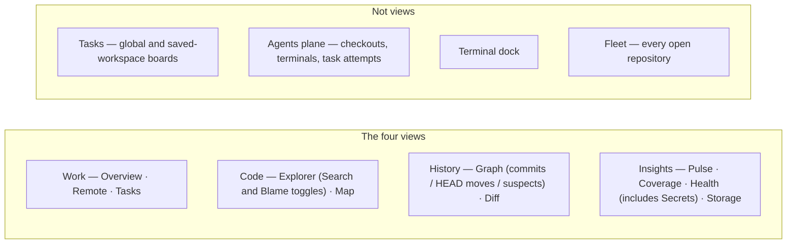

# GitPulse Wiki

**GitPulse is a workspace, not a chat window: a local-first command centre for agentic coding.** It is built for the agentic era and gives the same information and the same tools to the people and to the agents doing the work. It runs Claude Code, Codex and other agents side by side across your repositories, each in its own worktree with a policy guard and a code map, and keeps a full Git client, a task board and a terminal in the same window. A native Rust backend (Tauri 2) owns every privileged operation; a Svelte 5 frontend renders the graph, diffs, and audits. Nothing is sent to a GitPulse server — there isn't one. GitPulse is free and MIT-licensed. It is tested on macOS; Windows and Linux builds exist but have not been tested.

**Product stack.** [DevCouncil](https://github.com/bharathvbcr/DevCouncil) is components and modules. [Manvi](https://github.com/bharathvbcr/Manvi) wraps them. GitPulse uses Manvi for policy, workbench, and agent hosting, and DevCouncil modules for code intelligence. Update them independently; this app does not require the whole suite.

GitPulse is also the successor to the deprecated [LiquiTask](https://github.com/bharathvbcr/LiquiTask) agentic task workbench. New boards and agent handoff belong here.

[Website](https://gitpulse.vbcr.dev/) · [Releases](https://github.com/bharathvbcr/GitPulse/releases) · [Repository](https://github.com/bharathvbcr/GitPulse)

[Complete documentation index](https://github.com/bharathvbcr/GitPulse/blob/main/docs/README.md)

## Start here

| I want to… | Go to |
| --- | --- |
| Install a pre-built app | [[Installation]] |
| Open a repository and find my way around | [[Getting Started]] |
| Understand the four views | [[Views]] |
| Organize tasks and saved workspaces | [Tasks and workspaces](https://github.com/bharathvbcr/GitPulse/blob/main/docs/TASKS_AND_WORKSPACES.md) |
| Look up a shortcut | [[Keyboard Shortcuts]] |
| Run agents: launch, guards, messaging, collisions | [Agents guide](https://github.com/bharathvbcr/GitPulse/blob/main/docs/AGENTS_GUIDE.md) |
| Connect an agent (MCP) and look up tools | [[MCP and Agents]] |
| See how GitPulse compares with other tools | [Why GitPulse](https://github.com/bharathvbcr/GitPulse/blob/main/docs/WHY_GITPULSE.md) |
| Contribute or build from source | [[Development]] |
| Understand the security model | [[Security]] |

## How the app is organized

Four **views**, each a header tab. Sections inside a view are lenses on the same subject — switching Graph → Diff keeps the commit you selected.

**Fleet** (`Command/Ctrl+Shift+F`), the **Agents plane** (`Command/Ctrl+Shift+A`), **Tasks** and the **terminal dock** (`Ctrl+\``) are not views. Fleet is workspace-scoped; the terminal survives view switches because it is a dock, not a page.

## Design rules you will see on screen

GitPulse refuses to present a missing measurement as a clean result:

- A worktree that was not scanned does not show `0` dirty files.
- A coverage or audit cell is a **value**, **not scanned**, or **could not read** — never a reassuring zero.
- A policy check that could not run is **unchecked**, never **allowed**.
- Totals name what they could not count.

## In-repo documentation

This wiki is the GitHub-facing guide. Longer technical write-ups live in the repository:

- [README](https://github.com/bharathvbcr/GitPulse/blob/main/README.md)
- [Architecture](https://github.com/bharathvbcr/GitPulse/blob/main/docs/ARCHITECTURE.md)
- [Tasks and workspaces](https://github.com/bharathvbcr/GitPulse/blob/main/docs/TASKS_AND_WORKSPACES.md)
- [Features by area](https://github.com/bharathvbcr/GitPulse/blob/main/docs/FEATURES.md) and the [view reference](https://github.com/bharathvbcr/GitPulse/blob/main/docs/VIEW_REFERENCE.md)
- [Why GitPulse](https://github.com/bharathvbcr/GitPulse/blob/main/docs/WHY_GITPULSE.md)
- [Agents guide](https://github.com/bharathvbcr/GitPulse/blob/main/docs/AGENTS_GUIDE.md)
- [Contributing](https://github.com/bharathvbcr/GitPulse/blob/main/CONTRIBUTING.md)
- [Security](https://github.com/bharathvbcr/GitPulse/blob/main/docs/SECURITY.md)
- [Changelog](https://github.com/bharathvbcr/GitPulse/blob/main/CHANGELOG.md)
