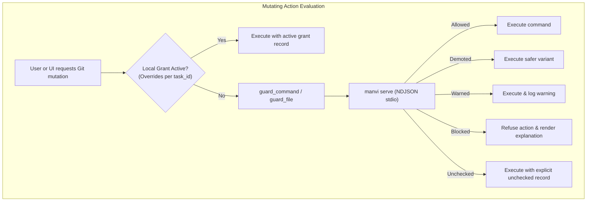
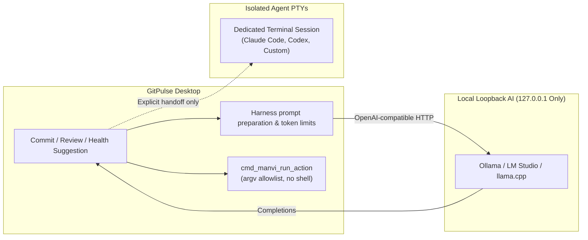

# Policy and AI

Mutating Git (commit, push, rebase, branch delete, worktree prune, …) is evaluated by the **Manvi** wrap of DevCouncil policy when it is running. Waylode talks to `manvi serve` over stdio (NDJSON). Code intelligence uses DevCouncil's `devmap` module directly and is not the same sidecar.

## Verdict ladder

The harness decides one of three actions (`allow`, `warn`, `deny`). Waylode then renders every decision as one of **eight statuses**, evaluated in a fixed order (`contracts/verdict.schema.json`, `$defs/classification`). An `allow` alone does not mean the rules passed.

| Status | Meaning |
| --- | --- |
| **Blocked** | The action was `deny`. Rejected; the UI explains why. (`denied` in the contract) |
| **Granted** | An override cleared a soft block. Never shown as a clean allow |
| **Demoted** | A gate mode or host posture downgraded a denial to an allow |
| **Widened** | The write was allowed by scope an executor appended to its own task |
| **Degraded** | A check could not run, so the decision is not the one a full check would reach |
| **Warned** | Proceeds; advisory recorded |
| **Allowed** | The rules passed with nothing overriding them. (`clean` in the contract) |
| **Unchecked** | No decision exists (harness missing or that rung could not run). Recorded as unchecked, **never reported as allowed** |

Each rule also has a severity: `hard` rules can never be cleared by a grant; `soft` rules can be demoted by posture or cleared by a grant.

Asymmetric degradation: a wedged sidecar fails closed in the sense that the UI does not pretend the gate passed. Settings → Agents → Manvi policy shows posture; Work → Overview → Policy activity shows recent verdicts and grants.

## Local AI

Completions (commit messages, commit explanations, branch names, health/coverage suggestions) go through Manvi's `work.assist.complete`, which runs on whatever Manvi is set to (`manvi use`): a local OpenAI-compatible server (Ollama, LM Studio, llama.cpp, vLLM; loopback only) or the Claude API in cloud mode. A failed call is an error, never a quiet fall back. Only when Manvi is not installed, lacks the op, or has no mode chosen (its unset default is cloud, which Waylode does not follow until you choose it in the Manvi pane) does Waylode's own **loopback** client answer, asking before it sends to a server it found, with a warning naming why. Remote URLs are rejected on that path.

Commit messages are classified in the app directly from the staged patch into a structured brief (type, scope, subject). When no loopback model is active, supported Macs can use on-device Apple Intelligence to phrase the subject from the classified brief (without sending the raw patch). If Apple Intelligence is unavailable or the subject fails validation, Waylode falls back to the deterministic patch-based draft. See [[Security]].

Suggested remediation scripts run only through `cmd_manvi_run_action`: a purpose-limited argv allowlist (npm, cargo, pytest, go, swift, dart, …), no shell string, explicit confirmation, hard timeout and capped output.

Ordinary shell sessions are outside this remediation path. Local AI suggestions
and the policy sidecar do not read/write them. Explicit agent launchers and saved
task handoffs start dedicated CLI sessions in the terminal dock, under those
providers' permissions. Managed runs (Codex and Claude Code) use a separate Manvi protocol.

Task title/description suggestions use the profile Manvi provider/model, are bound
to saved revisions, respect field locks and require selected acceptance. When
`~/.anthropic-accounts` is present (Manvi's `anthropic-account` registry), Waylode
launches `manvi serve` via `anthropic-account exec --no-fallback --repo $HOME -- manvi`,
never reading or storing an Anthropic API key itself, and shows `Cloud · <model>`
on the status-bar pill. See
[Tasks and workspaces](https://github.com/bharathvbcr/GitPulse/blob/main/docs/TASKS_AND_WORKSPACES.md).

## Grants

Temporary overrides are first-class and recorded. The Work view joins verdicts and grants by the `task_id` written when the gate judged — not by guessing from a branch name.

Longer write-up: [policy and AI features](https://github.com/bharathvbcr/GitPulse/blob/main/docs/FEATURES.md).
