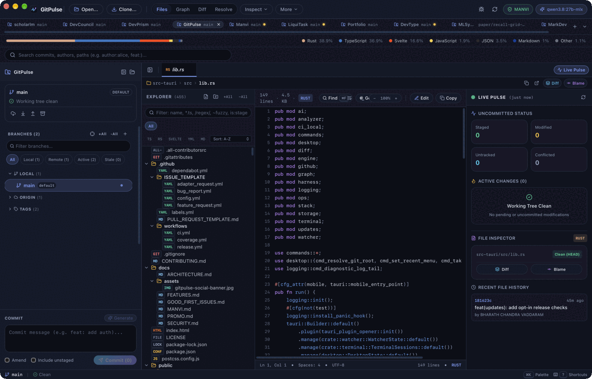
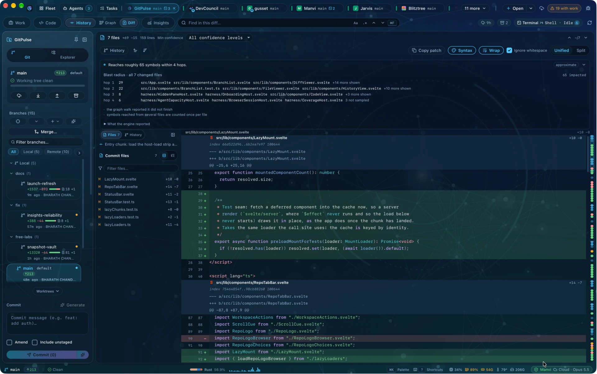
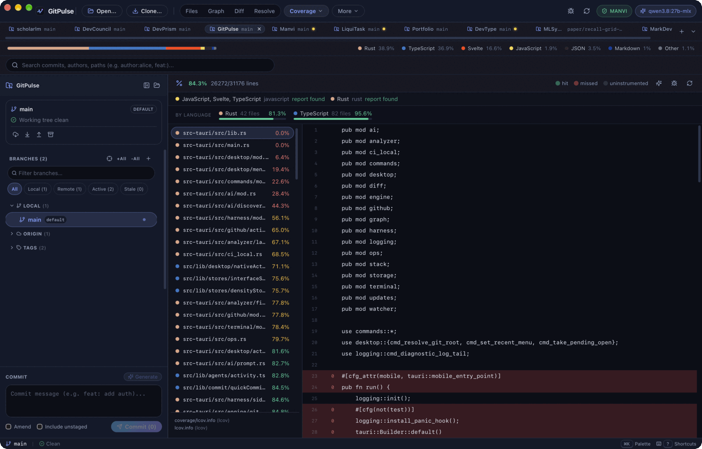

# Views

Waylode has **five views**: Work, Mavi, Code, History and Insights. Each holds sections (lenses) on one subject. Tasks, Fleet, the Agents plane and the terminal dock are workspace surfaces outside those four views.

**Product stack.** DevCouncil is components and modules. Manvi wraps them. Work → Overview's cleanup and policy activity, Remote's issue import and release publishing, and Tasks go through Manvi; Code → Map uses DevCouncil's `devmap` module.

The area-by-area list is [docs/FEATURES.md](https://github.com/bharathvbcr/GitPulse/blob/main/docs/FEATURES.md) and the per-view detail is [docs/VIEW_REFERENCE.md](https://github.com/bharathvbcr/GitPulse/blob/main/docs/VIEW_REFERENCE.md). This page is the map.

## Work (`F10`)

Everything in flight, keyed on the **worktree** (or a DevCouncil task when a store exists).

| Section | Purpose |
| --- | --- |
| **Overview** | One row per place work is happening: linked worktrees, PRs, runs, policy verdicts. Blocked operations sort first. Agent worktrees are detected from `/.<agent>/worktrees/` layout, never from a branch name. While a merge, rebase, cherry-pick or revert is parked, the 3-way conflict editor (ours / theirs / base, marker jump, accept current / incoming / both) leads Overview. Branch stack hierarchy, branch and tag cleanup (dead-branch cleanup with tip backups in the ledger, squash merge detection, and authorized delete commands) and policy activity (grants and recorded verdicts) are collapsible cards, with zero-round-trip churn carry-forward across matching commit tips. Supports DevMap-guided `--cone` sparse checkouts, `<512 B` zero-copy DevMap base pointers (`base_store_ref.json`), worktree copy-on-write cache sync (APFS clonefile / Linux FICLONE) paired with the `gitpulse-rustc` shared build cache, 3-layer parallel agent collision radar, named localhost routes via portless, and `.gitpulse/hooks.toml` lifecycle hooks. |
| **Remote** | Outgoing commits checked before you push; PRs and issues (report an issue, add issues to tasks) in the wide column; workflows, runs, and releases (push a release tag after preflight) in a CI rail. **CI:local** runs this repo's test matrix on your machine — affected tests when the map can prove coverage, otherwise the full suite (named as such; never badged as affected when fail-closed). |
| **Tasks** | Repository-scoped board/list over the shared profile task store: editing, selection, column "Load all" (pages up to 2,000 cards with persistent reload depth), named hidden repository notices, batched verification sweeps (`latest_many`), Manvi suggestions and agent handoff. |

Uncommitted counts that could not be scanned show nothing rather than `0`. A verdict this build cannot parse is `unreadable`, never `allowed`.

## Code (`⌥⌘1` / `Ctrl+Shift+1`)

**Explorer** (with inline **Blame** and **Search** toggles) and **Map** share the Code view. Explorer, Blame and Search work over files and text; **Map** is the structural navigator — DevMap repo map, code/doc graph, and tracked-markdown search. Sections: `⌥1` / `⌥2`.

| Section | Purpose |
| --- | --- |
| **Explorer** | File tree with live Git status, dual-backend highlighting (MarkDev tree-sitter for six languages; regex for the rest), virtualized code viewer with proportional row-height zoom scaling (70%–160%), responsive header scroll cues (`ScrollCue`), boundary-aware tooltips, in-file search, go-to-line, inline edit, MarkDev bidirectional scrolling preview / image / hex previews, toggled **Blame** gutter (line authorship, code-age timeline/rail, and coverage gutter), and toggled repository-wide **Search** (`git grep` with honest cancellation/cap status). Status bar language mix toggle (LOC vs percentage). Commit composer shows pre-commit blast radius from `devmap preview`, drafts structured commit briefs from the patch, and supports on-device Apple Intelligence phrasing fallback. |
| **Map** | Subsystems / entry points from the `repo_map` resolved by `devmap paths --json` (default `.devmap/repo_map.json`, legacy `.devcouncil` supported), code and doc graph canvas, docs search and broken links, cross-repo link candidates, and zero-copy worktree graph sharing (`base_store_ref.json` -> anchor `devmap.sqlite` + `overlay.json` Blake3/CAS delta overlays). Build/Refresh via the `devmap` CLI; watcher refreshes a stale index. Caps, `walk_incomplete`, and schema mismatch are named. |

The graph filters include **Hide notes & Markdown**, off by default. It hides
documentation nodes and their edges from the canvas, node browser, and
connections. In the subsystem view, only areas made entirely of documentation
are hidden; mixed areas stay visible. **Clear filters** restores the loaded
nodes. Filters survive a refresh and reset when switching repositories or map
views. Coverage and truncation counts still describe the original payload.

## History (`⌥⌘2` / `Ctrl+Shift+2`)

Lenses on one **commit** and regression history.

| Section | Purpose |
| --- | --- |
| **Graph** | GPU canvas graph with a topological lane solver. Default branch pinned left. Filters (`author:`, `sha:`, `type:`, `path:`, text) run in Rust before lanes are solved, so the graph stays connected. Its *Commits \| HEAD moves* toggle swaps in the reflog: every HEAD movement, selected in place under the list (even commits a reset orphaned), with branch-here and `reset --keep` recovery from the details pane below (the same actions the graph's row menu offers). A third option, *Suspects*, ranks which commit since a known-good ref could have caused a symptom — by what the code graph reaches, not by recency — with the question in the context bar, the verdict in the details pane, and a chip on ranked commits in the other two lists; Blame, a diff hunk's symbol and a code-graph node can each start the question. |
| **Diff** | Unified or true side-by-side from one row model. Syntax under word-diff, find-in-diff, hunk/line staging, diff symbol groups, symbol-level collision notes, image diffs. Layered blast radius by hop over the change set; rung filter on flat impact; preview markers on the file rail. The header names what the patch actually contains. |

## Insights (`⌥⌘3` / `Ctrl+Shift+3`)

Four on-demand scans of **this repository**. Each must say when it was capped rather than presenting a floor as a total.

| Section | Purpose |
| --- | --- |
| **Pulse** | Heatmap, rhythm, punch card, LOC trend, commit hygiene, hotspots, bus factor, local DORA, exportable SVG card. Unscanned tiles are an em dash with a reason. |
| **Coverage** | LCOV, Cobertura, Go cover, Istanbul/NYC JSON, SimpleCov, JaCoCo, Clover (7 formats parsed; a coverage.py `.coverage` database is detected but must be exported). Toolchain hints and failure recovery. |
| **Health** | `npm` / `cargo-audit` / `pip-audit` / `govulncheck` / `composer` / `bundler-audit` plus `cargo deny` SARIF and `cargo crev` JSONL supply-chain checks, pinned advisory table columns, Dependabot and code scanning via `gh` when a repository opens, and the **Secrets scan** (in-process; Kingfisher is an optional second opinion on an explicit Rescan; showing Git location and shared-value rows while dropping secret values and context, never reporting partial/incomplete scans as clean). Critical and high findings warn. |
| **Storage** | Packfiles, loose objects, LFS, submodules, build caches, size history. |

## Not views

### Terminal dock (`Ctrl+\``)

Resizable PTY under whichever view is on screen. When expanded, inerts and hides the underlying view to eliminate focus leaks. Employs a WebGL context hold to eliminate tab-switching lag with a bounded context recovery budget, enforces DEC 2026 synchronized frame output boundaries to prevent display freezes, sizes Unicode 11 emojis accurately across two cells, and defers fitting until visible. Terminal bell prompts can be configured in Settings → Agents to toggle reader attention alerts. Local AI suggestions and the policy sidecar do not read/write ordinary shells. Explicit Claude, Manvi, Codex and task launches create their own sessions. Hiding the dock keeps sessions; closing the repository ends them. See [Terminal](https://github.com/bharathvbcr/GitPulse/blob/main/docs/TERMINAL.md).

### Tasks

The Tasks button beside Fleet opens global and saved-workspace scopes over the same records as Work → Tasks. Saved workspace membership survives closing repository tabs. Board/list layouts, filters over loaded cards, context actions, Quick Enhance and agent copying are described in [Tasks and workspaces](https://github.com/bharathvbcr/GitPulse/blob/main/docs/TASKS_AND_WORKSPACES.md).

### Agents plane (`Command/Ctrl+Shift+A`)

The agent checkouts, terminals and task attempts your open repositories are holding, drawn as one tree: a terminal that continues an attempt, and a child session, nest under their parent. It also holds the agent inbox. Live sessions that Waylode did not launch are detected from the process table and reported by `gitpulse_sessions` and `gitpulse_insights`, and Work → Overview shows them against their worktree. See the [agents guide](https://github.com/bharathvbcr/GitPulse/blob/main/docs/AGENTS_GUIDE.md).

### Fleet (`Command/Ctrl+Shift+F`)

Workspace grid: every open repository and every recent one.

- **Tier 0** (free): changes, sync, conflicts, stash, parked operations.
- **Tier 1** (cheap git): worktrees, agent sessions, commit rhythm, last activity.
- **Tier 2** (opt-in): LOC, language mix, disk, audits, coverage — never run on their own.

Every cell is a value, *not scanned*, or *could not read*. Totals name what they could not count. `/` filters, `s` cycles sort, `p` toggles Pulse, `r` refreshes, `1`–`9` jump to a row.

See [[Architecture]] for why Fleet is hidden rather than unmounted (live PTYs).
